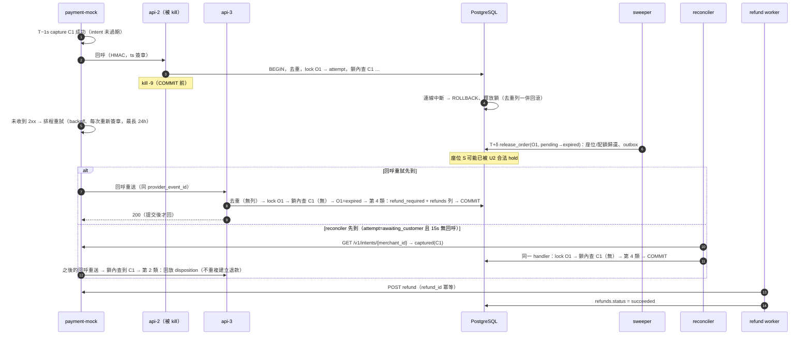
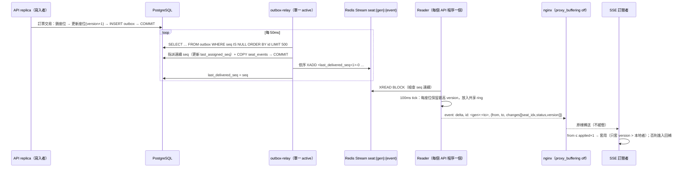

# DESIGN.md — 設計問答（requirement 第八節）、假設、替代方案、取捨與驗證

> 狀態：**實作前草稿（Pre-coding draft）**，依據 `PLAN.md` v1.2 撰寫。
> 所有「需要真實程式碼或量測」的內容一律以 placeholder 標示，**不包含任何臆造的數字或測試輸出**：
>
> | Placeholder | 意義 | 何時填入 |
> |---|---|---|
> | `TBD(T9.5): <預定模組路徑>` | 程式碼 `檔案:行號`，路徑為預定位置（依 PLAN §15.1 repo 結構） | P9 T9.5 對準最終程式碼 |
> | `TBD(T2.7)` | 破壞驗證（mutation）測試失敗輸出 | P2 T2.7 |
> | `TBD(T1.8)` / `TBD(T9.1)` / `TBD(T9.2)` / `TBD(T3.4)` … | 實測數據（benchmark / 壓測 / 收斂時間） | 對應 task 完成時 |
>
> 文中的時間（「約 30 秒」「約 14 秒」「≤ 2 秒」）一律是**設計預算或目標**，不是量測結果；量測結果只會出現在對應的 `TBD(...)` 被填入之後。
> 測試名稱若標示「（預定）」表示尚未存在，最終名稱以程式碼為準並於 T9.5 更新。
> 每題結構：**答案 → 機制 → 時間線/流程 → 驗證方式 → 證據**。

---

## 目錄

- [0. 設計假設](#0-設計假設)
- [Q1 座位不超賣](#q1座位不超賣)
- [Q2 部分失敗後的狀態收斂](#q2部分失敗後的狀態收斂)
- [Q3 重試、冪等與限購](#q3重試冪等與限購)
- [Q4 即時推送](#q4即時推送)
- [Q5 權限與憑證失效](#q5權限與憑證失效)
- [Q6 監控數據](#q6監控數據)
- [替代方案與取捨](#替代方案與取捨)
- [驗證總表（主張 → 驗證方式 → 證據）](#驗證總表主張--驗證方式--證據)
- [附：實作時需釐清的細節](#附實作時需釐清的細節)

---

## 0. 設計假設

| # | 假設 | 影響 / 若不成立 |
|---|---|---|
| A1 | **單一 PostgreSQL 16 primary** 為座位、訂單、配額、session、job 的唯一真實來源；`synchronous_commit=on`；不做讀寫分離、不從非同步 replica 讀取任何正確性相關資料。 | 若改為非同步 replica failover，已確認的 hold/付款可能遺失 → 本文件所有「不超賣」保證需重新論證。 |
| A2 | **Hold TTL = 600 秒**（`HOLD_TTL_SECONDS=600`，可調）；付款必須在 `expires_at` 前由**我方 DB 記錄**（`decision_at < expires_at`）。 | `decision_at` 是我方處理回呼/輪詢結果並取得訂單鎖後的 DB 時間，不是金流端 capture 時間；期限前付款但回呼延遲到期限後才處理者會被自動退款（Q2.2 取捨）。 |
| A3 | **逾時判斷只用 DB 時鐘**：`app_now()` = `clock_timestamp()`（`VOLATILE`），在取得訂單 row lock 之後取樣。假設 PG 主機時鐘由 NTP 維持（slew），不處理 DB 時鐘大幅倒退。 | 應用主機時鐘偏移不影響 DB 端的逾時決策；DB 時鐘被 step 調整時 hold 可能提早/延後釋放，但雙賣由鎖與 guard 決定，與時鐘無關。 |
| A4 | **座位正規化規則**：`norm_key = upper(zone_code) ‖ '|' ‖ upper(row_label) ‖ '|' ‖ ltrim(seat_number,'0')`（`001` 與 `1` 視為同一座位；區域與排號不分大小寫）；全為 `0` 的座位號正規化為 `0`。 | 待使用者確認（PLAN §20-3）；改規則只影響匯入重複判定。 |
| A5 | **配額（每人每活動 ≤ 4 張）只計「仍持有座位」的訂單**（`pending_payment` / `paid` / `refund_pending`）；逾時、取消、**退款完成後名額恢復**。 | 若業務要求「曾購買即佔名額」，需改為不回補配額。 |
| A6 | **Viewer 可下載所有活動的銷售報表**（依需求第四節字面）；草稿活動的報表內容為空；購買者識別以 HMAC 假名化。 | 草稿活動的基本資訊是否應對 Viewer 隱藏，見文末待釐清事項。 |
| A7 | 發布後凍結區域、票價、開賣時窗（標題/描述/分類仍可編輯）；因此訂票交易讀活動閘門不需加鎖。 | 若允許發布後改價，訂票交易需鎖活動或以 version 比對。 |
| A8 | 每筆訂單 1–4 張、只屬於單一活動；服務費 `fee = (subtotal*5 + 50) // 100`（half-up，整數元）。 | — |
| A9 | 每個 API 副本 1 個 uvicorn worker（單程序），3 副本；**relay 單一 active**（專用連線上的 `pg_try_advisory_lock`），熱備援不在範圍內。 | relay 停擺期間推送暫停（有告警與客戶端橫幅），不影響訂票正確性。 |
| A10 | 金流為我方實作的 **payment-mock**：intent 以 merchant id（= `payment_attempts.id`）冪等、每個 intent 至多 capture 一次、過期 intent 拒絕 capture、refund 以 `refund_id` 冪等、回呼重試 24h，**每次重試以新的時間戳重新簽章**（才能與 300 秒 HMAC 時間窗共存）。 | 真實金流若不支援冪等 create，需改以查詢先行。 |
| A11 | 單機 docker compose 部署下，所有容器**共用宿主機核心時鐘**；Q6.3 的「副本慢 20 秒」以測試掛鉤（注入 `wall_ts` 偏移 / libfaketime）模擬。 | 分桶不依賴 producer 時鐘，因此結論對多主機部署同樣成立。 |
| A12 | 推送延遲目標：正常情況 commit → 客戶端套用 p99 < 500ms @300 changes/s（**目標**；實測 `TBD(T9.2)`）。 | — |
| A13 | 自動收斂的前提是「依賴最終恢復」：worker/relay 容器有 `restart` 策略、PG 存活、金流最終可連線。依賴持續故障期間，本設計**不保證有限的收斂時間**，只保證不違反不變式並發出告警。 | — |

---

## Q1　座位不超賣

### Q1.1 指定座位購買的完整路徑與保護起訖

**答案**：保護從 **步驟 ⑤a 的 `SELECT … FOR NO KEY UPDATE NOWAIT`（取得座位 row lock）開始**，到 **步驟 ⑨ `COMMIT` 釋放**。保護機制是三層：(a) 座位 row lock、(b) `WHERE status='available'` 的 guarded UPDATE + 筆數檢查、(c) `order_items(seat_id) WHERE released_at IS NULL` partial unique index。保證：**任一時刻每個座位至多一個 active claim（不變式 1），且限購檢查與座位寫入在同一個交易內原子提交。**

**機制（請求路徑，PLAN §5.2）**

| 步驟 | 動作 | 預定位置 |
|---|---|---|
| 0 | nginx 產生 `X-Request-ID`、轉發到某個 API 副本 | `infra/nginx/nginx.conf` |
| 1 | `SecureRouter` 路由：policy `orders:create`；session 驗證（每請求 PG 索引查詢，含 `revoked_at IS NULL` 與 idle/絕對逾時謂詞，見 Q5.1）；CSRF 檢查 | `TBD(T9.5): apps/api/src/ticketing/api/v1/orders.py:L?` |
| 2 | Pydantic（`extra="forbid"`）驗證 `{seat_ids}`：1–4 個、互不重複（重複 → 422）；`Idempotency-Key` 必填 | `TBD(T9.5): apps/api/src/ticketing/api/v1/schemas/orders.py:L?` |
| 3 | service 層開交易：READ COMMITTED、`lock_timeout=500ms`、`statement_timeout=2s`；**交易內無任何網路呼叫**；交易的**第一個鎖**是 `SELECT … FROM sessions WHERE id=:sid AND revoked_at IS NULL FOR SHARE`（與撤銷互斥，Q5.1） | `TBD(T9.5): apps/api/src/ticketing/services/booking.py:L?` |
| ① | `pg_try_advisory_xact_lock(hashtextextended('idem:'‖u‖':'‖key,0))` → false 回 409 `idempotency-in-progress`；查 `idempotency_keys`：已完成 → 重放；hash 不同 → 422 | `TBD(T9.5): apps/api/src/ticketing/repositories/idempotency.py:L?` |
| ② | 活動閘門：`status='published'`（無鎖，發布後凍結，A7）；不符 → ROLLBACK、404/409 `event-not-on-sale` | `TBD(T9.5): apps/api/src/ticketing/repositories/booking_sql.py:L?` |
| ③ | 限購：`INSERT INTO user_event_quota(user_id,event_id) VALUES(:u,:e) ON CONFLICT DO NOTHING`（首次購買者建立配額列）→ `UPDATE user_event_quota SET reserved=reserved+:n WHERE … AND reserved <= 4-:n RETURNING` → 0 列 409 `purchase-limit-exceeded` | 同上 `:L?` |
| ④ | 先 `INSERT orders`（FK 對 events 取 KEY SHARE，排在座位鎖之前 → 消除與刪除活動的死結） | 同上 `:L?` |
| **⑤a ◀ 保護開始** | `SELECT id,status FROM seats WHERE event_id=:e AND id=ANY(:ids) ORDER BY id FOR NO KEY UPDATE NOWAIT`；此步驟拿不到鎖（55P03）→ 409 `seat-contended`（retryable）；筆數 ≠ n（座位不屬於該活動）→ 422。（區域+張數模式改走 PLAN §5.2 ⑤b 的 `SKIP LOCKED`，見 Q3.3） | `TBD(T9.5): apps/api/src/ticketing/repositories/booking_sql.py:L?` |
| ⑥ | `UPDATE seats SET status='held', order_id=:o, version=version+1 WHERE id=ANY(:locked) AND status='available' RETURNING …`；**RETURNING 筆數必須 = n**，否則 ROLLBACK → 409 `seat-unavailable` | 同上 `:L?` |
| ⑦ | `INSERT order_items`（partial unique index 為最後防線）；以 `app_now()` 檢查開賣時窗（不在時窗內 → ROLLBACK、409 `event-not-on-sale`）並計算 `expires_at = app_now()+TTL`；金額與服務費 | 同上 `:L?` |
| ⑧ | `INSERT outbox`（一筆交易一列，changes=[seat_idx,status,version]）+ `INSERT idempotency_keys(completed, 201, body)` | 同上 `:L?` |
| **⑨ ◀ 保護釋放** | `COMMIT` | `TBD(T9.5): apps/api/src/ticketing/services/booking.py:L?` |
| 10 | 回 201 + `Location` + body；之後 relay 推送（Q4） | — |

任何步驟失敗都 ROLLBACK 整個交易（配額、訂單表頭、座位一起回滾）。其他阻塞型鎖（配額列、FK、unique 衝突）等待超過 `lock_timeout` → 503 `server-busy`（retryable，PLAN §5.2 鎖圖）；只有 ⑤a 的 55P03 對應 `seat-contended`。

**各層保證的是什麼**

- **(a) row lock（⑤a→⑨）**：同一座位同一時間只有一個交易能進入 ⑥；`NOWAIT` 讓熱門座位的 **row lock** 不排隊（輸家立即 409，不占連線池）；`ORDER BY id` 讓多座位請求的鎖序一致。`NOWAIT`/`SKIP LOCKED` 只作用於 row lock，其他等待仍受 `lock_timeout` 約束。
- **(b) guarded UPDATE（⑥）**：即使 (a) 被移除，READ COMMITTED 下 UPDATE 遇到並行更新的列會等待對方提交，再對**最新版本**重新評估 `WHERE status='available'`（EvalPlanQual），所以「先讀後寫」的競爭者得到 0 列 → 筆數檢查失敗 → ROLLBACK。
- **(c) partial unique index（⑦ INSERT 時檢查）**：即使 (a)(b) 都被改壞，同一 `seat_id` 第二個 `released_at IS NULL` 的 item 會觸發 unique violation → 409。這一層**不隨 COMMIT 釋放**，持續到 `release_order()` 設定 `released_at`。
- `seats` 的 `CHECK ((status='available') = (order_id IS NULL))` 只保證「狀態與 order_id 是否為空」一致；跨表的歸屬一致（`seats.order_id` ↔ active item ↔ 訂單狀態）由交易內檢查與不變式 SQL 保證，不是 CHECK。
- 嚴格說，⑤a→⑨ 是「交易內互斥」區間；COMMIT 後座位歸屬由已提交的 `seats.status/order_id` 與 (c) 持續保護，直到 `release_order()`。

**驗證方式**：併發測試（Q1.3）；不變式 SQL（PLAN §4 不變式 1–3）在每個整合/併發測試結束時執行；barrier 測試驗證鎖圖無死結（刪除 vs 下單、release vs 下單）。

**證據**：`檔案:行號` → `TBD(T9.5)`；不變式 SQL → `TBD(T9.5): loadtest/consistency.sql`。

---

### Q1.2 最可能讓同一座位被賣兩次的故障順序

**答案**：最可能的危險順序是 **「付款回呼在期限前到達並開始交易，但在取得訂單鎖之前停頓（event loop 停頓 / CPU throttle / 容器暫停），跨過了 hold 期限；這段期間 sweeper 釋放座位、座位被第二位買家 hold 並付款；之後回呼才取得鎖」**。若回呼的期限判斷用「到達時間」或交易開始時間 `now()`，它會把已釋放的座位「標回 sold」→ 兩筆 paid 訂單宣稱同一座位。

我們的實作**擋得住**。**決定性的防護**是：**取得訂單 row lock 之後才查 capture、才以 DB 時鐘取樣 `decision_at`，並依訂單狀態走 PLAN §5.1 的四分類**——此時 O1 已是 `expired`，走「只退款、不碰座位與配額」分支。若這個狀態檢查被寫錯而走成功分支，**座位 UPDATE 的 `WHERE order_id=:o AND status='held'` + 筆數必須 = quantity** 會讓交易回滾（S 的 `order_id` 已是 O2）。partial unique index 只在錯誤程式「重新建立或重新啟用 O1 的 item」時才會觸發。

**時間線**（訂單 O1 屬使用者 U1，座位 S，`expires_at = T`）

| 時刻（DB 時鐘） | 元件 | 事件 | 資料庫狀態 |
|---|---|---|---|
| T−600s | api-1 | U1 hold S（Q1.1 路徑），提交 | S=`held(O1)`；O1=`pending_payment`；item(O1,S) active |
| T−2.0s | payment-mock | U1 在模擬付款頁完成付款；intent 未過期 → capture C1 成功 | （外部）已扣款 |
| T−1.9s | payment-mock → api-2 | 回呼到達；HMAC 驗證通過；`BEGIN`（此交易的 `now()` 凍結為 T−1.9s）；① `payment_callbacks` 依 `provider_event_id` 去重插入 | 未提交 |
| T−1.9s → T+3s | api-2 | **停頓**：在送出 `SELECT … FROM orders WHERE id=O1 FOR UPDATE` 之前，event loop 被長任務卡住 / 容器被 CPU throttle 或 pause | — |
| T+0.1s | worker（sweeper） | 無鎖候選查詢選到 O1 → 單筆交易 `release_order(O1, 'pending_payment', 'expired')`：UPDATE 取得 O1 列鎖、重檢 `status='pending_payment' AND expires_at <= app_now()` → 1 列 → 依 id 鎖座位、釋放 S、item 設 `released_at`、配額 −1、outbox；COMMIT | O1=`expired`；S=`available`；item(O1,S) released |
| T+0.3s | relay → SSE | 推送 S=available（version+1） | — |
| T+0.6s | api-3 | U2 hold S：⑤a 取得 S 鎖、⑥ guarded UPDATE 1 列、⑦ 新 item(O2,S) | S=`held(O2)`；item(O2,S) active |
| T+2.0s | api-1 | U2 的回呼（期限前）→ O2 `paid`，S `held→sold` | S=`sold(O2)` |
| T+3.0s | api-2 | 回呼恢復：② `SELECT … FROM orders WHERE id=O1 FOR UPDATE` → attempt 鎖 → ③ **在訂單鎖內**以 `provider_capture_id=C1` 查既有 capture（無）→ 另一個語句取樣 `decision_at = app_now()` = T+3.0s | — |
| T+3.0s | api-2 | 四分類：O1 已 `expired` → **第 4 類**：`payment_captures(C1, disposition='refund_required')` + `refunds` 列；**不碰座位與配額**；COMMIT 後回 200 | S 仍為 `sold(O2)` |
| 之後 | refund worker | 以 `refund_id` 冪等呼叫退款 → `refunds.status='succeeded'` | 不變式 4 成立 |

**變體與各自勝出的防護**

| 變體 | 結果 | 勝出的那一行 |
|---|---|---|
| 回呼在 sweeper 之前取得 O1 鎖，但 `decision_at ≥ T` | **第 3 類**：同交易先 `release_order(O1,'pending_payment','expired')` 歸還座位與配額一次，再記 `refund_required`；之後 sweeper 的 `release_order` 回 0 列 → no-op | `release_order` 的 `UPDATE orders … WHERE id=:o AND status=:expected AND (:new<>'expired' OR expires_at<=app_now()) RETURNING`（`TBD(T9.5): apps/api/src/ticketing/services/release.py:L?`） |
| 回呼在 T−0.05s 取得鎖、`decision_at < T` | **第 1 類**：O1 → `paid`、S `held→sold`；sweeper 稍早以無鎖查詢拿到的候選已過時，但它的 `release_order` 在鎖後重檢 `status` → 0 列 → no-op | 同上 |
| 同一 capture C1 的回呼重送（不同 `provider_event_id`）與 reconciler 輪詢同時到達 | 被 O1 的訂單鎖序列化；後到者在鎖內查到 C1 已存在 → **第 2 類**：回放 disposition，無副作用（不重複建立退款） | 鎖內 capture 查詢；`payment_captures` PK 為最後防線（`TBD(T9.5): apps/api/src/ticketing/services/payments/callback.py:L?`） |
| **實作錯誤**：以到達時間或 `now()`（= T−1.9s）判斷期限而走成功分支 | 若座位更新寫成 `UPDATE seats SET status='sold' WHERE id = ANY(:O1_seat_ids)`，S 會從 O2 被改成 O1 的 sold → **雙賣**。我們的寫法是 `WHERE order_id=:o AND status='held'` → 0 列 ≠ quantity → ROLLBACK | 回呼 handler 的座位 UPDATE 筆數檢查（`TBD(T9.5): apps/api/src/ticketing/services/payments/callback.py:L?`） |
| **實作錯誤**：補救程式重新啟用 O1 的 item | 第二個 active item(O1,S) 與 item(O2,S) 衝突 → unique violation | `order_items_one_active_claim`（`TBD(T9.5): migrations/versions/<rev>_booking_core.py:L?`） |

**擋不住的部分（誠實揭露）**

- U1 確實付了錢但沒拿到座位 → 這不是雙賣，而是 A2 的業務結果（自動退款）。收斂見 Q2.2。
- 若成功分支的狀態檢查被寫錯，後盾 guard 只會讓**這筆回呼交易回滾**；同一個錯誤在每次重試都會重演，因此付款會停在「已扣款但未分類」直到修正程式——不會雙賣，但需要告警（`PAYMENT_CALLBACK_LAG`）與人工修正。
- 若違反 A1（非同步 replica failover 遺失已提交交易），DB 層保證不延伸到遺失的提交。

**驗證方式**（預定，T3.3）
- `test_callback_vs_sweeper`：以 `test_clock` 與伺服器端 barrier 讓回呼在 `BEGIN` 之後、取 O1 鎖之前停住 → 推進到 T → sweeper 釋放 → U2 hold 並付款 → 放行回呼；斷言：S 屬於 O2、O1=`expired`、C1=`refund_required`、配額只回補一次、不變式 1–4 成立。
- 同一測試的另外兩個排列：回呼在 sweeper 前取鎖但已過期（第 3 類）、期限前取鎖（第 1 類）。
- `test_late_capture_no_quota_drift`：期限後 capture 不重複扣減/回補配額。
- 破壞版（各自隔離一層，`TBD(T2.7)`）：
  - **時鐘破壞**：`decision_at` 改為交易開始時間 `now()`；情境為「O1 在回呼取得鎖時**仍是 pending**、但已過 T」（sweeper 暫停）→ 正常版走第 3 類，破壞版錯走第 1 類，斷言失敗。
  - **狀態分支破壞**：在轉售情境中以測試掛鉤**略過**狀態分支、強制走成功路徑 → 斷言座位歸屬 guard 讓該交易回滾、S 仍屬 O2（證明後盾獨立有效）；再把座位 UPDATE 改為依 seat id → 斷言雙賣被不變式 1 抓到。

**證據**：測試輸出 `TBD(T3.3)`；破壞版輸出 `TBD(T2.7)`；程式行號 `TBD(T9.5)`。

---

### Q1.3 併發測試與破壞驗證

**答案**：用**同一支測試、同一組不變式斷言**，分別跑在正常版與破壞版；正常版必須通過、破壞版必須以**預期的不變式**失敗。

**測試（預定，PLAN T2.6；以下為設計規格，不是已存在的程式碼）**：`test_same_seat_200_contenders`

```text
前置：1 個已發布、開賣中的活動，1 個座位 S，200 位不同使用者（各自有 session）
動作：200 個真實平行請求，**在取得 DB 連線之前**以 barrier 對齊（避免 200 個交易同時卡在小連線池），
      同時送出 POST /api/v1/events/{e}/orders {seat_ids:[S]}，各用不同 Idempotency-Key
斷言（不變式，與破壞版共用）：
  1. 恰好 1 個 201；其餘皆為 409（seat-contended / seat-unavailable）；0 個 5xx
  2. SELECT seat_id FROM order_items WHERE released_at IS NULL
       GROUP BY seat_id HAVING count(*) > 1           → 0 列
  3. seats.status='held' 且 order_id = 唯一成功的訂單
  4. 每位使用者 quota.reserved 與其持有訂單一致
```

**破壞版**使用小規模、確定性的交易內競爭：**2 個交易**的伺服器端 barrier 放在「讀取座位狀態之後、寫入之前」，讓兩者必定讀到同一個過時狀態，而不是靠 200 人碰運氣；因此破壞版的失敗一定是不變式違反（多個 201 / 同座位多個 active item），不會是連線池逾時。

另有：重疊多座位 `{1,2}{2,3}{3,1}×50`（無 5xx、無雙佔）、同人兩 key 各 3 張 ×100（Q3.2）、區域配位收斂（Q3.3）。

**破壞方式（只存在於 test image；prod image 不含該程式碼，config validator 拒絕）**

| 破壞版 | 拿掉 | 保留 | 預期 |
|---|---|---|---|
| M1 全破壞 | (a) 鎖 + (b) guard + (c) unique index（`BOOKING_STRATEGY=naive` + 移除 index 的測試 migration） | — | 斷言 1、2 失敗（多個 201、同座位多個 active item） |
| M2 只留 guard | (a) + (c) | (b) | 測試通過（證明 (b) 獨立有效） |
| M3 只留 unique index | (a) + (b) | (c) | 測試通過（證明 (c) 獨立有效；輸家得 409） |
| M4 限購改 SUM 預檢 | 配額 guarded UPDATE | 座位三層 | Q3.2 測試失敗（某使用者 > 4 張）；barrier 放在兩個 SUM 讀取之後、任一寫入之前，且兩個請求使用互不重疊的座位，確保失敗只來自限購 |

**驗證方式**：`make test` 跑正常版；破壞版在 `make verify-all` 中執行（PLAN §14），CI 斷言「破壞版必須以指定不變式失敗」（以失敗訊息比對，不接受其他原因的失敗，例如逾時）。

**證據**
- 正常版測試輸出：`TBD(T2.6)`
- M1 破壞版失敗輸出（原始 pytest 輸出）：`TBD(T2.7)`
- M2/M3/M4 輸出：`TBD(T2.7)`
- 測試檔位置：`TBD(T9.5): apps/api/tests/concurrency/test_booking_contention.py:L?`

---

## Q2　部分失敗後的狀態收斂

### Q2.1 「DB 已改、系統其他部分還不知道」的時間窗

**答案**：共 12 個主要時間窗（W1–W12，PLAN §5.7），**最危險的是 W3**。「時間」欄是設計預算（A13 前提下），不是量測值。

| # | 時間窗 | 收斂機制 | 時間（預算） | 人工 | 故障注入測試 |
|---|---|---|---|---|---|
| W1 | 訂票已提交、HTTP 回應遺失 | 相同 Idempotency-Key 重送 → 重放原 201 | 客戶端重試 | 否 | T2.3 |
| W2 | 座位已變，outbox 未指派 seq / 已指派未投遞 | relay 輪詢 `seq IS NULL`；依序投遞 `last_delivered_seq+1`；重啟後從 PG replay log 補投；客戶端以座位 version 去重 | 輪詢 50ms + relay 重啟 | 否 | T4.1 |
| **W3** | **已扣款（金流端），回呼遺失/延遲，hold 已逾時，座位已被別人買走** | 金流 24h 回呼重試 + reconciler 15s 主動輪詢 + `release_order`（若尚未逾時處理）+ `refund_required` + 退款 worker | 名目上 ≤ 約 30s 開始輪詢；退款另計（Q2.2） | 否（依賴持續故障時告警） | T3.4 |
| W4 | hold 已過期但 sweeper 掛了 | 回呼自行判斷期限（不依賴 sweeper）；sweeper 恢復後釋放 | worker 恢復後 ≈ 積壓筆數 ÷ sweeper 吞吐量（每輪 ≤ 200 筆、逐筆交易）；吞吐量於 CP1 實測 `TBD(CP1)` | 否 | T2.5 |
| W5 | 金流 intent 已建立，API 在 txn2 前被 kill | 同 key 重試續做，或 reconciler 以同 merchant id 重跑冪等 create；兩者都走 `finalize_attempt()` | ≤ 約 30s | 否 | T3.2/T3.4 |
| W6 | 金流已受理退款，worker 記錄前被 kill | 同 `refund_id` 重試（冪等） | backoff | 否 | T3.4 |
| W7 | 匯入做到一半 | 單一 fenced 交易 finalize；lease 到期後新 fence 從檔案重來 | **lease 30s 後才開始重做**（完成時間另計） | 否 | T5.4 |
| W8 | relay 已 XADD、`last_delivered_seq` 更新前被 kill | 永遠只投 `last_delivered_seq+1`；XADD 回「ID 太小」→ `XRANGE id id` 比對 payload hash，相符才推進，不符 → 以新 generation 從 PG replay log 重建 | relay 重啟 | 否 | T4.1 |
| W9 | session 已撤銷，SSE 連線仍開著 | Pub/Sub 立即關閉 + 每副本每秒批次重驗；重驗連續失敗 2 次 → fail-closed 關閉該副本所有 SSE | ≤ 約 2s | 否 | T4.6 |
| W10 | 上傳檔已寫入但 job 列未提交 | fsync 檔案 → rename → fsync 目錄，之後才提交 `queued`；孤兒檔 sweeper | ≤ 1h（只佔磁碟） | 否 | T5.3 |
| W11 | 應用遙測在程序記憶體中尚未 flush 時被 kill；或 Redis 遺失未消費的 telemetry | **刻意取捨**：應用 histogram 不做持久 spool；遺失被 `telemetry_producers` 偵測並標示不完整；邊界指標（磁碟上的 nginx log）不受影響 | 即時可見 | 否（接受、文件化） | T7.3 |
| W12 | Excel 已產生、傳送中斷線 | executor 擁有暫存檔直到結束；response background task 刪最終檔；啟動時清掃 | 立即 | 否 | T6.1 |

其他較低風險、由上述機制覆蓋的窗口：待付款取消已提交但向金流取消 intent 未完成（同交易寫 `provider_cancellations` 待辦，worker 冪等重試）；匯入 finalize 已提交但 `layout_changed` 未推送（它本身是 outbox 列，屬 W2）；告警已寫入 `alert_events` 但未推送（Admin UI 每 5 秒直讀 PG 的備援輪詢）。

**為何 W3 最危險**
1. **跨越兩個獨立狀態系統**：錢已在金流端移動，無法以 PG ROLLBACK 撤回；其他時間窗的「真相」都在 PG 內、可重放。
2. **與座位轉售交錯**：座位已合法屬於他人，唯一正確的收斂是**補償（退款）**而非恢復，而補償本身是可能失敗的外部呼叫。
3. **使用者可見的金錢損害**，同時牽涉配額（處理不當會重複扣減/回補——規劃審查時 Codex 抓到的 P0 之一）。
4. 它正是 Q1.2 雙賣時序的發生點：若期限判斷或座位 guard 寫錯，這裡會直接變成超賣。

**證據**：各列「故障注入測試」欄對應 task 的測試輸出 `TBD(Tx.y)`。

---

### Q2.2 在 W3 那一刻 `kill -9`，系統如何自行收斂

**答案**：不需要人工介入（A13 前提下）。被 kill 的交易未提交 → PG 回滾並釋放鎖；之後由 **金流回呼重試** 或 **reconciler 主動輪詢**（先到者生效，經同一個 handler 冪等套用）把扣款分類為 `refund_required` 並建立退款；退款 worker 以冪等 `refund_id` 完成退款。

收斂時間分成兩段，分開量測：
- **偵測（capture → 我方持久化分類）**：名目上 **≤ 約 30 秒內開始主動輪詢**（reconciler 每 15 秒一輪 + 「15 秒內無回呼」條件），若金流重試先到則更快；實際值還要加上 worker 重啟、向金流查詢、鎖等待與分類交易提交，各段分開量測。前提：worker 存活且佇列未積壓、金流可連線、PG 可用。
- **退款完成（分類 → refund succeeded）**：退款 worker 立即嘗試 + backoff；取決於金流回應，**無固定上界**。
- **依賴持續故障時**（金流不可連線、worker 起不來）：**沒有有限的收斂上界**；系統保持不變式並告警。注意：此時 `PAYMENT_CALLBACK_LAG`（以金流 `captured_at` 起算、靠 reconciler 輪詢發現）可能**看不到** capture 證據，`REFUND_STUCK` 也還沒有退款列可判斷；因此需要一個獨立評估的停擺訊號——reconciler heartbeat 遺失與金流連線探測失敗（PLAN 尚未列為規則，見文末）。只有金流永久拒絕退款這類情況才需要人工。

**時間線（kill -9 落在回呼交易 COMMIT 之前）**



（若 kill 發生時 sweeper 尚未處理 O1，則由回呼/reconciler 走**第 3 類**：同交易 `release_order` + `refund_required`，結果相同。）

**收斂預算拆解**

| 階段 | 預算 | 依據 / 前提 |
|---|---|---|
| PG 回收被 kill 的連線與鎖 | 容器被 kill 時 socket 關閉，PG 隨即回滾；若是半開連線則取決於 TCP keepalive 設定（實作時設定 `tcp_keepalives_*`，數值 `TBD(T3.4)`） | PLAN §13.1 |
| hold 釋放 | sweeper 下一輪（積壓時 ≈ 積壓筆數 ÷ 吞吐量，`TBD(CP1)`）；sweeper 掛掉不影響回呼判斷（W4） | PLAN §5.6 |
| 開始主動輪詢 | min(金流重試間隔, 15s 週期 + 15s 無回呼條件) ≈ 名目 ≤ 30s | PLAN §5.4；worker 未積壓、金流可連線 |
| 查詢 + 分類交易提交 | 金流查詢延遲 + 鎖等待 + 提交（`TBD(T3.4)`） | — |
| 退款完成 | 立即嘗試 + backoff；無固定上界；> 5 分鐘 `REFUND_STUCK` | PLAN §10.5 |

**其他 kill -9 位置**
- kill 在回呼 COMMIT **之後**、回 200 之前：金流重試 → `payment_callbacks` 去重命中（或鎖內查到 capture，第 2 類）→ 回 200，已提交結果不變。
- kill reconciler / refund worker：lease + 冪等 `refund_id`（W6），重啟後重試。
- kill sweeper 在 `release_order` 中途：單一交易，全有或全無；重啟後重選候選。

**取捨**：以「我方 DB 記錄時間」而非「金流 capture 時間」判定期限（A2）。代價：期限前付款、但回呼與輪詢都延遲到期限後才被處理者會被退款；換來：座位一旦因逾時釋放就不會被搶回——否則會出現 Q1.2 的雙賣或「撤銷他人已付款訂單」。

**驗證方式**（預定，T3.4）
- `test_w3_kill9_before_commit`：compose 環境中於回呼 handler「鎖內查 capture 後、COMMIT 前」的故障點 `docker kill -s KILL`；推進 `test_clock` 跨過期限、讓 U2 hold；之後只靠系統自身等待；斷言不變式 1–4 + 退款 succeeded。
- `test_w3_reconciler_only`：以 payment-mock chaos flag **停止回呼重試**，證明只靠 reconciler 輪詢也會收斂。
- `test_w3_after_resale_unapplied`：座位已轉售、capture 仍未被任何路徑套用時 kill reconciler，重啟後收斂。
- 每個注入點重複多次，**分別記錄**偵測延遲與退款完成延遲的分佈。

**證據**：`TBD(T3.4)`（測試輸出與兩段延遲分佈）。

---

### Q2.3 鎖位逾時用哪個時鐘？如何不 sleep 測試？

**答案**：**資料庫時鐘**——`app_now()` 回傳 `clock_timestamp()`（宣告為 `VOLATILE`），而且**在取得訂單 row lock 之後**才取樣。

**機制**
1. **單一時鐘**：3 個 API 副本、worker、回呼 handler 都在同一個 PG 上判斷，主機時鐘偏移無法讓兩個元件對同一筆訂單做出矛盾判斷。
2. **與決策同一個 ACID 邊界**：`decision_at < expires_at` 的比較與狀態轉換在同一交易內；`expires_at` 本身也由 `app_now()` 寫入。
3. **取樣時點**：回呼路徑在 `SELECT … FOR UPDATE` 取得訂單鎖之後，以**獨立語句**取樣 `decision_at`；`release_order` 的逾時路徑把 `expires_at <= app_now()` 放在 UPDATE 的 WHERE 中——若 UPDATE 需要等待列鎖，PG 在取得鎖後以 EvalPlanQual 對最新版本重新評估 WHERE，`VOLATILE` 的 `app_now()` 會在此時重新求值。
4. **不用 `now()`**：`now()` 是交易開始時間；交易在鎖上等待後 `now()` 會「過舊」，讓期限後才取得鎖的回呼被誤判為期限前（Q1.2）。

**不 sleep 的測試**
- 測試專用 migration（`migrations_test/`）把 `app_now()` 改為讀 `test_clock` 表；**由另一條連線**提交時鐘推進（讓等待中的交易在取鎖後看到新值）；生產 config validator 拒絕此 migration。
- 以 `advance_clock(seconds=601)` 立即跨過期限，搭配伺服器端 barrier 控制交易交錯。
- **時鐘不一致情境**：
  - 注入 API / worker 程序的應用時鐘偏移 ±1 小時（測試掛鉤），斷言 hold 到期、回呼分類、sweeper 選取結果**完全不變**。此結論的範圍是「DB 端的逾時決策」；應用時鐘仍會影響日誌時間戳等非決策用途（Q6.3）。
  - 回呼交易在鎖上等待期間由另一連線推進 `test_clock`，驗證 `decision_at` 是取鎖後的值（若改用 `now()`，此測試會失敗）。

**驗證方式**：`test_expiry_uses_db_clock_under_app_skew`（預定）、`test_callback_vs_sweeper`（預定，T3.3）、`test_sweeper_double_run`（T2.5）。
**證據**：`TBD(T2.5)`、`TBD(T3.3)`；`app_now()` 定義 `TBD(T9.5): migrations/versions/<rev>_baseline.py:L?`、`TBD(T9.5): migrations_test/<rev>_test_clock.py:L?`。

---

### Q2.4 同一筆逾時工作被兩個 worker 同時執行

**答案**：**結果仍正確**。讓它正確的那一行是 `release_order()` 的第一句（PLAN §5.1）：

```sql
UPDATE orders SET status=:new, closed_at=app_now(), version=version+1
 WHERE id=:o AND status=:expected
   AND (:new <> 'expired' OR expires_at <= app_now())
 RETURNING user_id, event_id, quantity;   -- 0 rows → 什麼都不做
```

`TBD(T9.5): apps/api/src/ticketing/services/release.py:L?`

**機制**
- 兩個 worker 以無鎖查詢拿到同一個候選 O1（sweeper 每輪至多 200 個 id），各自開**單筆交易**呼叫 `release_order(O1, 'pending_payment', 'expired')`。
- 第一個的 UPDATE 取得 O1 row lock 並更新；第二個在同一列上等待；第一個提交後，第二個對**最新版本**重新評估 `status='pending_payment'` → 不成立 → **0 列 → 函式直接返回**。之後的「依 id 鎖座位 → 釋放座位 → items → 配額 → outbox」全部以這個 RETURNING 結果為前提，因此不會重複歸還。
- 後盾：座位 UPDATE 筆數必須 = quantity；`CHECK (reserved BETWEEN 0 AND 4)` 只攔截超出範圍的值（不是所有漂移），完整的配額一致性由不變式 3 檢查。
- sweeper 逐筆一個交易，避免兩個 worker 以相反順序鎖配額列而死結；鎖序 order → seats（依 id）→ quota。

**驗證方式**：`test_sweeper_double_run`（PLAN T2.5）：兩個 sweeper 以 barrier 同時處理同一批逾時訂單；斷言**輸家的 UPDATE 回 0 列**（以測試掛鉤記錄）、每筆只轉換一次、配額只回補一次、每筆只有一列 release outbox。破壞版（移除 `AND status=:expected`）：第二個交易的座位 UPDATE 會因筆數 ≠ quantity 而回滾，或在無筆數檢查時產生重複 outbox——破壞版斷言「輸家不是 0 列 no-op」以區分這兩種結果，輸出 `TBD(T2.7)`。
**證據**：`TBD(T2.5)`、`TBD(T2.7)`。

---

## Q3　重試、冪等與限購

### Q3.1 相同 Idempotency-Key 重送的三種情況

**答案（下單；取消同理）**

| 情況 | 回應 | 理由 |
|---|---|---|
| 第一次已成功（已提交） | **原 201 + 原 body + 原相關 headers + `Idempotent-Replayed: true`** | 回應與副作用（訂單、座位、`idempotency_keys` 列）在**同一交易**提交，所以「有副作用就一定有可重放的回應」，反之亦然。 |
| 第一次仍在處理中（尚未提交） | **409 `idempotency-in-progress` + `Retry-After: 1`**，**不論 payload 是否相同** | 第二個請求的 `pg_try_advisory_xact_lock` 失敗；第一個請求的 hash 尚未提交、不可見，既無法判斷內容是否相同，也不知道結果；阻塞等待會占用連線池。 |
| 相同 key、不同內容 | **第一個請求提交之後**：**422 `idempotency-key-reused`**；**第一個仍在處理中**：依上一列回 409 | 客戶端錯誤；絕不回傳另一個操作的結果。 |

**精確語意（含邊界）**
- key 範圍為 `(user_id, key)`；**先驗證身分與授權才重放**（已撤銷者不能藉重放取得資料）。
- `request_hash` = operation + resource id + canonical body（`seat_ids` 排序後），因此 `[3,1]` 與 `[1,3]` 視為相同請求。
- **單交易操作只儲存成功結果**：第一次得到業務 409/422（無副作用）時不寫 `idempotency_keys`，重送會**重新執行**（例如第一次 `seat-contended`，重送可能成功）。
- 第一次請求在 COMMIT 前程序崩潰：交易回滾；advisory xact lock 在**伺服器端交易結束時**釋放（連線中斷 → 回滾）→ 重送重新執行。
- advisory lock key 為 64-bit hash；不同 key 碰撞時，只要另一個請求仍持有鎖，就會得到假性 409（可重試），不影響正確性。
- **付款（多交易操作，PLAN §5.3–5.4）**：txn1 在呼叫金流**之前**就把 attempt 與 `idempotency_keys(in_progress, request_hash, attempt_id)` 原子提交。因此：
  - 同 key、不同內容（txn1 已提交後）→ 422（hash 已可見）。
  - 同 key、同內容、仍 `in_progress` → 續做同一個 attempt（以同一 merchant id 冪等呼叫金流，經 `finalize_attempt()` 的 guarded 轉換；與 reconciler 同時執行時只有一方生效）；若另一個請求正持有該 key 的 advisory lock → 409 `idempotency-in-progress`。
  - 終態（成功 201、明確拒絕 402 `payment-declined`）都持久化並供重放；結果不明時**不會**標為失敗（PLAN §5.4）。
  - **同一訂單、不同 key** 的付款請求：PLAN 讓它們重用同一個唯一可扣款 attempt，因此**結果以 attempt 為準**——attempt 的終態持久化一次，所有綁定該 attempt 的 key 在重送時都由它解析（包括在 `finalize_attempt()` 競爭中落敗的那一方），不會有 key 永遠停在 `in_progress`。（替代方案：在綁定前直接以 409 拒絕第二個 key；T3.2 擇一並記錄。）
  - 精確的回應契約（各終態的 status/headers/body）於 T3.2 定稿：`TBD(T3.2)`。
- **取消**：單交易操作，第一次成功提交後重送回放原 200 + 原訂單表示（`status=cancelled` 或 `refund_pending`、`refund_status`）+ `Idempotent-Replayed: true`；已終態且非本 key 造成 → 409 `order-not-cancellable`。
- 已完成 key 的保存期限：`TBD`（PLAN 未定義，見文末；保存期限內重送保證重放）。

**驗證方式**（預定，T2.3/T3.2）：`test_idempotency_replay_after_commit`、`test_idempotency_inflight_returns_409`（第一個請求以伺服器端 barrier 停在 COMMIT 前，第二個以相同/不同 payload 各送一次 → 皆 409）、`test_idempotency_reused_key_422`、`test_idempotency_retry_after_business_409`、`test_idempotency_crash_before_commit`、`test_payment_same_key_resumes_attempt`、`test_payment_decline_replays_402`。
**證據**：`TBD(T2.3)`、`TBD(T3.2)`；`TBD(T9.5): apps/api/src/ticketing/repositories/idempotency.py:L?`。

---

### Q3.2 同一使用者兩個不同 key 同時「區域+張數」下單（合計 > 4）

**答案**：**是同一個原子操作**。限購的檢查與遞增是同一句 guarded UPDATE，且與座位寫入在同一交易（Q1.1 步驟 ③）：

```sql
INSERT INTO user_event_quota(user_id,event_id) VALUES(:u,:e) ON CONFLICT DO NOTHING;
UPDATE user_event_quota SET reserved = reserved + :n
 WHERE user_id=:u AND event_id=:e AND reserved <= 4 - :n RETURNING reserved;   -- 0 rows → 409 purchase-limit-exceeded
```

`TBD(T9.5): apps/api/src/ticketing/repositories/booking_sql.py:L?`

**機制**：兩個請求（各 3 張）以不同 key 通過冪等層；第一個交易取得配額列的 row lock（訂票交易中唯一會等待的 row lock）；第二個在同一列上等待；第一個 COMMIT 後，第二個在 READ COMMITTED 下對新版本重新評估 `reserved(3) <= 4-3` → 不成立 → 0 列 → 409。若第一個 ROLLBACK（例如座位不足），第二個看到原版本並繼續。若第二個等待超過 `lock_timeout`（500ms）→ 503 `server-busy`（retryable），不會在未檢查的情況下寫入。配額在 `release_order` 中同交易回補（A5）。

**若不是原子的會怎樣**：例如「先 `SELECT sum(quantity)` 再寫入」（破壞版 M4）：兩個交易同時讀到 0，都通過檢查，各自寫入 3 張 → 該使用者持有 6 張，違反限購；這種錯誤在低併發下幾乎不會出現，只在搶票瞬間發生。

**驗證方式**：`test_same_user_two_keys_quota`（預定，T2.6）：100 輪，每輪同一使用者以兩個 key 同時送各 3 張，barrier 對齊；斷言每輪恰 1 個成功、`reserved ≤ 4`、不變式 3 成立。破壞版 M4 必須失敗（Q1.3）。
**證據**：`TBD(T2.6)`、`TBD(T2.7)`。

---

### Q3.3 配位在資料庫內還是應用程式記憶體？

**答案**：**在資料庫內**挑選（PLAN §5.2 ⑤b）：

```sql
SELECT id FROM seats WHERE event_id=:e AND zone_id=:z AND status='available'
 ORDER BY sort_key, id LIMIT :n FOR NO KEY UPDATE SKIP LOCKED;
```

拿到 < n 時 ROLLBACK，再以不加鎖的 `count(*)` 判斷：可售數 < n → 409 `insufficient-seats`；否則 → 409 `allocation-contended`（retryable，被鎖住的座位可能隨對方 rollback 回來）。注意 `count(*)` 是**當下的 MVCC 觀察**，不是永久的售罄判定——它可能把「其他交易正在 hold、尚未提交」的座位算成可售（因而回 `allocation-contended`），之後也可能因逾時/取消而有座位回來。因此 `insufficient-seats` 的語意是「此刻不足」，客戶端可稍後重試；`allocation-contended` 建議有界重試（指數退避 + jitter）。

**會暴露問題的並行情境**：多個 API 副本、同一時刻、同一區域的大量配位請求。若把可售座位讀到記憶體再挑：各副本（甚至同副本的多個請求）都看到相同的「前 n 個可售座位」並挑中同一批 → 只有一個成功，其他全部在 guarded UPDATE 失敗 → 大量**假性售罄**與重試風暴；若沒有 guard 則直接超賣。`SKIP LOCKED` 讓每個交易拿到不同的座位，競爭分散。

**取捨**：SKIP LOCKED 不是嚴格「最佳座位優先」（被他人暫鎖的較佳座位會被跳過）；我們接受此不嚴格性以換取吞吐。

**驗證方式**：`test_zone_allocation_converges`（預定，T2.6）：300 個座位、500 位使用者各要 2 張、測試期間**無任何釋放**（不推進時鐘、不取消）；第一階段併發、客戶端對 `allocation-contended` 有界重試；第二階段 **drain**：單執行緒依序重試未成功者，直到每人都得到 `insufficient-seats` → 必須**恰好 150 筆**成功、300 個座位 held、不變式成立（drain 讓結果不受重試上限影響而不會 flaky）。對照版（`ALLOCATION_STRATEGY=in_memory`，test-only，以 barrier 強制所有請求在挑選後才寫入）記錄第一階段的 `allocation-contended` 比例與成功數，與正常版比較。
**證據**：`TBD(T2.6)`；對照版數據 `TBD(T2.7)`。

---

## Q4　即時推送

### Q4.1 從 DB 提交到所有訂閱者的路徑與順序保證

**答案**：順序由 **outbox-relay 在 PG 內指派的 per-event 連續 `seq`** 保證（PG 的 outbox 即 replay log）；每個座位的因果順序另由 **座位 row lock + 每座位 `version`** 保證。多個 API 副本時**仍成立**：seq 由單一 active relay 在 PG 中指派，不是在 API 副本產生；所有副本讀同一個 Redis Stream（ID = `<seq>-0`），客戶端以 `seq` 檢查連續、以 `version` 判斷新舊。

**路徑**



匯入 finalize 不推送 10 萬筆座位，而是同交易 `events.layout_ver+1` 並寫一列 `layout_changed{layout_ver}` outbox，走同一條路徑（Q4.2）。reader 的 100ms 合併**不得跨越** `layout_changed`：遇到它時先送出目前累積的 delta 區間，再以它自己的 seq 單獨送出 `layout_changed`，之後開始新的 delta 區間（delta 的 `seat_idx` 依附於 layout，跨 layout 合併會套錯座位）。

**為什麼 per-seat 順序成立（前提）**
1. 每個寫入交易都是「先鎖並更新座位 → 再 INSERT outbox」。同一座位的後一交易 B 必須等前一交易 A 提交才拿得到座位鎖，所以 B 的 outbox id 取號發生在 A 提交之後。`outbox.id` 是 `bigserial`，使用預設 `CACHE 1` 的序列，在單一 PG 上 `nextval` 隨時間遞增 → `B.id > A.id`。（若改用 `CACHE > 1`，各連線預取的區段會讓此性質失效。）
2. B 可見時 A 必已可見；relay 依 id 排序在單一交易中連續指派 seq → `seq(A) < seq(B)`。
3. 一筆交易只寫一列 outbox，不會被切到兩個 relay 批次。
4. **不同座位之間**的 seq 順序可能與提交順序不同——座位彼此獨立，客戶端以 per-seat `version` 判斷新舊。
5. relay 以「未指派列」輪詢而非 id 游標推進，晚提交的小 id 不會被跳過（只會在下一輪拿到較大的 seq）。
6. reader 的 100ms 合併只保留每座位最高 version：訂閱者保證收斂到正確的**最終狀態**，但可能看不到中間轉換（例如 held→available→held 在同一 tick 內只送最後一個）。

**多副本與 relay 故障模型**：API 副本只消費、不產生順序；每個副本的 reader 檢查 seq 連續，斷號即觸發回補。relay 投遞嚴格依序：只投 `last_delivered_seq+1`；Redis 拒絕「ID 小於等於目前最後 ID」的 XADD 時，以 `XRANGE id id` 比對 payload hash，相符才推進，**不符則以新 generation 從 PG replay log 重建**後才公開。單一 active 由**專用連線**上的 session advisory lock 保證；本設計的故障模型是「relay 崩潰/重啟」，**不防禦**失去鎖後仍繼續寫 Redis 的殭屍 relay（Redis 端沒有 epoch fencing，列為延伸項）。

**驗證方式**：relay kill（XADD 前/後）測試（T4.1）；`test_layout_change_not_coalesced`（預定，T4.3：layout_changed 與其後一筆訂票落在同一 tick，3 個副本的訂閱者都先收到 layout_changed、delta 未跨 layout 合併）；`test_per_seat_order_across_replicas`（預定，T4.4）：同一座位快速 hold→release→hold，3 個副本上的訂閱者最終 version 一致且只前進不後退；情境 B 結束後每個探針客戶端的最終座位 hash 與 PG hash 比對（T9.2）。
**證據**：`TBD(T4.1)`、`TBD(T4.4)`、`TBD(T9.2)`；`TBD(T9.5): apps/relay/src/relay/assign.py:L?`。

---

### Q4.2 客戶端如何得知漏了事件、如何回到正確狀態

**偵測**（任一成立即視為落後）
1. delta 的 `from > applied + 1`（seq 斷號）。
2. 每秒 `progress` frame（**不帶 SSE `id`**，不會推進續傳游標）帶 PG 取樣的 `assigned_head` 與 `oldest_unassigned_age_ms`：`assigned_head > applied` 持續 > 3 秒，或 unassigned age > 2 秒（relay 停擺）。
3. 5 秒沒收到任何 frame（連線靜默斷開）。
4. 續傳 token 的 generation 與伺服器不符（Redis 被清空重建）。
5. 收到 `layout_changed{layout_ver=N}` 而本地 layout 較舊。

**續傳游標**：客戶端自行維護「**最後一個連續套用**的 `<gen>:<seq>`」，重連時以 `@microsoft/fetch-event-source` **手動**設定 `Last-Event-ID` 為這個值。原生 `EventSource` 會以「最後收到的 id」續傳——一個帶較大 id、但因斷號被拒絕套用的 delta 會讓游標跳過缺口，因此不使用原生續傳。

**回復階梯**：伺服器依序嘗試 **共享 ring → Redis `XRANGE` → PG replay log（`outbox WHERE seq > :s`）→ 快照**，每一層都檢查區間連續（`from = s+1`）。
- **Replay → live 交接**（PLAN §6.3）：連線建立時先向本程序 reader 登記並取得 live 起點 `L`（reader 已消化的最大 seq），replay 只送 `(s, L]`，之後從 ring 的 `L+1` 接續 live；由同一連線協程依序寫出，不會交錯或漏段。
- **快照**（`GET /events/{id}/seats`）：REPEATABLE READ 一次讀出 `{gen, layout_ver, last_assigned_seq, seats(bitmap + 每座位 version)}`；客戶端以「快照 + 游標 = `(gen, last_assigned_seq)`」**一起**安裝，之後的事件一律以 **version 較大者勝** 套用。這修正了規劃審查時 Codex 找到的反例（快照已是 `available/v2`，但 `held/v1` 尚未指派 seq、之後才送達 → 若快照不帶 version，畫面會倒退）。
- **generation 不符**：直接給快照，同上一起安裝。
- **layout 變更**：收到 `layout_changed{N}` 後以 `GET /seats?min_layout_ver=N` 取快照（快取較舊則繞過），**拿到 `layout_ver ≥ N` 之前暫停套用 delta**（delta 的 `seat_idx` 依附於 layout）。
- 期間 UI 顯示「資料可能過期」橫幅。

**安全網**：購買永遠由 DB 重新驗證；畫面過期最壞只會得到 409 `seat-unavailable`，不會造成超賣。

**驗證方式**（T4.4/T4.5）：帶較大 id 的斷號 frame（游標不得前進）、replay 被截斷、追趕期間 generation 變更、replay→live 交接邊界、`layout_changed` 期間的 delta 暫停；Redis `FLUSHALL`；情境 B 中途 `docker kill` 一個 API 與重啟 Redis（T9.2）。
**證據**：`TBD(T4.4)`、`TBD(T4.5)`、`TBD(T9.2)`（resync 次數、最終 hash 一致）。

---

### Q4.3 慢速客戶端緩衝已滿時的行為

**答案**：**斷開慢客戶端，讓它以回補或快照重新同步**。每程序每活動只有一個共享 ring（100ms 合併 tick，保留 5 秒 / 2MB），每條連線只有一個游標 + 單一 in-flight write（5 秒 write deadline）。落後超出 ring → Redis replay → PG replay log → 仍跟不上就**關閉連線**，客戶端重連拿快照。

- **捨棄了**：慢客戶端的「連續、不中斷的 delta 串流」，以及每連線的保證送達。
- **換來了**：每程序記憶體有上界（與連線數無關的共享 ring + 每連線常數大小狀態）、單次編碼多次寫入、一個慢客戶端不會拖慢其他連線、不會因無上限 queue 讓 API 副本 OOM（那會傷到搶票本身）。

**最壞情況（條件式預算，待實測）**——前提：Redis 與 relay 正常、客戶端只是暫時變慢、重連後網路恢復正常：

| 組成 | 預算 |
|---|---|
| 落後到超出 ring | 約 5 秒（ring 深度） |
| 最後一次 write 卡住 | 5 秒 write deadline |
| 重連 jitter | 1–3 秒 |
| 快照 + 追趕 | 約 1 秒 |
| **合計** | **約 14 秒** |

在這段時間內，畫面上**任何座位**都可能是舊狀態（顯示可售但已售出、或顯示已售但已釋放），錯誤範圍不限於少數座位——開賣尖峰時可能是大面積過期。

**沒有上界的情況**：客戶端**持續**慢（每次重連後又落後）會反覆斷線重連，過期時間不受 14 秒限制；Redis 或 relay 長時間失效時亦同。緩解：客戶端 **freshness watchdog**——只有「收到可套用的 delta」或「progress frame 顯示 `assigned_head == applied` 且 unassigned age 正常」才視為新鮮；否則約 3 秒後顯示過期橫幅；`OUTBOX_LAG` / `RELAY_DOWN` 告警。瀏覽器分頁被暫停（背景節流）時 watchdog 本身也不會執行，因此不承諾橫幅時限；分頁恢復時以 watchdog 立即判定並觸發回補。

**驗證方式**：慢客戶端測試（T4.3，經 nginx 的限速讀者：斷言每程序 RSS 有界、其他連線延遲不受影響、慢客戶端最終 hash 一致）；情境 B 中 10% 限速讀者（T9.2）量測實際「過期時長」分佈。
**證據**：`TBD(T4.3)`、`TBD(T9.2)`（實測過期時長）。

---

### Q4.4 情境 B 實測結果

**答案**：**尚未量測**。將於 T9.2 填入下表（不預填任何數字），每次執行另記錄：機器規格、版本、writer 速率、限速讀者比例、故障注入時點、drain 後的 hash 比對結果。

| 量測項 | 寫入速率 50 / 300 / 1,000 changes/s |
|---|---|
| 2,000 連線建立成功率 | `TBD(T9.2)` |
| 首快照時間 p50/p95/p99 | `TBD(T9.2)` |
| commit → 客戶端套用延遲 p50/p95/p99 | `TBD(T9.2)` |
| 限速讀者的過期時長分佈 | `TBD(T9.2)` |
| 斷層 / resync 次數 | `TBD(T9.2)` |
| 每 API 程序 RSS、event loop lag | `TBD(T9.2)` |
| 輸出 bytes/s | `TBD(T9.2)` |
| `docker kill` 一個 API 後重連完成時間 | `TBD(T9.2)` |
| Redis 重啟後恢復時間 | `TBD(T9.2)` |
| 1 秒內 2,000 連線重連風暴 | `TBD(T9.2)` |
| 撤銷 → SSE 關閉延遲（含刻意丟棄 Pub/Sub）、每秒重驗 row 數、對訂票 p99 的影響 | `TBD(T9.2)` |
| drain 後最終狀態 hash 與 PG 比對 | `TBD(T9.2)` |

測試機器規格、方法與原始輸出見 `LOADTEST.md`（`TBD(T9.2)`）。

---

## Q5　權限與憑證失效

### Q5.1 登出、停用、改角色後既有憑證如何立即失效？成本？快取一致性？

**答案**：憑證是 **opaque 256-bit session token**（DB 只存 SHA-256），**每個請求都查一次 PG primary**（`sessions.token_hash` partial index，謂詞含 `revoked_at IS NULL`、`idle_expires_at > now`、`abs_expires_at > now`）。登出撤銷當前 session；停用（`users FOR UPDATE`）與**任何**角色變更在同一交易撤銷該使用者全部 session。**沒有 session/權限快取 → 撤銷提交後新進的 HTTP 請求不一致窗口為 0**。

**機制**
- **為何不快取**：規劃階段評估過兩種 Redis 快取設計，皆有撤銷後仍放行的漏洞——(1) 撤銷時 DEL，但並行讀者在 DEL 後以舊值回填；(2) PG 提交後、寫 Redis 前程序崩潰，舊值持續被服務。修好需要版本化 + 失效廣播 + 崩潰恢復，複雜度與風險高於一次索引查詢。
- **為何不用 JWT**：要立即失效就必須每請求查 server 狀態，JWT 的無狀態優勢歸零。
- **檢查後才被撤銷（check-to-use）**：敏感寫入（下單、取消、付款建立與 txn2/finalize、活動與區域的建立/修改/刪除/發布、匯入 admission/重試、Admin 操作）在**自己的交易內**以**第一個鎖** `SELECT … FROM sessions WHERE id=:sid AND revoked_at IS NULL FOR SHARE` 再檢查，與撤銷的 UPDATE 互斥 → 寫入先提交屬合法順序；撤銷先提交則寫入被拒。**唯讀請求**若在撤銷提交前已通過驗證，仍會完成該次回應——接受並文件化的邊界。
- **開啟中的串流**（座位 SSE、匯入進度 SSE、Admin 指標/告警 SSE 一體適用）：Redis Pub/Sub 撤銷訊息立即關閉；另每副本**每秒一次**以單一 `id = ANY($1)` 查詢重驗本副本所有 distinct session（獨立 2 連線 pool）。關閉預算（從撤銷提交起算）：Pub/Sub 正常 → 數十 ms；Pub/Sub 遺失 → 1s 間隔 + pool acquire 200ms + 查詢 300ms + 取消串流 ≈ **≤ 約 2 秒**（設計目標）。**Fail-closed**：重驗連續失敗 2 次 → 關閉該副本所有 SSE。已交給 TCP 的位元組仍可能送達。
- 登入時 `SELECT user … FOR SHARE`，防止以停用前的狀態發出新 session。

**每請求成本**：**尚未量測**。量測計畫：
1. Microbenchmark（T1.8）：auth dependency 的 p50/p99 與每請求 DB round-trip 數；**敏感寫入另計交易內第二次 session 檢查**；若 idle timeout 需要更新 `last_seen_at`，該寫入的節流方式與成本一併量測 → `docs/bench/auth.md`：`TBD(T1.8)`。
2. 情境 A 對照（T9.1）：同負載下 auth on vs. 測試用 auth bypass，比較訂票 p50/p95/p99、RPS、DB 連線池等待：`TBD(T9.1)`。
3. 情境 B：每秒 SSE 重驗的 row 數與對訂票 p99 的影響：`TBD(T9.2)`。

**最長不一致時間**

| 通道 | 最長不一致 |
|---|---|
| 撤銷提交後新進的 HTTP 請求 | 0（無快取，直查 primary） |
| 撤銷前已通過驗證的敏感寫入 | 0（交易內 `FOR SHARE` 與撤銷互斥） |
| 撤銷前已通過驗證的唯讀請求 | 該次請求的處理時間（不會有下一個） |
| 開啟中的串流 | Pub/Sub 正常時數十 ms；Pub/Sub 遺失時 ≤ 約 2 秒（設計目標，實測 `TBD(T9.2)`） |

**驗證方式**（預定，T1.2/T1.6/T4.6）：`test_logout_revokes_immediately`、`test_disable_revokes_all_sessions`、`test_role_change_revokes_all_sessions`、`test_revoke_races_sensitive_write`（barrier：撤銷與下單交錯，斷言不存在撤銷提交之後才提交的寫入）、`test_stream_closed_after_revoke`（座位/匯入/Admin 三種串流；含刻意丟棄 Pub/Sub、重驗查詢失敗 → fail-closed）。
**證據**：`TBD(T1.6)`、`TBD(T4.6)`、`TBD(T1.8)`、`TBD(T9.1)`。

---

### Q5.2 使用者被停用時，他建立的匯入 job 正在執行

**答案**：**取消**。

**理由**：「繼續」等於讓可能已被盜用、因而被停用的帳號在撤銷後仍完成資料變更；「依建立時的權限執行」是 confused deputy（worker 以系統身分替一個已不被信任的主體行事）。取消是唯一讓「停用」語意與「憑證立即失效」一致的選擇。

**機制**：worker 在每批（1 萬列）邊界提早檢查建立者狀態以節省資源；**權威檢查在 finalize 交易**，依 PLAN §5.2 統一鎖序：`users FOR SHARE`（建立者）→ `events FOR UPDATE` → `import_jobs … WHERE id=:j AND fence=:f AND status='running' FOR UPDATE`，鎖後重檢：建立者 `is_active`、建立者**目前**角色仍可匯入（User/Admin）、仍是活動擁有者或為 Admin、活動仍為草稿、fence 有效。停用交易對同一 `users` 列取 `FOR UPDATE`，與 `FOR SHARE` 互斥 → **誰先提交誰贏**：finalize 先提交則匯入完整生效（停用發生在其後，屬合法順序）；停用先提交則 finalize 看到 inactive → job `cancelled`、0 筆寫入。不會出現半套寫入。匯入重試（`POST /seat-imports/{job}/attempts`）同樣重新授權。

**驗證方式**：`test_disable_creator_during_import`（預定，T5.6）：兩種交錯順序各一（barrier 控制）；另測「建立者被降為 Viewer」；斷言座位數為 0 或全部、job 狀態對應、audit_log 記錄。
**證據**：`TBD(T5.6)`；`TBD(T9.5): apps/api/src/ticketing/jobs/seat_import/finalize.py:L?`。

---

### Q5.3 如何系統性驗證每個端點的授權？最容易漏掉的端點？

**強制機制（讓漏掉變成不可能，而非靠記得）**
- `SecureRouter` 覆寫 `add_api_route` / `add_api_websocket_route`：**沒宣告 `policy=` 的路由在 import 時直接 raise**；公開路由必須明確 `Public()`，系統路由（金流回呼）明確宣告 HMAC system principal。
- Policy = (action, 依**父資源範圍**載入的 resource loader, rule)；集合查詢一律經過需要 principal 的 repository（import-linter 禁止未限定範圍的查詢）。
- Pydantic 分離 Create/Update/Read schema；`role/is_active/owner_id/status/version` 永不可由使用者寫入。

**系統性測試**
1. **Route introspection test**：列舉 app 上所有路由——包含直接註冊、mount 的子應用與靜態路徑、自動 HEAD/OPTIONS、以及 middleware 回應的 OPTIONS——任何路由缺 policy 或不在宣告式矩陣中 → 失敗；`Public()` 與 system 路由另有明確白名單（login/register/healthz/callback），新增公開路由必須同時改白名單。
2. **Policy 確實被執行**：註冊時有 policy 不代表執行時有呼叫。測試以 spy 記錄每個請求實際執行的 (action, loader, rule)，斷言矩陣中每個案例都經過預期的 policy。
3. **宣告式矩陣 × fixture**：{匿名, Viewer, User, Admin} × {自己的、別人的、Admin 的、草稿、已發布} 參數化產生測試；**拒絕時斷言資料列數與 version 不變**（不只看狀態碼）。
4. **父子不符**：每個巢狀路由（`/events/{a}/…` 帶入屬於 `b` 的子資源）→ 404。
5. **串流訂閱矩陣** + Origin 檢查 + 已撤銷 session。
6. 有效性證明：T1.4 驗收要求「刻意漏掉 policy 會紅」。

**最容易漏掉的端點**：`GET /seat-imports/{job}/errors.csv`（匯入錯誤報告下載）。原因：它是以 `job_id` 為 key 的**衍生資源**——上傳時檢查了活動擁有權，但下載時很容易直接用 `job_id` 查詢而不回到父資源（活動）驗證擁有者；它也不在 `/events/{id}/…` 路徑下，依路徑參數套用的檢查不會觸發；而且錯誤報告含原始檔案內容。我們的 resource loader 一律由 job 載入其父活動再套用 policy，矩陣中對此端點有專屬案例（包含 Viewer、他人、Admin）。

**驗證方式**：`apps/api/tests/authz/`（T1.4、T5.7）。
**證據**：`TBD(T1.4)`、`TBD(T5.7)`；`TBD(T9.5): apps/api/src/ticketing/core/secure_router.py:L?`。

---

## Q6　監控數據

### Q6.1 各指標的資料來源、時間窗口、儲存方式

| 指標 | 量測層（來源） | 時間窗口 | 儲存 |
|---|---|---|---|
| RPS | **邊界**：nginx JSON access log 中**已完成、非串流**請求數 / 秒（`$msec` 為完成時間；SSE 等長連線排除，另列連線數） | 1 秒（nginx 單一時鐘分秒）、2 秒寬限收遲到列 | `metrics_1s(source='edge')`；較長窗口由秒值相加 |
| 錯誤率 | 邊界：5xx / 同一秒已完成非串流請求數（4xx 另列，**分子分母同母體**）；應用層 5xx by route；**業務失敗原因**（hold_conflict / soldout / limit / pay_fail） | 1 秒；告警以 30 秒評估 | `metrics_1s`、`business_1s` |
| p50 / p95 / p99 | 邊界 `request_time`（使用者感受，含 proxy 排隊）+ 應用 handler histogram（raw ASGI middleware） | 1 秒；**較長窗口由合併 histogram bucket 重算，不平均百分位數** | `metrics_1s.hist int[]`（固定 log-linear bucket：0.5ms–60s、每倍 8 個子 bucket，相對誤差約 9%；< 0.5ms 與 > 60s 各一個 underflow/overflow bucket，百分位落在 overflow 時標示「> 60s」） |
| 即時連線數 | 主圖：nginx `stub_status` active =「**用戶端連線數**」（含 idle keep-alive，不等於串流訂閱數）；分項：應用 gauge `sse_active`（實際 SSE 訂閱數；每 producer 每 interval 只取最新值後加總，3 秒未回報視為 stale） | 每秒取樣 | `metrics_1s.conns_sse` 等 |

所有每秒指標由 telemetry-collector **批次**寫入（COPY 進分區表）；日誌由檔案 spool 以 inode+offset checkpoint 批次入庫（offset 與資料同交易提交 → 重放不重複）。Retention：日誌 7 天、`metrics_1s` 14 天、`seat_events` 90 天。

**驗證方式**：邊界 `req_total` 與 k6 `http_reqs`（相同過濾條件與時間窗）差 < 1%（T9.3）；histogram 合併單元測試（T7.1）；collector kill / log 輪替不重不漏測試（T7.2）。
**證據**：`TBD(T7.1)`、`TBD(T7.2)`、`TBD(T9.3)`。

---

### Q6.2 「圖表都正常但使用者正在受害」的情境

**情境 A（畫面過期）**：開賣尖峰時 outbox-relay 停擺（卡在長交易或 Redis 寫入阻塞）。座位圖快照以 200 載入、SSE 連線仍在；使用者看到「可售」的座位，下單全部得到 **409 `seat-unavailable`**。
**情境 B（配位錯誤）**：一次部署讓區域配位對所有請求回 409 `allocation-contended`，即使座位充足。

兩個情境中：**5xx = 0、p99 正常（409 很快）、RPS 正常甚至升高（使用者重試）、連線數正常**。409 會出現在邊界 4xx 序列中，但搶票期間大量 409 是正常現象（售罄、競爭），所以 4xx 不設告警——HTTP 層看起來都健康，但**沒有人買得到票**。

**系統能偵測**，靠業務層指標：

| 告警（範圍） | 條件 | 抓到 | 情境 |
|---|---|---|---|
| **PURCHASE_FUNNEL_COLLAPSE**（P0） | 有可售座位時 hold 成功率 < 20%，持續 30s | 「HTTP 全 200/409 但沒人買到」的核心訊號（來源：`business_1s`，由交易結果分類） | A、B |
| **OUTBOX_LAG / RELAY_DOWN**（P0） | 最舊未發布 outbox > 2s 持續 10s / relay heartbeat 遺失 5s（由 API 監看） | 推送停擺 → 畫面過期 | A |
| PAYMENT_CALLBACK_LAG（P0） | 金流端已 capture、本地尚無對應紀錄超過 30s（以 payment-mock 的 `captured_at` 起算，由 reconciler 輪詢發現；不把買家尚未付款的思考時間算進去） | 「已扣款、但回呼沒進來」 | 付款類 |
| CANARY_FAIL（P1/延伸） | 每 30 秒合成使用者在隱藏活動跑 hold→pay→callback→cancel，連續 2 次失敗 | 端到端功能失效 | A、B、付款 |
| SSE_RESYNC_RATE（P1） | > 5% 串流/分鐘 | 推送品質惡化 | A |

**已知限制**：
- PURCHASE_FUNNEL_COLLAPSE 在**售完前的尾段**（少量座位、大量競爭者）會自然出現低成功率而誤報；故障只影響部分區域時整體成功率可能仍高於門檻而漏報。緩解方向（T7.4 定案）：每區域評估、以「成功數 / min(可售數, 嘗試數)」正規化、以 canary 交叉確認。
- 實際誤報/漏報以情境 A 售完階段與故障注入驗證：`TBD(T7.4)`、`TBD(T9.1)`。

**驗證方式**：故障注入觸發每條 P0 告警（T7.4）：暫停 relay、注入配位錯誤（test-only flag）、停止回呼。
**證據**：`TBD(T7.4)`。

---

### Q6.3 多副本寫入每秒指標：避免重複與遺失；某副本時鐘慢 20 秒

**避免重複**
- 每個程序以 monotonic timer 每秒 `XADD telemetry:app {boot_uuid, interval_no, mono_ms, wall_ts, body}`；`(boot_uuid, interval_no)` 是穩定、唯一的 interval ID。
- Collector `XREADGROUP` → **單一交易**：`INSERT telemetry_ingest(boot_uuid, interval_no, …) ON CONFLICT DO NOTHING`，只有真的插入才累加到該秒 → **提交後才 XACK**。collector 在提交前崩潰 → 未 ACK，重啟以 `XAUTOCLAIM` 接手；提交後、ACK 前崩潰 → 重送因 PK 衝突而不重複累加。
- 連線數 gauge 每 producer 每秒只取最新值，補送不會重複加總。

**避免遺失（或至少讓遺失可見）**
- `telemetry_producers`（持久化於 PG）記錄每個預期 producer 與 `last_interval_no`、`last_seen_at`；預期 interval = 從註冊起每秒一個。`interval_no` 斷號 → `missing_intervals`；producer 死亡時「最後幾個沒送出的 interval」沒有後繼可暴露斷號，因此以 heartbeat 寬限期（數值 `TBD(T7.3)`）到期判定那些秒為**不完整**。
- `completeness = 回報 producer 數 / 預期數`，圖表把不完整的秒加陰影；寬限期內尚無法判定的秒標示為「**未知**」而非完整。flush 連續失敗或 Redis 遺失資料時，遺失可能涵蓋**多個** interval，同樣以斷號 + heartbeat 標示。
- **刻意取捨**：應用 histogram 不做持久 spool——producer 被 kill 通常遺失 ≤ 1 個 interval（flush 失敗重試期間可能更多）、Redis 遺失時為未消費部分，且都會被標示為不完整或未知；需要持久保證的「使用者實際感受」由邊界指標（磁碟上的 nginx log）提供。

**分桶（不使用 producer 的 wall clock）**
- Collector 為每個 producer 維護 `offset_ms = min(recv_time − mono_ms)`（類似 NTP 的最小延遲樣本：最小值濾掉佇列延遲；每 60 秒滑動更新；`offset_err_ms` 一併存於 `telemetry_producers`），interval 所屬秒 = `floor((offset_ms + mono_ms_at_interval_end) / 1000)`。補送的 flush 回到它的**估計**所屬秒（而不是到達時刻），因此不會在補送時刻產生假尖峰；首次 flush 恰逢積壓只會讓初始估計偏大，之後被較小的樣本修正。
- **誤差與限制**：分桶是**估計值**。最小延遲樣本無法得知「真實」時間原點——若 collector **持續**有固定延遲 d（從未出現低延遲樣本），所有應用層秒會整體偏移 d，且 d 會被吸收進 skew 估計；`offset_err_ms` 只是觀察到的樣本離散程度，**不是經獨立校準的誤差上界**。offset 滑動更新時，相鄰 interval 的所屬秒可能跳動。已輸出且超過 2 秒寬限的秒不回頭改寫；更晚到達的 interval 計入 `late_intervals` 計數並在該秒標示不完整（處理細節 `TBD(T7.3)`）。producer 的 interval 邊界與整秒邊界不對齊，單一 interval 可能落到相鄰秒。監控頁同時顯示每個 producer 的估計 offset 與相對延遲，讓偏移可被看見。

**某副本時鐘慢 20 秒時，圖表會出現什麼**
- **邊界圖（RPS、錯誤率、延遲、連線數）**：**不受影響**（只用 nginx 時鐘；單機 compose 下 nginx 與 collector 共用宿主時鐘，A11）。
- **應用圖**：**不受影響**——分桶只用 collector 校準的 offset + monotonic 時間，producer 的 `wall_ts` 不參與。
- **會出現的現象**：`CLOCK_SKEW` 告警（`(offset_ms + mono_ms) − wall_ts ≈ 20s` > 2s；此估計包含上述持續延遲 d 的偏差，但 20 秒遠大於正常佇列延遲），監控頁標示該 producer 時鐘偏移；佇列延遲另以 `recv_time − (offset_ms + mono_ms)` 監控為 `COLLECTOR_LAG`。
- **request_id 日誌查詢**：該副本的 `service_logs.ts` 會比實際早 20 秒；查詢以因果樹（`op_id/parent_op_id/local_seq`）排序並顯示 skew 警告，而不是只依 ts 排序。
- **逾時判斷**：用 DB 時鐘，不受影響（Q2.3）。
- **對照（若以 producer 時鐘分桶，我們沒有採用）**：即時圖的「現在」這一秒會少掉該副本的貢獻（約 1/N 的應用層 RPS，N = 副本數）、p99 漏掉該副本的延遲；這些資料會落在 20 秒前的位置形成一個突起（或超過寬限期時被當遲到資料丟棄）。

**驗證方式**（T7.3，分開測試）：`test_collector_skewed_producer`（以測試掛鉤讓一個 producer 的 `wall_ts` 偏移 −20s，斷言各秒 RPS 與無偏移基準相同、`CLOCK_SKEW` 觸發、`COLLECTOR_LAG` 不觸發）；`test_collector_first_flush_during_backlog`；`test_collector_backfill_no_spike`（暫停 flush 10 秒後一次補送，斷言落回原本的秒）；`test_collector_redis_restart`（多 interval 遺失被標示）；`test_collector_producer_killed`（最後一個 interval 遺失被標示）；`test_collector_crash_before_commit` / `after_commit_before_ack`（總數不變）。
**證據**：`TBD(T7.3)`。

---

### Q6.4 兩個來源的數字不一致時相信哪一個？

**答案**：依「問題是什麼」決定，而不是固定信一個來源。先對齊過濾條件（例如是否排除 SSE）與時間窗，再比較；對齊後仍有差異才是訊號。

| 問題 | 相信 | 理由 |
|---|---|---|
| 伺服器端實際回給用戶端的 HTTP 結果與延遲 | **邊界（nginx）** | 看得到應用層看不到的 502/504/499、proxy 排隊時間、應用程序崩潰時的請求；單一時鐘；來源是磁碟 log，程序被 kill 也不遺失。 |
| 用戶端實際體驗（壓測時） | **k6（客戶端）** | 包含網路與連線建立；只在壓測時存在。 |
| 哪個路由 / 哪段程式慢、錯在哪 | **應用層** | 有路由模板、handler 時間、DB pool 等待等歸因資訊。 |
| 業務事實（賣了幾張、誰持有哪個座位） | **資料庫** | 唯一真實來源（A1）；監控只是觀察。 |
| 外部金流事實（實際扣款/退款） | **金流（payment-mock）記錄** | 錢在那邊移動；我方 DB 與其對帳（不變式 4）。 |

差異本身也是訊號：邊界與應用的請求數差 > 10% 持續 30 秒 → `EDGE_APP_DIVERGENCE`（常見原因：應用程序崩潰、nginx 直接回錯、遙測遺失）。壓測後的三方對照（k6 / 邊界 / 應用）記錄於 `LOADTEST.md`：`TBD(T9.3)`。

---

## 替代方案與取捨

| 議題 | 採用 | 考慮過的替代方案 | 取捨（付出 → 換來） |
|---|---|---|---|
| 防超賣 | PG row lock（NOWAIT / SKIP LOCKED）+ guarded UPDATE + partial unique index | Redis 分散式鎖 / Lua 預扣；樂觀鎖 version 重試；僅 unique constraint | 放棄 Redis 的極限吞吐 → 換來單一 ACID 邊界、無雙寫、可被破壞測試證明。僅靠 unique constraint 會讓輸家走到 INSERT 才失敗（浪費工作）。 |
| 熱門座位競爭 | `NOWAIT` 立即 409 | 排隊等待鎖 | 放棄「等一下也許拿得到」→ 換來不占連線池、尖峰延遲有界。 |
| 配位 | DB 內 `SKIP LOCKED` | 讀出後在記憶體挑選 | 放棄嚴格最佳座位優先 → 換來競爭分散、無假性售罄。 |
| 限購 | 配額表 guarded UPDATE（同交易） | `SUM()` 預檢；Redis 計數器 | 付出一個會等待的 row lock（只在同一使用者內競爭）→ 換來原子性。 |
| 冪等 in-flight | advisory try-lock → 409 | 阻塞等待第一個完成；先插 `in_progress` 列（付款採用此法） | 放棄「第二個請求直接拿到結果」→ 換來不占連線池；單交易操作不需清理 in-progress 列。代價：in-flight 時不同 payload 也回 409 而非 422。 |
| 逾時時鐘 | DB `clock_timestamp()`（取鎖後） | 應用時鐘；`now()` | 付出少量 DB 依賴 → 換來所有元件同一時鐘、等鎖不造成誤判。 |
| 付款期限判定 | 以我方 DB 記錄時間 `decision_at` 判定 | 以金流 capture 時間判定 | 放棄「期限前付款但回呼延遲」者的座位（自動退款）→ 換來已釋放座位永不被搶回、無雙賣。 |
| 逾時處理 | sweeper + 回呼自行判斷期限 | 只靠 sweeper；pg_cron | 回呼不依賴 sweeper → sweeper 掛掉只延後座位回到可售。 |
| 推送傳輸 | SSE | WebSocket | 放棄雙向通道 → 換來原生 `Last-Event-ID` 續傳、同源 cookie 驗證、經 proxy 簡單。 |
| 事件順序 | relay 在 PG 指派 per-event seq + per-seat version | 訂票交易內遞增 per-event 計數器；xid/id 游標 | 計數器會把同活動所有訂票序列化（打在搶票熱點）；游標會跳過晚提交的列。付出：多一個 relay 元件與約 50ms 輪詢延遲、單一 relay 的可用性。 |
| 事件匯流排 | Redis Streams（投遞）+ PG outbox（真實 replay log） | Redis Pub/Sub；PG LISTEN/NOTIFY | Pub/Sub 不可重放；NOTIFY 有 8KB 限制且 queue 滿會讓 commit 失敗。 |
| 慢客戶端 | 共享 ring + 斷開 → 回補/快照 | 每連線獨立 queue | 放棄慢客戶端的連續串流 → 換來記憶體有界、不拖累其他連線（條件式最壞過期約 14 秒）。 |
| Session | opaque token + 每請求 PG 查詢、無快取 | JWT；Redis session 快取 | **付出**每請求一次 PG 索引查詢（成本實測 `TBD(T1.8)`）→ 換來新請求不一致窗口 0。 |
| 停用時匯入 | 取消（finalize 權威檢查） | 繼續；依建立時權限 | 放棄已完成的匯入工作 → 換來停用語意一致、無 confused deputy。 |
| 分頁 | 第一頁物化快照（單一 `INSERT…SELECT`，上限 50,000）+ 簽章 cursor | keyset；watermark | 付出瀏覽路徑的寫入（以 2 秒公開快照共用緩解）→ 換來頁間編輯/發布/刪除/同值排序下不重複不遺漏。 |
| 背景工作佇列 | 自建 PG 佇列（SKIP LOCKED + lease + fence） | Celery / arq + Redis broker | 放棄現成生態 → 換來 job 狀態與資料同一 DB、無雙寫、易證明 fencing 正確。 |
| 監控分桶 | collector 最小延遲 offset + monotonic 時間 | producer wall clock | 付出實作複雜度與 `offset_err_ms` 誤差 → 換來對 producer 時鐘偏移與補送免疫。 |
| 應用遙測持久性 | 不持久 spool（≤ 1 interval 遺失、標示不完整） | 每程序磁碟 spool | 放棄應用層每一秒都完整 → 換來 API 熱路徑零磁碟 I/O；持久性由邊界 log 提供。 |
| 監控堆疊 | 內建 collector + PG + uPlot | Prometheus / OTel / Grafana | 放棄成熟生態 → 換來需求要求的「存入資料庫」、少 3+ 容器、request_id 查詢與業務指標同庫。 |
| Excel 匯出 | API 實例內、專用 executor + server-side cursor + `constant_memory` | 獨立 worker 產生 | 需求指定 512MB API 實例；以隔離避免拖垮搶票（匯出期間訂票 p99 實測 `TBD(T6.2)`）。 |

---

## 驗證總表（主張 → 驗證方式 → 證據）

| 主張 | 驗證方式 | 證據 |
|---|---|---|
| 同一座位不會被賣兩次 | `test_same_seat_200_contenders`、重疊多座位測試、不變式 SQL、情境 A 後一致性檢查 | `TBD(T2.6)`、`TBD(T9.3)` |
| 測試真的能抓到超賣 | 破壞版 M1–M4（同一斷言、確定性競爭） | `TBD(T2.7)` |
| 期限後回呼不造成雙賣、配額不漂移 | `test_callback_vs_sweeper`（三種排列）、`test_late_capture_no_quota_drift` | `TBD(T3.3)` |
| W3 kill -9 自行收斂（名目 ≤ 約 30s 開始輪詢；各段與退款分開量測） | `test_w3_kill9_before_commit`、`test_w3_reconciler_only`、`test_w3_after_resale_unapplied` | `TBD(T3.4)` |
| 雙 worker 逾時處理正確 | `test_sweeper_double_run`（輸家 0 列） | `TBD(T2.5)` |
| DB 端逾時決策不受應用時鐘影響 | `test_clock` + ±1h 應用時鐘偏移測試 | `TBD(T2.5)`、`TBD(T3.3)` |
| 冪等三種情況語意（含付款） | T2.3 / T3.2 冪等測試組 | `TBD(T2.3)`、`TBD(T3.2)` |
| 兩個 key 不能繞過限購 | `test_same_user_two_keys_quota` + 破壞版 M4 | `TBD(T2.6)`、`TBD(T2.7)` |
| DB 內配位收斂 | `test_zone_allocation_converges`（drain 後恰 150 單） | `TBD(T2.6)` |
| 推送 per-seat 收斂、多副本成立 | relay kill 測試、跨副本 version 測試、最終 hash 比對 | `TBD(T4.1)`、`TBD(T4.4)`、`TBD(T9.2)` |
| 漏事件可偵測並回復（游標不跳過缺口） | 斷層/截斷/generation/交接/layout 測試、Redis FLUSHALL、kill API | `TBD(T4.4)`、`TBD(T4.5)` |
| 慢客戶端記憶體有界；條件式最壞過期約 14s | 限速讀者測試 + 情境 B 過期時長分佈 | `TBD(T4.3)`、`TBD(T9.2)` |
| 情境 B 數字 | k6 + xk6-sse | `TBD(T9.2)` |
| 撤銷立即生效（新請求 0、串流 ≤ 約 2s） | 撤銷測試組、串流撤銷 + fail-closed 測試 | `TBD(T1.6)`、`TBD(T4.6)`、`TBD(T9.2)` |
| 每請求 auth 成本 | microbenchmark + 情境 A on/off | `TBD(T1.8)`、`TBD(T9.1)` |
| 停用使用者 → 匯入取消且無半套 | `test_disable_creator_during_import` | `TBD(T5.6)` |
| 所有路由都有授權且 policy 確實執行 | route introspection + policy spy + 矩陣 + 父子不符 | `TBD(T1.4)`、`TBD(T5.7)` |
| 「200 但受害」可被偵測 | P0 告警故障注入 | `TBD(T7.4)` |
| 多副本指標不重複、遺失可見、20s 偏移不影響圖表 | T7.3 collector 測試組 | `TBD(T7.3)` |
| 邊界數字與 k6 相符（對齊過濾條件後 < 1%） | 三方對照 | `TBD(T9.3)` |

---

## 附：實作時需釐清的細節

以下為撰寫本文件時發現 `PLAN.md` v1.2 尚未定義或可能不一致之處，實作時決定並回填本文件：

1. `idempotency_keys` 已完成 key 的保存期限與清理（Q3.1）。
2. Session idle timeout 的 `last_seen_at` / `idle_expires_at` 更新節流（Q5.1 成本）。
3. payment-mock 回呼重試需每次重新簽章，才能與 300 秒 HMAC 時間窗共存（A10）。
4. 殭屍 relay（失去 advisory lock 後仍寫 Redis）沒有 sink 端 epoch fencing（Q4.1）。
5. SSE 續傳游標必須是「最後連續套用」的 seq，而非最後收到的 id（Q4.2）。
6. PURCHASE_FUNNEL_COLLAPSE 在售完尾段的誤報與局部故障的漏報（Q6.2）。
7. `REFUND_STUCK` 不在 P0 告警集合，但 W3 的依賴故障告警依賴它（Q2.2）。
8. Viewer 可下載「所有活動」報表（含草稿）時，報表摘要中的草稿活動資訊是否構成對 Viewer 不可見資源的洩漏（A6）。
9. 金流/ reconciler 停擺時缺少獨立評估的告警（`PAYMENT_CALLBACK_LAG` 依賴 reconciler 輪詢才看得到 capture），建議新增 reconciler heartbeat 與金流連線探測規則；PLAN §5.7 W3「≤ ~30s」宜改為「名目上 ≤ 30s 開始輪詢」（Q2.2）。
10. 同一訂單以不同 key 付款時重用同一 attempt：所有綁定 key 的回應如何由 attempt 終態解析，或改為拒絕第二個 key（Q3.1）。
11. reader 合併不得跨越 `layout_changed`（Q4.1）。
12. 遙測遲到 interval（超過寬限）的處理與 heartbeat 寬限期數值（Q6.3）。
