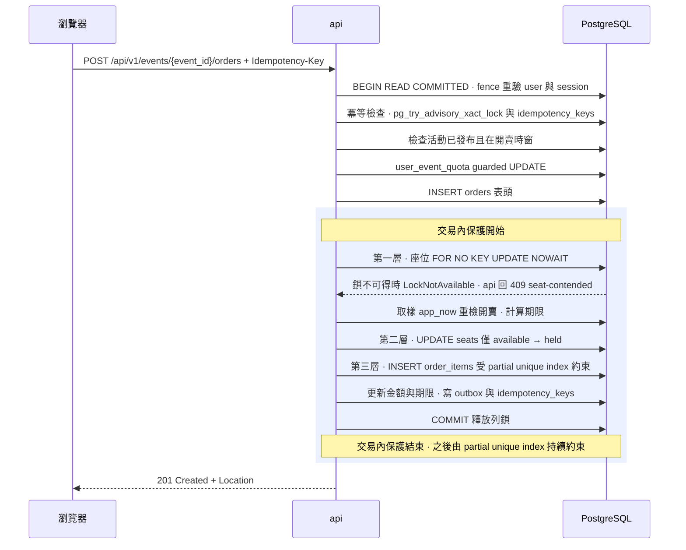
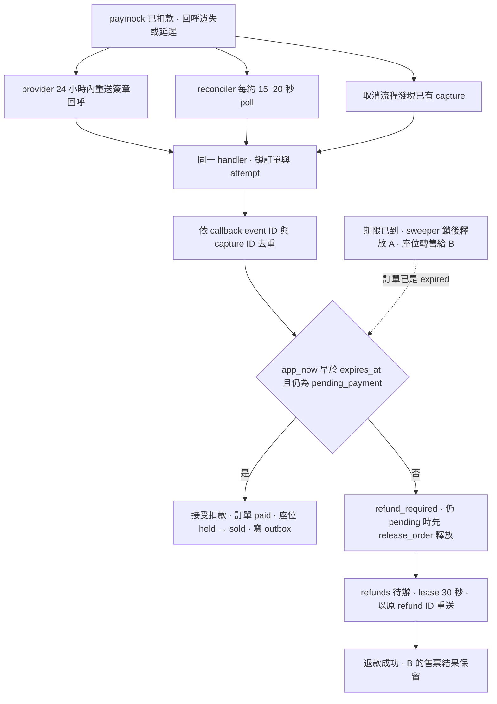
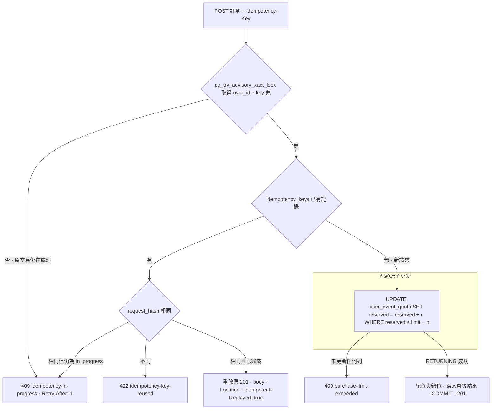
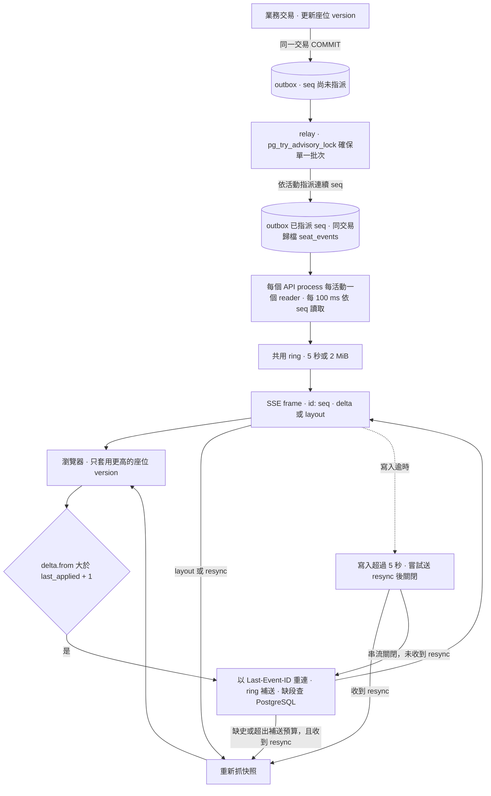
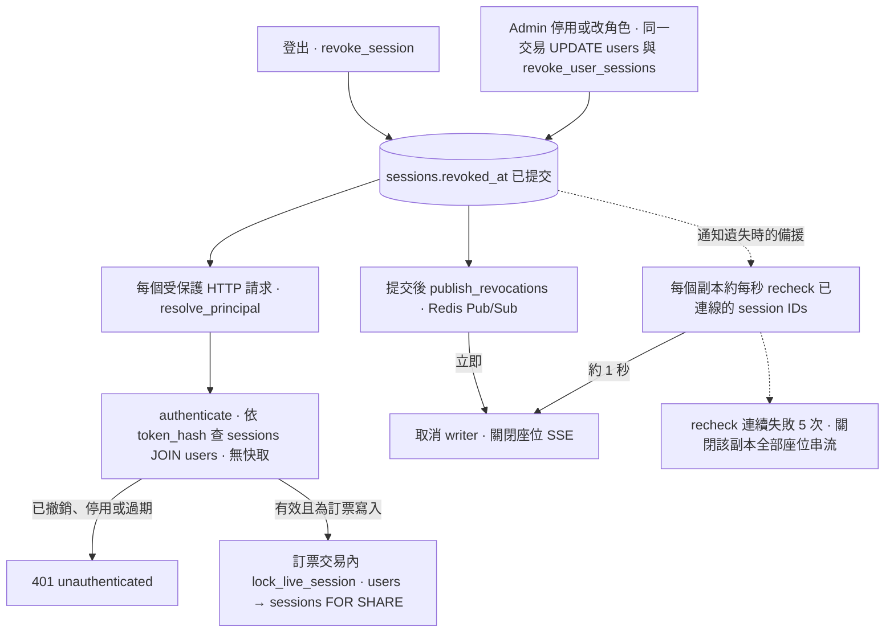
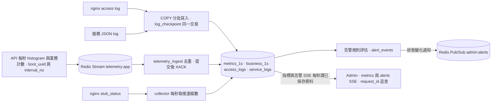

# 設計說明

## TL;DR

- **Q1 座位不超賣**　指定席以 PostgreSQL 列鎖保護至交易結束，partial unique index 持續限制每席只有一筆有效占用，逾期扣款則安排退款。
- **Q2 部分失敗後的狀態收斂**　回呼與付款 reconciler 共用分類邏輯，依資料庫時鐘和鎖定後的訂單狀態決定接受扣款或退款，背景工作可重試收斂。
- **Q3 重試、冪等與限購**　同一使用者的冪等鍵以交易序列化並保存原回應，跨鍵購買以原子更新守住配額，區域配位由 PostgreSQL 以 `SKIP LOCKED` 選取並鎖定座位。
- **Q4 即時推送**　座位異動與 outbox 同交易提交，由單一 active relay 按活動編序，各 API 副本經 SSE 送出，同一座位依版本更新，斷線後可重放或重新取快照。
- **Q5 權限與憑證失效**　受保護的 HTTP 請求逐次查 PostgreSQL，撤銷提交後舊 cookie 在下次驗證即失效，敏感寫入另在交易內重驗，座位 SSE 由 Redis 通知與定期查核關閉。
- **Q6 監控數據**　Edge 與 App 各自保留秒級指標，錯誤率採 `err_5xx / req_total`，App 樣本經對時與去重，回報涵蓋率揭露缺口，業務告警捕捉 HTTP 成功時仍可能發生的異常。

## 目錄

- [設計假設](#設計假設)
- [Q1 座位不超賣](#q1-座位不超賣)
  - [Q1-1 保護在哪一行取得、哪一行釋放？保證什麼？](#q1-1-保護在哪一行取得哪一行釋放保證什麼)
  - [Q1-2 最可能讓同一座位賣兩次的故障順序？擋得住嗎？](#q1-2-最可能讓同一座位賣兩次的故障順序擋得住嗎)
  - [Q1-3 哪個併發測試能抓到拆掉防線後的雙賣？](#q1-3-哪個併發測試能抓到拆掉防線後的雙賣)
  - [Q1 補充](#q1-補充)
- [Q2 部分失敗後的狀態收斂](#q2-部分失敗後的狀態收斂)
  - [Q2-1 哪些已提交的變更可能尚未被接收，哪個風險最大？](#q2-1-哪些已提交的變更可能尚未被接收哪個風險最大)
  - [Q2-2 扣款後程序被終止，如何恢復，要等多久？](#q2-2-扣款後程序被終止如何恢復要等多久)
  - [Q2-3 hold 到期看哪個時鐘，測試如何跳過等待？](#q2-3-hold-到期看哪個時鐘測試如何跳過等待)
  - [Q2-4 兩個 worker 同時處理同一筆逾期會怎樣？](#q2-4-兩個-worker-同時處理同一筆逾期會怎樣)
  - [Q2 補充](#q2-補充)
- [Q3 重試、冪等與限購](#q3-重試冪等與限購)
  - [Q3-1 同一冪等鍵重送時，會收到什麼？](#q3-1-同一冪等鍵重送時會收到什麼)
  - [Q3-2 兩把不同的 key 如何共用限購額度？](#q3-2-兩把不同的-key-如何共用限購額度)
  - [Q3-3 區域配位在哪裡挑座，並行時怎麼驗證？](#q3-3-區域配位在哪裡挑座並行時怎麼驗證)
  - [Q3 補充](#q3-補充)
- [Q4 即時推送](#q4-即時推送)
  - [Q4-1 座位更新如何送到各副本的訂閱者，誰負責編序？](#q4-1-座位更新如何送到各副本的訂閱者誰負責編序)
  - [Q4-2 客戶端怎麼發現缺段並補回座位狀態？](#q4-2-客戶端怎麼發現缺段並補回座位狀態)
  - [Q4-3 慢連線落後時如何處理，畫面最差有多舊？](#q4-3-慢連線落後時如何處理畫面最差有多舊)
  - [Q4-4 最終 Scenario B 壓測量到哪些結果？](#q4-4-最終-scenario-b-壓測量到哪些結果)
  - [Q4 補充](#q4-補充)
- [Q5 權限與憑證失效](#q5-權限與憑證失效)
  - [Q5-1 登出、停用或改角色後，舊憑證何時失效，驗證成本多少？](#q5-1-登出停用或改角色後舊憑證何時失效驗證成本多少)
  - [Q5-2 建立者被停用時，執行中的匯入怎麼處理？](#q5-2-建立者被停用時執行中的匯入怎麼處理)
  - [Q5-3 如何自動檢查端點授權，哪個路由最易漏查？](#q5-3-如何自動檢查端點授權哪個路由最易漏查)
  - [Q5 補充](#q5-補充)
- [Q6 監控數據](#q6-監控數據)
  - [Q6-1 HTTP 指標和連線數在哪裡量測、分桶與儲存？](#q6-1-http-指標和連線數在哪裡量測分桶與儲存)
  - [Q6-2 圖表都正常但使用者受害的情境？能否偵測？](#q6-2-圖表都正常但使用者受害的情境能否偵測)
  - [Q6-3 多副本如何去重與補收，牆鐘慢 20 秒會怎樣？](#q6-3-多副本如何去重與補收牆鐘慢-20-秒會怎樣)
  - [Q6-4 Edge 與 App 結果不一致時，信哪個來源？](#q6-4-edge-與-app-結果不一致時信哪個來源)
  - [Q6 補充](#q6-補充)
- [替代方案與取捨](#替代方案與取捨)
- [驗證對照表](#驗證對照表)

## 設計假設

| 假設 | 適用範圍 |
|---|---|
| PostgreSQL 16 為座位、訂單、配額、session 與 job 的權威來源 | Compose 預設使用單一 PostgreSQL、三個 API 副本。帳務收斂另仰賴模擬金流保存 intent、capture、refund 並接受同一識別碼重試。見 `compose.yaml:55`、`compose.yaml:120`、`paymock/src/paymock/store.py:153`、`paymock/src/paymock/store.py:204`。 |
| 每筆 1–4 張，每人每活動預設最多 4 張 | `pending_payment`、`paid`、`refund_pending` 佔配額。取消、逾時或退款完成而釋位時回補。預設 hold 為 600 秒，接受付款以持有訂單鎖後的 DB 時間為準。見 `backend/src/ticketing/booking/models.py:19`、`backend/src/ticketing/booking/models.py:40`、`backend/src/ticketing/core/settings.py:71–72`、`backend/src/ticketing/booking/orders.py:103–129`、`backend/src/ticketing/payments/callbacks.py:161–174`。 |
| 自動收斂以依賴恢復、持久資料仍可用為前提 | Compose 常駐後端使用 `restart: unless-stopped`。worker 與 relay 恢復後從 DB 繼續處理。長時間停機或 backlog 堆積會延長收斂。見 `compose.yaml:34`、`compose.yaml:48`、`backend/src/ticketing/worker/main.py:20`、`backend/src/ticketing/realtime/relay.py:55`。 |

## Q1 座位不超賣

### Q1-1 保護在哪一行取得、哪一行釋放？保證什麼？

**答：** 座位交易保護在 PostgreSQL 執行 `FOR NO KEY UPDATE NOWAIT` 時取得（`backend/src/ticketing/booking/create.py:54`），離開交易 context 時由 COMMIT 或 ROLLBACK 釋放（`backend/src/ticketing/booking/database.py:31`，提交前最後一行為 `backend/src/ticketing/booking/create.py:248`）。Row lock 序列化同席寫入，guarded UPDATE 只允許可用座位變為 held，partial unique index 則在交易結束後持續保證同席最多一筆有效 claim，直到該 item 寫入 `released_at`。

| 順序 | 指定席路徑 |
|---|---|
| 1. API 驗證 | `POST /api/v1/events/{event_id}/orders` 限 Admin、User。policy 驗證 session、CSRF 與有提供的 Origin。要求 `Idempotency-Key`，座位 ID 驗證 1–4 個、不得重複並排序。route 將 event ID 與正規化 body 納入請求雜湊。見 `backend/src/ticketing/api/routes/orders.py:40`、`backend/src/ticketing/api/routes/orders.py:81`、`backend/src/ticketing/api/routes/orders.py:89`、`backend/src/ticketing/api/security.py:115–144`、`backend/src/ticketing/booking/models.py:16–31`。 |
| 2. 進入交易 | `READ COMMITTED`，先鎖定並重驗 user/session，再檢查冪等記錄。新請求檢查發布與開賣時間，原子增加配額，先插入 order header 取得 event FK 所需的鎖。見 `backend/src/ticketing/booking/database.py:31`、`backend/src/ticketing/auth/sessions.py:111`、`backend/src/ticketing/booking/create.py:242–250`、`backend/src/ticketing/booking/create.py:149–161`、`backend/src/ticketing/booking/create.py:162–168`。 |
| 3. 第一層，座位 row lock | 依座位 ID 順序取鎖。同座位的並行寫入互斥，搶不到鎖回 `409 seat-contended`。在鎖內確認座位屬於活動且都可用，否則回 `409 seat-unavailable`。見 `backend/src/ticketing/booking/create.py:54–64`。 |
| 4. 第二層，guarded UPDATE | 鎖後重新以 `app_now()` 確認開賣，計算期限。只有 `status='available'` 的座位能寫為 `held`、填入 `order_id` 並遞增版本。更新筆數少一筆就回滾整單。即使先行讀取改成無鎖，並行 UPDATE 等到前一個寫入提交後仍須重檢條件。見 `backend/src/ticketing/booking/create.py:91–92`、`backend/src/ticketing/booking/create.py:178`、`backend/src/ticketing/booking/create.py:183`。 |
| 5. 第三層，partial unique index | 寫入 `order_items` 和單價。同一 `seat_id` 只容許一筆 `released_at IS NULL` 的 item。違反該 index 回 `409 seat-unavailable`，座位和配額一起回滾。見 `backend/src/ticketing/booking/create.py:99–112`、`backend/migrations/versions/0001_baseline.py:189`、`backend/src/ticketing/booking/orders.py:112`。 |
| 6. 提交與回應 | 完成金額、期限，寫 outbox 和冪等結果，提交後才回 `201` 與 `Location`。服務費以整數 TWD 計算 5% half-up。見 `backend/src/ticketing/booking/create.py:30`、`backend/src/ticketing/booking/create.py:186–204`、`backend/src/ticketing/booking/create.py:207`、`backend/src/ticketing/booking/create.py:248`、`backend/src/ticketing/api/routes/orders.py:91–94`。 |

### Q1-2 最可能讓同一座位賣兩次的故障順序？擋得住嗎？

**答：** 最危險的時序是 A 已被扣款，回呼卻在座位釋出且賣給 B 後才恢復。回呼在鎖內只接受尚未到期的 `pending_payment`，所以 A 會安排退款，B 保有座位（`backend/src/ticketing/payments/callbacks.py:161–174`、`backend/src/ticketing/payments/callbacks.py:192–215`）。

1. A 鎖住座位 S。模擬金流在期限前扣款，回呼因網路或程序停頓延後。
2. Sweeper 取 A 的訂單鎖，重檢 `pending_payment` 與期限。提交時 A 為 `expired`，S 釋出，item 關閉且配額回補。B 隨後可鎖住 S 並付款。見 `backend/src/ticketing/booking/sweeper.py:27`、`backend/src/ticketing/booking/orders.py:92–129`。
3. A 的回呼恢復，取 A 的訂單鎖後讀狀態並取樣 DB 時間。A 已逾時，寫入 `refund_required` 與退款工作，保留 B 的售票結果。若回呼先取鎖但已逾期，它會在同一交易先釋放 A，再安排退款。接受付款的分支還會確認每張座位都由該訂單持有，更新條件是 `order_id=$1 AND status='held'`，筆數不符即回滾。見 `backend/src/ticketing/payments/callbacks.py:84–97`、`backend/src/ticketing/payments/callbacks.py:105–120`、`backend/src/ticketing/payments/callbacks.py:161–174`、`backend/src/ticketing/payments/callbacks.py:192–215`。

### Q1-3 哪個併發測試能抓到拆掉防線後的雙賣？

**答：** `test_specific_seat_races` 分別讓 200 位買家搶同一席、150 位買家搶重疊多席，斷言每輪只有一筆 `201`，再查 SQL 不變式（`backend/tests/booking/test_booking.py:45–64`）。`test_break_it` 以相同不變式驗證三組，`indexed` 拿掉 row lock 與 UPDATE guard 仍擋住第二筆 claim，`naive` 再移除測試 DB clone 的 unique index 後兩筆都回 `201`（`backend/tests/booking/test_booking.py:105–128`）。`BREAK_IT_RAW=1` 讓 `naive` 的斷言直接失敗，以下為 PostgreSQL 16 留存的 [原始輸出](docs/evidence/break-it-raw.txt)。

```text
$ BREAK_IT_RAW=1 pytest -v "backend/tests/booking/test_booking.py::test_break_it"
# PostgreSQL 16 (postgres:16 image), 2026-11-21 15:50 CST; normal and indexed are controls, naive removes all three protections

backend/tests/booking/test_booking.py::test_break_it[normal] PASSED      [ 33%]
backend/tests/booking/test_booking.py::test_break_it[indexed] PASSED     [ 66%]
backend/tests/booking/test_booking.py::test_break_it[naive] FAILED       [100%]
E       AssertionError: Booking invariant violations: [{'invariant': 'seat active claims', 'id': 2}, {'invariant': 'seat active claims', 'id': 1}, {'invariant': 'seat active claims', 'id': 3}]
backend/tests/booking/support.py:117: AssertionError
=========================== short test summary info ============================
FAILED backend/tests/booking/test_booking.py::test_break_it[naive] - Assertio...
========================= 1 failed, 2 passed in 12.60s =========================
```

### Q1 補充



*圖：指定席購買交易的步驟順序，三層防線都位於同一個交易內，任一層失敗即整筆回滾。*

`test_late_capture_preserves_quota` 分別測 sweeper 先釋放與回呼先處理（`backend/tests/payments/test_payments.py:209`）。

一般執行在 PostgreSQL 16.16 上三個 pytest case 都通過，`naive` 的 invariant 違規是測試預期捕捉的失敗。見 [破壞驗證紀錄](docs/evidence/break-it.txt)。

```text
backend/tests/booking/test_booking.py::test_break_it[normal] PASSED      [ 33%]
backend/tests/booking/test_booking.py::test_break_it[indexed] PASSED     [ 66%]
backend/tests/booking/test_booking.py::test_break_it[naive] PASSED       [100%]

----------------------------- Captured stdout call -----------------------------
Booking invariant violations: [{'invariant': 'seat active claims', 'id': 2}, {'invariant': 'seat active claims', 'id': 1}, {'invariant': 'seat active claims', 'id': 3}]
======================= 3 passed, 9 deselected in 7.07s ========================
```

## Q2 部分失敗後的狀態收斂

### Q2-1 哪些已提交的變更可能尚未被接收，哪個風險最大？

**答：** 下列時間窗跨越 HTTP、座位推送、金流、匯入、session 和監控。最危險的是金流已扣款而 PostgreSQL 尚未記錄 capture，因為 hold 可能在此期間到期，買家已被扣款而座位可能已轉售（`paymock/src/paymock/store.py:111–129`、`backend/src/ticketing/payments/callbacks.py:161–174`）。

- 訂單已提交，HTTP 回應遺失。
- 座位已變更，relay 或 SSE 尚未通知。
- payment attempt 已建立，但 provider 尚未收到請求，或已完成 create 但本地尚無結果。
- **已扣款但本地尚未記錄**，或回呼已提交但 ACK 遺失。
- 本地已排入退款或取消 intent，或 provider 已成功但本地未確認。
- 匯入檔已存但 job 尚未提交，或 worker 在匯入中中斷。
- session 已撤銷，串流尚未收到通知。登入已提交但 cookie 尚未送達。
- 日誌或 telemetry 已產生但尚未寫入歷史，或 collector 在提交後、ACK 前終止。告警已入庫但通知未送達。

### Q2-2 扣款後程序被終止，如何恢復，要等多久？

**答：** 程序遭 `kill -9` 後，Paymock 仍有同一交易保存的 capture 與待送回呼，會用同一 event ID 在 24 小時內重送，reconciler 也會查 provider，取消流程發現 capture 時同樣交給 `apply_event`（`paymock/src/paymock/store.py:111–118`、`paymock/src/paymock/store.py:119–129`、`paymock/src/paymock/delivery.py:53–78`、`backend/src/ticketing/payments/reconciler.py:60–71`、`backend/src/ticketing/payments/attempts.py:124–130`、`backend/src/ticketing/payments/reconciler.py:183–186`、`backend/src/ticketing/api/routes/payments.py:149–161`）。Handler 依 callback event ID 與 capture ID 去重，鎖後有效 hold 就售出，否則排入退款（`backend/src/ticketing/payments/callbacks.py:146–174`、`backend/src/ticketing/payments/callbacks.py:192–215`、`backend/src/ticketing/payments/callbacks.py:219–269`）。自 `last_polled_at`（無值時取 `updated_at`）滿 15 秒可領取，worker 每輪後等 5 秒，因此健康且無積壓時約 15–20 秒出現下次 poll 機會（`backend/src/ticketing/payments/reconciler.py:42–53`、`backend/src/ticketing/worker/main.py:22`、`backend/src/ticketing/worker/main.py:34`）。暫時中斷在依賴恢復後自動處理，無需人工介入，重啟、前輪耗時、provider 延遲、積壓與退款重試均另計，沒有固定完成上限。

### Q2-3 hold 到期看哪個時鐘，測試如何跳過等待？

**答：** 以 PostgreSQL 的 `app_now()` 判斷到期，底層是 `clock_timestamp()`，所以等鎖後仍讀到當下時間，與 API 牆鐘無關（`backend/migrations/versions/0001_baseline.py:29–31`、`backend/src/ticketing/booking/orders.py:92–95`、`backend/src/ticketing/payments/callbacks.py:161–164`）。測試在 DB clone 替換函式，`TestClock.set/advance` 只推進 DB 時鐘，Python 牆鐘照常運行，再直接跑 sweeper 或套用回呼覆蓋兩個時鐘不一致的到期情境（`backend/tests/sql/test_clock.sql:10`、`backend/tests/support.py:25–32`、`backend/tests/booking/test_booking.py:157`、`backend/tests/payments/test_payments.py:209`）。

### Q2-4 兩個 worker 同時處理同一筆逾期會怎樣？

**答：** 同一筆逾期只會釋位一次。Sweeper 先用 `FOR UPDATE SKIP LOCKED` 跳過另一個 worker 已鎖住的訂單（`backend/src/ticketing/booking/sweeper.py:27`），即使再次進入 `release_order`，決定性保護仍是鎖後 UPDATE 的狀態與期限條件（`backend/src/ticketing/booking/orders.py:95`）。沒有更新列就直接返回，座位、item、配額及 outbox 都不會再改（`backend/src/ticketing/booking/orders.py:101–102`）。

### Q2 補充



*圖：已扣款但本地未記錄時，三條重試路徑匯入同一個 handler，在鎖內以 DB 時鐘決定接受或退款。*

其他時間窗的恢復路徑如下。Tick、lease 與 backoff 來自設定與程式行為。

| `kill -9` 時的落差 | 恢復流程與時間 |
|---|---|
| 訂單已提交，HTTP 回應遺失 | 相同 key 重送時從 PostgreSQL 重放。沒有重送的未付款訂單在期限到達後由 sweeper 處理，迴圈每輪後等 1 秒，每輪最多 200 筆。見 `backend/src/ticketing/booking/create.py:242–250`、`backend/src/ticketing/booking/sweeper.py:10`、`backend/src/ticketing/worker/main.py:20–21`。 |
| 座位已變更，relay 或 SSE 尚未通知 | outbox 隨座位提交。relay 每輪後等 50 ms 再處理已提交且未編序的批次，編序與 archive 同一交易。掛在交易中可回滾重做，掛在提交後由 API 直接讀取已編序資料。斷線客戶端 replay 或抓快照。見 `backend/src/ticketing/realtime/outbox.py:20`、`backend/src/ticketing/relay/main.py:10`、`backend/src/ticketing/realtime/relay.py:28`、`backend/src/ticketing/realtime/stream.py:45`。 |
| payment attempt 已建立，但 provider 尚未收到請求，或已完成 create 但本地尚無結果 | attempt 和 key 先持久化，再以同 attempt ID 呼叫 provider。客戶端可重送，reconciler 也會重做 create 或 poll。attempt 至少間隔 15 秒才重新符合領取條件，reconciler 每輪後等 5 秒。見 `backend/src/ticketing/payments/attempts.py:49–78`、`backend/src/ticketing/payments/attempts.py:156–188`、`backend/src/ticketing/payments/reconciler.py:37–57`、`backend/src/ticketing/worker/main.py:22`。 |
| 本地已排入退款或取消 intent，或 provider 已成功但本地未確認 | 到期 lease 可重領（30 秒）。退款以原 refund ID 重送，取消以 attempt ID 重送。本地寫入檢查 `lease_owner`。已付款訂單直到退款成功才在同一交易釋位與回補配額。失敗 backoff 上限 300 秒。見 `backend/src/ticketing/payments/reconciler.py:84`、`backend/src/ticketing/payments/reconciler.py:97`、`backend/src/ticketing/payments/reconciler.py:110`、`backend/src/ticketing/payments/reconciler.py:121–130`、`backend/src/ticketing/payments/reconciler.py:183–192`。 |
| 匯入檔已存但 job 尚未提交，或 worker 在匯入中中斷 | 未被活躍 job 使用的舊檔經 24 小時可清除。已提交的 job 依活動與檔案 digest 去重。30 秒 lease 到期後 worker 以新 fence 領回，第三次 lease 到期仍未完成即終止。每批最多 5,000 列，staging COPY 與 `processed_rows` 同一交易提交。重領後重讀不可變檔案，略過已提交的 parser records 並保留原始行號。已提交的 `total_rows` 及 `file_validated` 檢查點也會保留，可分別略過解析及檔案驗證。finalize 在活動鎖內重驗 fence，將正式座位、outbox 與 job 結果一起提交。進度 SSE 可重讀 DB。見 `backend/src/ticketing/imports/jobs.py:32`、`backend/src/ticketing/imports/runner.py:55–85`、`backend/src/ticketing/imports/runner.py:136–142`、`backend/src/ticketing/imports/runner.py:340–342`、`backend/src/ticketing/imports/runner.py:375–379`、`backend/src/ticketing/imports/runner.py:386–394`、`backend/src/ticketing/imports/runner.py:397–399`、`backend/src/ticketing/imports/runner.py:218–228`、`backend/src/ticketing/imports/runner.py:292–302`、`backend/src/ticketing/imports/runner.py:440–448`、`backend/src/ticketing/api/routes/imports.py:174–182`。 |
| session 已撤銷，串流尚未收到通知 | 新請求即時讀 DB。座位串流靠 DB 批次重驗補上 Redis 通知遺失，見 Q5。若登入已提交但 cookie 尚未送達，該 session 仍受 idle／absolute deadline 限制，使用者可再登入。見 `backend/src/ticketing/api/routes/auth.py:215–233`、`backend/src/ticketing/auth/sessions.py:37–47`。 |
| 日誌或 telemetry 已產生但尚未寫入歷史，或 collector 在提交後、ACK 前終止 | 檔案 checkpoint 隨 DB 寫入提交，Redis 已送達的 interval 可重新領取並去重。API 在 XADD 前終止的記憶體樣本可能永久遺失。告警寫入 DB 後若通知遺失，Admin SSE 下次輪詢仍可看到。見 Q6 及 `backend/src/ticketing/api/routes/monitoring.py:507–528`。 |

正常暫時性中斷由後續 tick 或重試自行處理。持續 provider 故障、儲存卷遺失或匯入已到終止狀態時，需要排查或重送，沒有固定的收斂時間上限。

**驗證**　`test_parallel_sweepers_skip_locked_and_bad_orders`、`test_cancel_expire_and_page`、`test_app_now_uses_clock_timestamp`、`test_test_clock_controls_app_now`、`test_lost_create_response_and_paid_cancel`、`test_open_response_after_hold_expires`、`test_stale_worker_cannot_stage_or_finalize`、`test_expired_third_attempt_becomes_terminal`、`test_stage_timeout_resumes_committed_rows`。見 `backend/tests/booking/test_booking.py:306`、`backend/tests/booking/test_booking.py:157`、`backend/tests/integration/test_schema.py:65`、`backend/tests/integration/test_constraints.py:140`、`backend/tests/payments/test_payments.py:244`、`backend/tests/payments/test_payments.py:379`、`backend/tests/imports/test_imports.py:160`、`backend/tests/imports/test_imports.py:219`、`backend/tests/imports/test_imports.py:240`。

**證據**　整合測試以可控時鐘、鎖衝突、遺失 provider 回應和重領 lease 驗證狀態。上表的週期不能當作整個 Compose stack 的 `kill -9` 量測結果。

## Q3 重試、冪等與限購

### Q3-1 同一冪等鍵重送時，會收到什麼？

**答：** 建立訂單先以 `(user_id, key)` 取得交易 advisory lock，再比對已提交的 request hash。原回應和座位、配額一起提交，重送結果取決於鎖和已存記錄（`backend/src/ticketing/booking/create.py:242–250`、`backend/src/ticketing/booking/idempotency.py:75–103`、`backend/src/ticketing/booking/idempotency.py:112–132`）。

| 重送時原請求的狀態 | 建立訂單的結果 |
|---|---|
| 已成功 | 回原本的 `201`、body 與 `Location`，加上 `Idempotent-Replayed: true`。即使訂單之後變更，重放的仍是原回應。以訂單 GET 查最新狀態。 |
| 處理中 | 原交易持有 key 鎖時，`pg_try_advisory_xact_lock` 立即失敗，回 `409 idempotency-in-progress` 並帶 `Retry-After: 1`。搶鎖先於 hash 比對，並行的不同 body 也先收到 409。若已存記錄的 hash 相同且仍為 `in_progress`，同樣回 409。 |
| 同 key、已存在的 hash 不同 | 回 `422 idempotency-key-reused`。hash 涵蓋 operation、resource ID、正規化 body。指定席只換 ID 順序仍視為相同。 |

回應 header 與 hash 口徑見 `backend/src/ticketing/booking/idempotency.py:40–65`，指定席 ID 正規化見 `backend/src/ticketing/booking/models.py:28–31`。`test_idempotency_contention_and_canonical_replay` 覆蓋鎖衝突、原回應重放與 body 變更（`backend/tests/booking/test_booking.py:131`）。

### Q3-2 兩把不同的 key 如何共用限購額度？

**答：** 檢查與加量在同一個 SQL `UPDATE ... SET reserved=reserved+$3 WHERE ... AND reserved <= $4::int - $3 RETURNING reserved`，兩把 key 競爭同一個 user/event 配額列（`backend/src/ticketing/booking/create.py:126–139`）。兩筆並行各買 3 張時只會有一筆成功，另一筆重檢後回 `409 purchase-limit-exceeded`，後續配位失敗則回滾配額（`backend/src/ticketing/booking/create.py:242–250`、`test_quota_race` 在 `backend/tests/booking/test_booking.py:91–102`）。若拆成無鎖讀寫，兩筆可能都讀到 0，合計取得 6 張。

### Q3-3 區域配位在哪裡挑座，並行時怎麼驗證？

**答：** PostgreSQL 依活動、區域與 `available` 過濾，按 `sort_key,id` 取 `LIMIT`，用 `FOR NO KEY UPDATE SKIP LOCKED` 選並鎖住座位（`backend/src/ticketing/booking/create.py:74–75`）。多位買家同搶同區最後幾張時，若先讀到應用程式記憶體挑選，可能同時選到同一批或用到過時庫存。`test_zone_converges` 讓 500 位買家在 300 席的同區每筆配 2 張，最後恰有 150 筆訂單、300 張 held（`backend/tests/booking/test_booking.py:67–88`）。

### Q3 補充



*圖：帶冪等鍵的建立訂單決策，以及以單一 SQL 守住每人每活動上限的配額更新。*

若原交易回滾且未留下記錄，同 key 可重新執行。已完成記錄超過 24 小時後可由 worker 批次清理（`backend/src/ticketing/payments/reconciler.py:226–236`）。建立付款另有持久的 `in_progress` attempt，交易鎖未被占用時，同 key 可續做 provider create 或讀取結果。Provider 結果仍未知時回可重試 `503 server-busy`（`backend/src/ticketing/payments/attempts.py:156–188`）。

配額先用 `INSERT ... ON CONFLICT DO NOTHING` 確保配額列存在（`backend/src/ticketing/booking/create.py:126`）。配位暫時不足時，原交易回滾後另查可用筆數，區分可重試的 `409 allocation-contended` 與 `409 insufficient-seats`（`backend/src/ticketing/booking/create.py:211–229`、`backend/src/ticketing/booking/create.py:249–250`）。`test_allocation_distinguishes_locked_inventory_from_sold_out` 驗證這兩類短缺（`backend/tests/booking/test_booking.py:255`）。

**證據**　可從測試中的狀態碼、配額與座位不變式斷言核對，對外回應契約見 [OpenAPI](docs/openapi.json)（`docs/openapi.json:3143`）。

## Q4 即時推送

### Q4-1 座位更新如何送到各副本的訂閱者，誰負責編序？

**答：** 座位版本與 outbox 同交易提交，relay 以 PostgreSQL advisory lock 保證同時只有一個批次，為各活動指派連續 seq 並同時歸檔（`backend/src/ticketing/booking/create.py:182–204`、`backend/src/ticketing/realtime/relay.py:14–40`、`backend/src/ticketing/realtime/relay.py:46–65`、`backend/src/ticketing/realtime/relay.py:74–81`）。各 API 副本按活動共用 reader，約每 100 ms 按 seq 讀取、合併成 frame 放進共用 ring，再由各連線透過 SSE 送出（`backend/src/ticketing/realtime/reader.py:22`、`backend/src/ticketing/realtime/reader.py:47–52`、`backend/src/ticketing/realtime/reader.py:161`、`backend/src/ticketing/realtime/stream.py:83–91`）。副本共用同一套 seq 與同席版本順序。各副本合併的區間可不同，跨席的 seq 以 relay 編序為準。

### Q4-2 客戶端怎麼發現缺段並補回座位狀態？

**答：** 客戶端從快照的 `last_seq` 開始，看到 `delta.from > last_applied + 1` 時判定缺段，以最後成功套用的 seq 作 `Last-Event-ID` 重連（`frontend/src/seat-model.ts:33–38`、`frontend/src/events.ts:267–324`、`frontend/src/api.ts:278`）。伺服器先從 ring 補送，缺段則查 PostgreSQL，最多 5,000 筆、每 process 8 個並行 replay task，補送預算 5 秒（`backend/src/ticketing/realtime/reader.py:28–29`、`backend/src/ticketing/realtime/reader.py:98`、`backend/src/ticketing/realtime/stream.py:45–66`）。缺史或超出預算時，伺服器會嘗試送出 `resync`。客戶端收到 `resync` 或 `layout` 即重新取快照，必要時帶 `min_layout_ver`（`backend/src/ticketing/realtime/stream.py:160–179`、`frontend/src/events.ts:274–283`、`frontend/src/events.ts:299–303`）。

### Q4-3 慢連線落後時如何處理，畫面最差有多舊？

**答：** 共用 ring 保留 5 秒或 2 MiB（先達者淘汰），每連線一次寫一個 frame，落後的連線先回查。單次寫入超過 5 秒則用 100 ms 嘗試送 `resync` 並關閉（`backend/src/ticketing/realtime/reader.py:24–25`、`backend/src/ticketing/realtime/reader.py:78`、`backend/src/ticketing/realtime/stream.py:21–24`、`backend/src/ticketing/realtime/stream.py:160–179`）。這把記憶體用量維持在有界範圍，快客戶端可繼續收件，慢客戶端可能跳過中間狀態或重抓整份座位圖（`backend/tests/realtime/test_api.py:474`）。UI 約 20 秒無串流資料或落後 progress head 約 10 秒便重連，最壞時其後所有變動的座位與 layout 都可能過時，直到 replay 或快照成功。持續斷網、DB 或 relay 故障時沒有固定收斂上限（`frontend/src/events.ts:288–293`）。

### Q4-4 最終 Scenario B 壓測量到哪些結果？

**答：** 同桌機、同 commit `346fe0f` 比較 6 個 API 副本與 3 副本基準，8 個探測程序在同一活動啟動 2,000 條連線，測試設定為 80 秒，writer 目標為 100 changes/s。兩輪的寫入期間峰值都為 2,000，最後各有 2,000／2,000 個 client 與 PostgreSQL 相符，待編序和封存差異均為 0。Delta 延遲從 frame 內最早的 outbox `created_at` 計到探測程式套用更新。

| 指標 | 6 副本（建議） | 3 副本（基準） |
| --- | --- | --- |
| 已建立連線／目標 | 2,000／2,000 | 2,000／2,000 |
| 寫入期間同時在線峰值 | 2,000 | 2,000 |
| Writer 寫入／實測速率 | 5,504 次／99.7 changes/s | 5,504 次／99.5 changes/s |
| 建連 p50／p95／p99（ms） | 317／2,820／3,600 | 687／2,360／4,170 |
| 快照 p50／p95／p99（ms） | 193／247／247 | 3,420／8,240／8,640 |
| Delta 套用 p50／p95／p99（ms） | 175／2,750／9,450（821,925 筆樣本） | 216／3,070／7,750（789,776 筆樣本） |
| `stream_attempts`／`stream_request_errors` | 18,555／29（0.16%，分母含重連） | 21,279／17（0.08%，分母含重連） |
| `resyncs`／`stalled_progress`／`gaps` | 0／16,526／16,526 | 33／19,229／19,229 |
| `matching_clients` | 2,000 | 2,000 |
| 最終 `final_head` | 1,376 | 1,376 |
| SSE body 大小／每秒位元組（bytes／bytes/s） | 268,876,174／3,121,380 | 264,912,047／3,088,627 |
| `outbox_pending`／`archive_mismatches` | 0／0 | 0／0 |

[6 副本環境](docs/evidence/loadtest-final-6replicas-20261122/environment.txt#L2-L9) · [3 副本環境](docs/evidence/loadtest-final-20261122/environment.txt#L2-L9) · [6 副本 SSE](docs/evidence/loadtest-final-6replicas-20261122/b/sse-client.txt#L3) · [3 副本 SSE](docs/evidence/loadtest-final-20261122/b/sse-client.txt#L3) · [完整結果](LOADTEST.md#3-scenario-b) · [6 副本 writer](docs/evidence/loadtest-final-6replicas-20261122/b/writer.txt) · [3 副本 writer](docs/evidence/loadtest-final-20261122/b/writer.txt)

### Q4 補充



*圖：座位變更從交易提交到瀏覽器的路徑，以及缺段、版面變更與慢客戶端的補救方式。*

同一席的第二筆寫入須等第一筆提交才取得 outbox ID，無關座位的提交順序則可與 seq 不同（`backend/src/ticketing/realtime/outbox.py:20`、`backend/src/ticketing/realtime/relay.py:46–65`）。Reader 合併連續區間時，同席只帶最高版本，遇到 `layout` 切段。nginx 對座位串流關閉 buffering（`backend/src/ticketing/realtime/frames.py:40`、`infra/nginx/nginx.conf:128`）。

快照走 `GET /api/v1/events/{event_id}/seats`，SSE 走 `GET /api/v1/events/{event_id}/seat-stream`（`backend/src/ticketing/api/routes/seats.py:58`、`backend/src/ticketing/api/routes/seats.py:112`）。快照在 `REPEATABLE READ` 交易讀座位與 head，可能包含已提交但未編序的座位版本，因此客戶端只套用更高版本（`backend/src/ticketing/realtime/snapshot.py:170–178`、`frontend/src/seat-model.ts:33–53`）。PostgreSQL 的交易條件仍可拒絕根據過時畫面選取的座位（`backend/src/ticketing/booking/create.py:54–64`）。

**驗證**　`test_concurrent_writers_preserve_per_seat_order`、`test_two_relays_only_one_active`、`test_snapshot_and_delta_resume_end_to_end`、`test_replay_recovers_from_ring_eviction_or_resyncs`、`test_slow_connection_resyncs_and_fast_peer_keeps_receiving`。見 `backend/tests/realtime/test_relay.py:15`、`backend/tests/realtime/test_relay.py:103`、`backend/tests/realtime/test_api.py:248`、`backend/tests/realtime/test_api.py:362`、`backend/tests/realtime/test_api.py:474`。

**歷史量測（Scenario B）**

| 指標 | 第 1 輪（目標 300 changes/s） | 第 2 輪（目標 100 changes/s） |
|---|---:|---:|
| 同時 SSE 峰值 | 2,000 | 2,000，寫入期間峰值亦為 2,000 |
| 最終與 PostgreSQL 相符 | 1,326／2,000 | 2,000／2,000 |
| Delta 套用 p50／p95／p99（ms） | 3,614／38,833／79,780 | 266／8,060／16,600 |
| outbox 待編序／archive 差異 | 0／0 | 0／0 |

第 2 輪 writer 實得 99.7 changes/s。client 偵測進度停滯後重連，最終全部追上 DB。[第 1 輪 SSE client](docs/evidence/loadtest-run1-20261121/b/sse-client.txt) · [第 2 輪 SSE client](docs/evidence/loadtest-run2-20261121/b/sse-client.txt) · [第 2 輪 writer](docs/evidence/loadtest-run2-20261121/b/writer.txt) · [完整結果](LOADTEST.md#3-scenario-b)

## Q5 權限與憑證失效

### Q5-1 登出、停用或改角色後，舊憑證何時失效，驗證成本多少？

**答：** 登出先寫 `revoked_at` 再清 cookie，停用或改角色則在更新 user 的同一交易撤銷其 sessions（`backend/src/ticketing/api/routes/auth.py:265–269`、`backend/src/ticketing/api/routes/admin_users.py:221–240`）。每個帶 session cookie 的受保護 HTTP 請求做一次 token hash、pool acquire 和 PostgreSQL session JOIN user 查詢，提交後下次驗證就回 `401`，跨副本的 session cache 不一致時間為 0（無 session cache，`backend/src/ticketing/api/security.py:99–125`、`backend/src/ticketing/auth/sessions.py:37–55`）。隔離量測在同一 DB 連線交替執行各 6,000 次，`authenticate()` p50 **0.891 ms**，`SELECT 1` p50 **0.703 ms**，驗證本身多 **0.188 ms**，pool acquire 等待另計。已通過驗證的敏感寫入在交易內另做 fence，座位 SSE 收到撤銷通知即關閉，通知遺失時健康副本約 1 秒重驗（`backend/src/ticketing/booking/create.py:242–244`、`backend/src/ticketing/auth/sessions.py:111`、`backend/src/ticketing/realtime/revocation.py:93–125`）。

| 同連線呼叫（各 6,000 次） | p50 | p95 | p99 | 平均 |
|---|---:|---:|---:|---:|
| `authenticate()` | 0.891 ms | 2.455 ms | 7.965 ms | 1.187 ms |
| `SELECT 1` | 0.703 ms | 1.911 ms | 6.788 ms | 0.936 ms |

[session 驗證成本紀錄](docs/evidence/session-auth-cost.md) · [隔離量測腳本](scripts/measure_auth_cost.py)

### Q5-2 建立者被停用時，執行中的匯入怎麼處理？

**答：** 停用先提交時取消匯入，job 為 `cancelled`、原因 `creator_disabled`，清理 staging（`backend/src/ticketing/imports/runner.py:175–191`、`backend/src/ticketing/imports/runner.py:230–234`）。Worker 每批檢查 `is_active`，finalize 在 DB 交易鎖住 creator 和活動並重驗 fence，再按當時的角色、所有權與活動狀態決定是否寫入（`backend/src/ticketing/imports/runner.py:344–348`、`backend/src/ticketing/imports/runner.py:218–245`）。若 finalize 先取鎖並提交，後續停用不會回滾已完成匯入，因此寫入依提交順序使用當時的有效權限。

### Q5-3 如何自動檢查端點授權，哪個路由最易漏查？

**答：** 測試遍歷所有已註冊 API endpoint 的 policy metadata，按 HTTP method 和完整路徑比對 public allowlist，並驗證遺漏 policy 或繞過 SecureRouter 會遭拒（`backend/tests/authz/test_route_policies.py:52`、`backend/tests/authz/test_route_policies.py:75`、`backend/tests/authz/test_route_policies.py:93`、`backend/tests/authz/test_route_policies.py:102`）。OpenAPI 測試逐 operation 核對 security 與錯誤契約及匯出 JSON，runtime 測試則涵蓋角色和物件權限，包括匯入上傳、查詢、進度與錯誤檔（`backend/tests/authz/test_openapi.py:22`、`backend/tests/authz/test_openapi.py:80–83`、`backend/tests/imports/test_imports.py:71`）。最容易漏的是 `GET /api/v1/seat-imports/{job_id}/errors.csv`，因為 URL 只有 job UUID，檔案卻有原始欄位與錯誤資訊。程式先 JOIN parent event 查 Admin 或活動 owner 權限，再建立下載檔（`backend/src/ticketing/api/routes/imports.py:253–274`、`backend/src/ticketing/imports/jobs.py:60–68`）。

### Q5 補充



*圖：撤銷提交後，HTTP 在下次驗證即失效，座位 SSE 由 Pub/Sub 立即關閉並以每秒查核兜底。*

- **撤銷**　登出寫 `revoked_at` 再清 cookie。Admin 修改角色或啟用狀態時在同一交易更新 user、撤銷其現有 sessions。訂票交易依 `users → sessions` 順序取 `FOR SHARE` 並重驗。撤銷提交後的 Redis pub/sub 用於關閉座位 SSE。若通知遺失，座位 SSE 每個副本約每秒批次檢查已連線的 distinct session IDs，被撤銷者在下一輪（約 1 秒）關閉。檢查本身連續失敗 5 次才關閉該副本全部座位串流。健康時每輪約 1 秒，DB 劣化時取連線與查詢各有 1 秒上限，算入連線歸還後，5 次可約 10–15 秒。原本 2 次（0.2 s／0.3 s）在 2,000 條 SSE 的壓測下造成整批斷線與重連風暴，因此放寬。Pub/Sub 正常時撤銷仍立即生效，事件迴圈停頓時無固定上限。Admin 監控與匯入進度串流每輪另讀 session。見 `backend/src/ticketing/api/routes/auth.py:265–267`、`backend/src/ticketing/api/routes/admin_users.py:221`、`backend/src/ticketing/api/routes/admin_users.py:240`、`backend/src/ticketing/auth/sessions.py:111`、`backend/src/ticketing/realtime/revocation.py:21–27`、`backend/src/ticketing/realtime/revocation.py:93–125`、`backend/src/ticketing/core/db.py:38–59`、`backend/src/ticketing/api/routes/monitoring.py:406`、`backend/src/ticketing/api/routes/imports.py:174`。
- **每請求成本**　一次 token hash、一次 DB pool acquire 與一次按具唯一約束的 `sessions.token_hash` 查 session、JOIN user，判斷撤銷、啟用、角色及有效期。idle 續期合併後批次更新，SQL 不會復活撤銷或過期的 session。訂票另有交易內兩次鎖定查詢。以有效 cookie 重放 `GET /api/v1/auth/me`，在 API 量測 `resolve_principal` 中 acquire wait 與 `authenticate` 單獨的 latency p50/p95/p99，分低負載與 A 負載時段並記錄錯誤數。可用 `EXPLAIN (ANALYZE, BUFFERS)` 驗證查詢 plan，SQL 時間與端到端時間分開報告。閒置堆疊實測經 nginx 依序各 1,000 次，`GET /api/v1/auth/me` p50/p95/p99 為 10.89/25.38/35.78 ms，不查 session 的 `GET /healthz/live` 為 7.03/18.85/34.07 ms，中位數差約 3.9 ms，0 錯誤，但此差值也含路由差異。隔離量測在 API 容器內以同一連線執行。另以 `EXPLAIN ANALYZE` 以有效 token 回傳 1 列，使用者以 `users_pkey` 取得，session 在本次 41 列時循序掃描、11/21 的 3,831 列時走 `sessions_token_hash_key`（planner 依統計選擇）。本次 `EXPLAIN` 的 Execution Time 為 0.265 ms。腳本 `scripts/measure_auth_cost.py`。見 `backend/src/ticketing/api/security.py:104`、`backend/src/ticketing/auth/sessions.py:38`、`backend/src/ticketing/auth/sessions.py:50`、`backend/src/ticketing/auth/sessions.py:190–201`、`backend/migrations/versions/0001_baseline.py:69`。[session 驗證成本紀錄](docs/evidence/session-auth-cost.md)
- **高負載連線池等待**　最終 Scenario A 採 6 個 API 副本時，nginx 503 占 35.4%，3 副本基準為 88.1%。兩輪 k6 p50 為 1.06／1.05 秒，接近 DB pool 取用上限 1 秒。受保護請求在驗證 session 前也須取用連線，取用逾時會回可重試的 503。6 副本的 598 筆 nginx 499 全在付款路徑。[6 副本 nginx](docs/evidence/loadtest-final-6replicas-20261122/a/nginx-summary.txt#L1-L20) · [3 副本 nginx](docs/evidence/loadtest-final-20261122/a/nginx-summary.txt#L1-L20) · [6 副本 k6](docs/evidence/loadtest-final-6replicas-20261122/run-log.txt#L516) · [3 副本 k6](docs/evidence/loadtest-final-20261122/run-log.txt#L498) · [DB pool 設定](backend/src/ticketing/core/settings.py#L34) · [瓶頸分析](LOADTEST.md#7-瓶頸分析)

**證據**　`test_logout_invalidates_the_cookie_immediately`、`test_role_change_revokes_target_sessions_and_is_audited`、`test_disable_revokes_sessions`、`test_invalid_session_closes_stream`、`test_disable_creator_after_staging_cancels_finalize`、`test_import_authorization_matrix` 的斷言與 [OpenAPI](docs/openapi.json) 可交叉核對。見 `backend/tests/integration/test_auth.py:82`、`backend/tests/integration/test_admin_users.py:24`、`backend/tests/integration/test_admin_users.py:47`、`backend/tests/realtime/test_api.py:507`、`backend/tests/imports/test_imports.py:284`、`backend/tests/imports/test_imports.py:71`、`docs/openapi.json:819`。

## Q6 監控數據

### Q6-1 HTTP 指標和連線數在哪裡量測、分桶與儲存？

**答：** Edge 在 nginx 量測，App 在 API middleware 量測。兩者依來源與 scope 在 PostgreSQL 的 `metrics_1s` 保存 UTC 秒級資料，按 UTC 日分區，連線數記在最近完成的一秒（`backend/src/ticketing/telemetry/metrics.py:12–29`、`backend/src/ticketing/telemetry/collector.py:46–75`）。

| 指標 | 來源與時間窗口 | 儲存 |
|---|---|---|
| RPS | Edge 用 nginx 請求完成時的 `$msec` 分 UTC 秒，距 watermark 超過 2 秒的舊 bucket 只存 log。App 在 ASGI 完成時計入 route template，以 process 單調時鐘約每秒 flush。兩個 HTTP 聚合都排除 SSE。見 `infra/nginx/nginx.conf:39`、`backend/src/ticketing/telemetry/logs.py:242–263`、`backend/src/ticketing/telemetry/api_setup.py:35`、`backend/src/ticketing/telemetry/api_setup.py:76`。 | `metrics_1s.req_total`，key 為 `(source, scope, ts)`。 |
| 錯誤率 | 每來源／scope／秒按 HTTP status class 計數。監控 API 的 `error_rate` 為 `err_5xx / req_total`，分母 0 回 null。4xx 另查，包含 nginx 在 client disconnect 時記錄的 Edge 499，以及預期業務 409。見 `backend/src/ticketing/telemetry/metrics.py:12–23`、`backend/src/ticketing/api/routes/monitoring.py:268`、`infra/nginx/nginx.conf:43`。 | `metrics_1s.err_4xx`、`err_5xx`、`status_classes` 及分母。 |
| p50/p95/p99 | 同一秒的 nginx `$request_time` 含 proxy 時間。App 從進入 middleware 到 ASGI 處理返回，以 monotonic 計時。合併同來源各副本的 histogram 桶後再算 percentile。見 `infra/nginx/nginx.conf:44`、`backend/src/ticketing/telemetry/api_setup.py:39`、`backend/src/ticketing/telemetry/metrics.py:17–29`。 | `metrics_1s.hist` 與固定桶估計的 `p50_ms`、`p95_ms`、`p99_ms`。 |
| 即時連線數 | Collector 每秒透過內部 nginx `/nginx_status` 取得 `Active connections` 的 TCP 連線數，並對近 3 秒有回報的 API 副本加總各自最後一筆座位 SSE 連線數。寫到最近完成的秒。見 `infra/nginx/nginx.conf:108`、`backend/src/ticketing/telemetry/collector.py:34`、`backend/src/ticketing/telemetry/collector.py:46`。 | `metrics_1s.conns_active`、`conns_sse`。 |

### Q6-2 圖表都正常但使用者受害的情境？能否偵測？

**答：** **能偵測符合告警規則的情境，靠的是業務指標，而不是 HTTP 狀態碼。** 例如金流 confirm 與訂單輪詢都回 `200`，畫面卻持續待付款。Capture 經回呼或 poll 入庫並提交後，`PAYMENT_CALLBACK_LAG` 會檢查最近 60 秒入庫的紀錄。若 `recorded_at - captured_at` 超過 30 秒，且目前無同規則、同 scope 的活躍告警，也未處於 5 分鐘冷卻期，就建立 `pending` 告警。此規則的 `wait_s` 為 0，可在同一輪評估轉為 `firing`（`backend/src/ticketing/telemetry/alerts.py:43–50`、`backend/src/ticketing/telemetry/alerts.py:74–78`、`backend/src/ticketing/telemetry/alerts.py:113–165`、`backend/src/ticketing/telemetry/alerts.py:184–197`）。若 capture 始終未入庫，需對照金流、訂單或 `HOLD_EXPIRY_BACKLOG`，該筆不會觸發回呼延遲告警。另一種情境是有空位卻大量遇到 `hold_soldout`，可由依活動聚合的 `PURCHASE_FUNNEL_COLLAPSE` 偵測（`backend/src/ticketing/telemetry/alerts.py:58–69`、`backend/src/ticketing/telemetry/alerts.py:205–206`、`backend/src/ticketing/booking/create.py:251–262`）。

### Q6-3 多副本如何去重與補收，牆鐘慢 20 秒會怎樣？

**答：** **去重與遺失**　Collector 在同一個 PostgreSQL 交易以 `(boot_uuid, interval_no)` 寫 `telemetry_ingest`，只加總新 interval，提交後才 `XACK`，重啟靠 `XAUTOCLAIM` 補收 pending（`backend/src/ticketing/telemetry/app_metrics.py:194–205`、`backend/src/ticketing/telemetry/app_metrics.py:241–264`、`backend/src/ticketing/telemetry/app_metrics.py:284`、`backend/src/ticketing/telemetry/collector.py:153–162`）。API flush 前終止、XADD 失敗或 stream 被修剪仍可遺失資料，`completeness` 和 `late_or_missing` 揭露回報缺口（`backend/src/ticketing/telemetry/api_setup.py:57`、`backend/src/ticketing/telemetry/api_setup.py:76`、`backend/src/ticketing/telemetry/app_metrics.py:109`）。

**牆鐘慢 20 秒**　App 以 Redis Stream ID 接收時間減 producer 單調時鐘，用近 60 秒的最小偏移校正分桶。App 流量仍顯示在校正後的圖表時間桶，精度受樣本到達時間影響。該副本近期有回報時，監控 API 的 `clock_skew_ms` 會納入約 20,000 ms 的絕對偏差並取各副本最大值。Admin 圖表未繪製此欄位。Edge 照 nginx 自己的日誌時間分桶（`backend/src/ticketing/telemetry/app_metrics.py:163–178`、`backend/src/ticketing/telemetry/app_metrics.py:228–238`、`backend/src/ticketing/telemetry/collector.py:61–73`、`backend/tests/telemetry/test_app_metrics.py:39`）。見 [監控 API 欄位](backend/src/ticketing/api/routes/monitoring.py#L264-L271) · [Admin 圖表](frontend/src/admin.ts#L121-L129)。

### Q6-4 Edge 與 App 結果不一致時，信哪個來源？

**答：** 對外 HTTP 狀態、RPS 與入口耗時以 nginx（Edge）為準，因為它看得到自己回的 502／504、client disconnect 的 499 與 proxy 耗時。App 用來定位 API 路由、耗時及業務結果，ASGI 的量測範圍從 middleware 開始（`infra/nginx/nginx.conf:39–44`、`backend/src/ticketing/telemetry/api_setup.py:35–53`）。實際售出與歸屬以 PostgreSQL 為準，訂單與座位同交易更新（`backend/src/ticketing/payments/callbacks.py:105–120`、`backend/src/ticketing/api/routes/payments.py:153–154`）。客戶端實際收到的狀態、等待時間和座位更新延遲，以 k6 和 SSE 探測客戶端為準。見 [壓測口徑](LOADTEST.md)。

### Q6 補充



*圖：Edge 日誌、App 樣本與連線取樣經 collector 入庫，再供 Admin 即時圖表、告警與 request_id 查詢使用。*

PostgreSQL 按 UTC 日分區，保留門檻由清理函式設定（`backend/migrations/versions/0005_monitoring.py:76–103`）。

| 資料表 | 批次寫入方式 | 保留門檻 |
|---|---|---|
| `access_logs`、`service_logs` | Collector 追讀 nginx 與服務的 JSON 檔，每次最多 2,000 筆，以 `COPY` 和檔案游標在同一交易提交。 | 7 天 |
| `seat_events` | Relay 每批最多為 500 筆已提交的 outbox 列編序，在同一交易以 `INSERT … SELECT` 展開並歸檔座位變更。 | 90 天 |
| `metrics_1s`、`business_1s` | Collector 合併已完成秒的來源樣本與業務計數，透過 `executemany` 批次 upsert。 | 14 天 |

```sql
SELECT ts, request_id, method, path, status FROM access_logs
 WHERE ts >= now() - interval '15 minutes' ORDER BY ts DESC LIMIT 50;
SELECT recorded_at, event_id, seq, seat_idx, status, request_id FROM seat_events
 WHERE recorded_at >= now() - interval '15 minutes' ORDER BY recorded_at DESC LIMIT 50;
SELECT ts, source, req_total, err_5xx, p95_ms FROM metrics_1s
 WHERE ts >= now() - interval '15 minutes' AND scope = 'all' ORDER BY ts DESC LIMIT 50;
```

監控 SSE 每秒讀最近完成的秒，Edge 缺該秒時可帶上最近的 Edge 資料，判讀時看各列 `ts`。[Admin 監控頁](http://localhost:8080/#/admin) 的「Access log」讀取已落庫的 nginx 日誌，可依狀態碼級別、HTTP 方法、路徑前綴及請求 ID 篩選。「Recent warnings and errors」在頁面可見時每 5 秒更新。兩個列表預設讀取最近 15 分鐘的 50 筆，最多查詢 60 分鐘與 200 筆。點選請求 ID 可開啟「Request trace」。

API 為每個完成的 HTTP 請求記錄一行 INFO JSON `request.completed`，略過健康檢查與 SSE 串流。日誌只取路由樣板、方法、狀態碼、耗時、追蹤識別碼及已驗證的使用者 ID。以 2,000 req/s 全部經過 API 計算，新增約 2,000 行/s 的完成紀錄，各寫一份至 stdout 與 `LOG_DIR`。請求端只序列化並入有界佇列，背景執行緒批次寫入，正常關閉時排空。佇列滿時直接丟棄日誌並計數，請求不等待空位。寫入器以 `service_logs.dropped` 記錄丟棄數。見 `backend/src/ticketing/core/logging.py:101–104`、`backend/src/ticketing/core/logging.py:153–155`、`backend/src/ticketing/api/middleware.py:85–97`。容器的 stdout 輪替設定只涵蓋 `json-file`，Collector 追讀的是共用磁碟區的檔案 sink，該檔案的容量與輪替需各自管理。資料庫的分區保留期限只適用於已落庫的資料。

API 呼叫 paymock 時透過 `X-Request-ID` 傳遞識別碼，paymock 以路由樣板記錄處理結果，並沿用付款操作的識別碼傳送回呼。回呼日誌連回建立付款的請求，Worker 處理付款重試、取消、退款與座位匯入時沿用工作所保存的來源識別碼。Trace 可依識別碼串接 nginx、API、paymock 和 Worker 紀錄。

- **告警演練**　停掉 relay 後，`SERVICE_DOWN`（relay）與 outbox 編序延遲告警依規則進入 pending、轉為 firing 並出現在 Admin 監控頁，重新啟動後轉為 resolved。見 [告警演練紀錄](docs/evidence/alert-drill-20261121/README.md)。

Edge 以 device/inode 的 checkpoint 與日誌同交易提交（`backend/src/ticketing/telemetry/logs.py:266`）。

購票漏斗按活動看過去 30 秒，分母為 `hold_ok + hold_conflict + hold_limit + hold_soldout`。成功率低於 20%、conflict 與 limit 合計少於失敗的一半且仍有可用席，條件持續 30 秒才告警。單一小區的問題可能被同活動其他區的流量掩蓋（`backend/src/ticketing/telemetry/alerts.py:58–69`、`backend/src/ticketing/telemetry/alerts.py:205–206`）。

- **為什麼在伺服器端的數字中，Edge 比 App 更接近使用者體驗**
  - **位置**　對外的 HTTP 狀態碼以 nginx（Edge）為準，例如上游不可用或逾時時由 nginx 回傳的 502／504。客戶端斷線則由 nginx 記為 499。若請求已進入 ASGI 的量測 middleware，即使 Edge 記為 499 或 502／504，仍可能留下 App 樣本，兩邊記錄的狀態可以不同。見 `backend/src/ticketing/telemetry/api_setup.py:35–53`。
  - **量測範圍**　nginx 的耗時（`$request_time`）包含在 nginx 排隊與 proxy 的時間，比 App 更接近使用者等待的時間，App 則從請求進入 middleware 才開始計時。完整的端到端等待時間要看客戶端量測。
  - **遺失風險**　Edge 來自 nginx 寫到磁碟的存取日誌，collector 重啟後會從已提交的檔案游標續讀仍保留的日誌。若未讀的日誌已被輪替刪除則無法補回，落後 watermark 超過 2 秒的舊 bucket 只寫入 `access_logs`。App 樣本先存在各副本記憶體，再經 Redis Stream 傳送，副本在送出前終止時那幾秒會遺失。每秒 App 資料的 `completeness` 為有回報的副本數除以預期副本數（上限 100%）。低於 100% 代表有副本沒回報，顯示 100% 時個別樣本仍可能遺失。
- **以 request ID 比對**　兩邊都保存供比對。先對齊時間窗與流量範圍，再用 `request_id` 對照 nginx 存取日誌的狀態碼、上游位址與耗時，以及 API 的請求紀錄。Edge 的 5xx 多於 App 時，檢查 nginx 自己產生的錯誤（上游不可用、逾時）與 App 樣本缺口。Edge 的 499 增加代表更多客戶端在請求完成前斷線，可比對 Edge 與上游耗時，再用客戶端樣本確認是否和等待過久有關。
- **客戶端量測**　客戶端實際收到的回應與等待時間看 k6。座位變化多久套用到客戶端狀態，看 SSE 探測客戶端的 delta 套用延遲（量到探測程式套用更新為止，不含瀏覽器繪製），口徑見 [LOADTEST.md](LOADTEST.md)。

**驗證**　`test_edge_event_time_grace_sse_exclusion_and_connection_sample`、`test_minimum_delay_dedupe_wall_skew_completeness_and_gauge`、`test_rule_fires_and_resolves`、`test_admin_metric_history_streams_and_openapi`。見 `backend/tests/telemetry/test_logs.py:104`、`backend/tests/telemetry/test_app_metrics.py:39`、`backend/tests/telemetry/test_alerts.py:30`、`backend/tests/telemetry/test_admin.py:479`。

**證據**　時鐘測試注入慢 20 秒的 producer wall timestamp，驗證校正分桶及 `20_000` ms skew。監控合約另見 [OpenAPI](docs/openapi.json)（`docs/openapi.json:5542`）與 [telemetry README](backend/src/ticketing/telemetry/README.md)。本文件的 error rate 採目前監控查詢的 5xx 定義。

## 替代方案與取捨

| 選擇 | 取捨 |
|---|---|
| PostgreSQL 短交易、row lock 與 unique index | 指定席以 NOWAIT 回業務衝突，區域配位跳過被鎖列。座位與配額共用 DB 原子性。負載過高時 pool 或 DB 逾時可回 503。見 `backend/src/ticketing/booking/create.py:54–64`、`backend/src/ticketing/booking/create.py:75`、`backend/src/ticketing/booking/database.py:16–27`。 |
| 座位推送由原案 Redis Streams／generation 改為 PostgreSQL relay + polling | DB 保存 seq 與可 replay log，省掉第二份座位事件游標與 generation 切換。成本是每個活躍 event／API process 的 DB polling、replay 讀取與 relay 延遲。Redis Stream 用於 App telemetry。見 `docs/development/workstreams.md:44`、`backend/src/ticketing/realtime/reader.py:161`、`backend/src/ticketing/telemetry/api_setup.py:95`。 |
| Cookie session 即時查 DB | 撤銷對新的授權讀取立即生效，成本是每個受保護請求的 acquire 與查詢。串流以通知配合週期查詢。 |
| 期限以本地 DB 決策為準 | 期限前扣款、期限後才由平台看到時可能退款。在席位已釋放後仍能安全收斂。 |
| 匯入採 lease、fence 與 staging | 中途 crash 可重跑，寫入正式席位前可再驗權限。未完成的解析重讀到已提交的列數後接續，已完成的解析與檔案驗證可從檢查點繼續。租約到期前需等候。前台查 job 狀態及當前 attempt 的錯誤 CSV。匯入已移除 attempts API，JSON 解析以 `raw_decode` 和 offset 對應實體行號。見 `docs/development/workstreams.md:46`、`backend/src/ticketing/imports/runner.py:54–87`、`backend/src/ticketing/imports/runner.py:210–245`、`backend/src/ticketing/imports/runner.py:331–394`、`backend/src/ticketing/api/routes/imports.py:253–274`。 |
| Excel 採 server-side cursor 與 constant-memory 寫檔 | 降低大量明細的匿名記憶體用量，成本是暫存磁碟、持續 DB 讀取與長 HTTP 下載。見 `backend/src/ticketing/reports/sales.py:30`、`backend/src/ticketing/reports/sales.py:289`、[Excel 匯出量測](docs/evidence/cp4-excel-500k.md)。 |

## 驗證對照表

| 主張 | 入口 |
|---|---|
| Q1–Q3 座位、期限、付款、配額與冪等不變式 | PostgreSQL 整合與併發測試（`backend/tests/booking/`、`backend/tests/payments/`）、[破壞驗證](docs/evidence/break-it.txt)、[壓測後 SQL](loadtest/consistency.sql)。 |
| Q4 跨 reader 序列一致、斷線可補送、慢客戶端隔離 | `backend/tests/realtime/`、[Scenario B 本機紀錄](loadtest/scenario_b.md#local-measurements)、[正式 Scenario B 結果](LOADTEST.md#3-scenario-b)。 |
| Q5 授權、cookie 撤銷、匯入取消 | `backend/tests/authz/`、`backend/tests/integration/test_auth.py`、`backend/tests/integration/test_admin_users.py`、`backend/tests/imports/test_imports.py`。 |
| Q6 分桶、去重、延遲與告警 | `backend/tests/telemetry/`、`backend/tests/realtime/test_api.py:683`。 |
| 完整測試與端到端驗證 | `make test` 經 `compose.test.yaml` 跑 PostgreSQL 整合與前端測試（`Makefile:22–27`、`compose.test.yaml:30–73`）。`scripts/e2e_flow.py` 走匯入、發布、鎖位與模擬付款（`scripts/e2e_flow.py:94–151`）。 |
