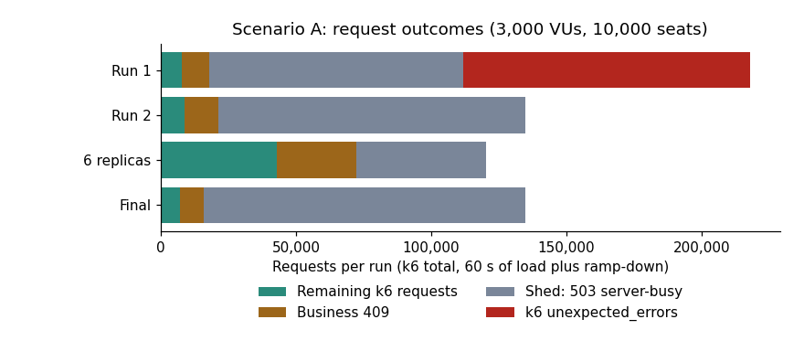
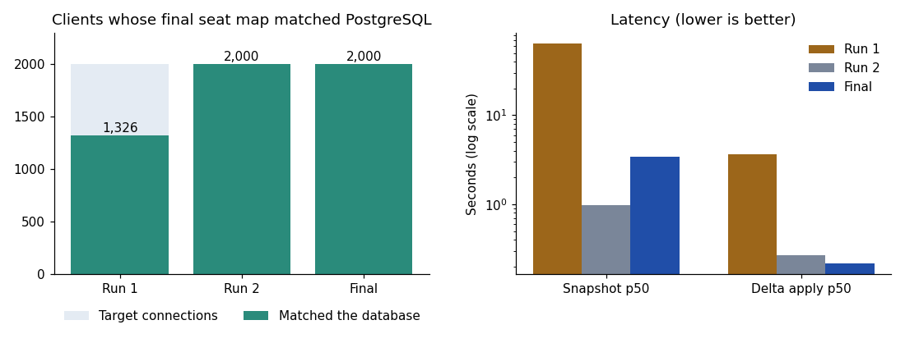

# 壓測與資源驗證

## 一、結論

- **正確性通過。** Scenario A 無超賣，一致性 SQL 回傳 0 列，HTTP 502／500 各 0。Scenario B 寫入期間同時在線峰值達 2,000，最終 2,000／2,000 個 client 與 PostgreSQL 一致。[一致性 SQL 輸出][a-sql] · [nginx][a-nginx] · [SSE client][b-sse]
- **容量。** 3,000 VUs 搶 10,000 席時，88.1% 的請求收到 `503 server-busy`。排空後占席 8,078／10,000，已付款 237 筆。k6 自我檢查判定 **FAILED**。[測試參數][env] · [nginx][a-nginx] · [最終庫存][a-state] · [執行紀錄][run]
- **瓶頸。** A 的延遲中位數接近 DB pool 取用上限；B 的 client 仍頻繁因進度停滯而重連。見 [瓶頸分析](#7-瓶頸分析)。[k6][a-k6] · [DB pool 設定](backend/src/ticketing/core/settings.py#L34) · [SSE client][b-sse]

## 二、怎麼判斷成功或失敗

| 類別 | 標準 |
| --- | --- |
| **① 正確性** | A 無超賣，一致性 SQL 回傳 0 列，502／500 各 0。B 同時在線達 2,000 條，所有 client 最終與 PostgreSQL 相符，待推送事件與封存差異各 0。 |
| **② 容量與體驗** | 記錄吞吐、p50／p95／p99 延遲、過載拒絕比例與推送延遲，依機器和副本數解讀。 |
| **③ k6 自我檢查** | 每筆抽樣重放都須驗證為原訂單，`unexpected_errors` 須為 0。 |

**名詞**

- **503 server-busy**：DB pool 取用預設最多等 1 秒，逾時即回可重試的 503。重送建單時沿用原本的 Idempotency-Key。[DB pool 設定](backend/src/ticketing/core/settings.py#L34) · [取用連線](backend/src/ticketing/core/db.py#L39) · [重放邏輯](loadtest/scenario_a.js#L132)
- **409 業務衝突**：例如座位已被搶走，或買家達到 4 張限購。[建單流程](loadtest/scenario_a.js#L191)
- **非預期錯誤**：由 k6 依回應狀態與業務代碼分類，例如 client timeout。[分類規則](loadtest/scenario_a.js#L77)

## 三、結果總表

### ① 正確性

| 標準 | 目標 | 結果 | 證據 |
| --- | ---: | ---: | --- |
| A 同一座位被賣兩次 | 0 | ✅ 0 | [一致性 SQL 輸出][a-sql] |
| A 排空後一致性 SQL 異常列 | 0 | ✅ 0 | [一致性 SQL 輸出][a-sql] |
| A HTTP 502／500 | 0／0 | ✅ 0／0 | [nginx][a-nginx] |
| B 寫入期間同時在線 | 2,000 | ✅ 2,000 | [SSE client][b-sse] |
| B 最終與 PostgreSQL 一致 | 2,000 | ✅ 2,000 | [SSE client][b-sse] |
| B 待推送事件／封存差異 | 0／0 | ✅ 0／0 | [SSE client][b-sse] |

### ② 容量與體驗

| 指標 | 結果 | 證據 |
| --- | --- | --- |
| A HTTP 請求數／吞吐 | 134,834／2,072.6 req/s | [k6][a-k6] |
| A HTTP p50／p95／p99 | 1.05／2.02／2.64 s | [k6 終端摘要][run] · [原始毫秒數][a-k6] |
| A 過載 503／建單 409 | 118,817（88.1%）／9,010 | [nginx][a-nginx] |
| A 排空後占席／已付款訂單 | 8,078／10,000 席；237 筆 | [最終庫存][a-state] |
| B 快照 p50 | 3.42 s | [SSE client][b-sse] |
| B delta 套用 p50／p95／p99 | 216／3,070／7,750 ms | [SSE client][b-sse] |
| B 串流嘗試（含重連）／進度停滯／resync | 21,279／19,229／33 | [SSE client][b-sse] |

### ③ k6 自我檢查

| 檢查 | 結果 | 證據 |
| --- | --- | --- |
| 每筆抽樣重放均成功驗證 | ❌ 發起 74 筆、驗證 46 筆，皆回原訂單；28 筆用完 10 次嘗試仍回過載 503 | [k6][a-k6] · [執行紀錄][run] · [重放邏輯](loadtest/scenario_a.js#L132) |
| `unexpected_errors` 為 0 | ❌ 63 筆，對應 nginx 的 499 | [k6][a-k6] · [nginx][a-nginx] |
| k6 判定 | **FAILED**，`replay_unverified` 與 `unexpected_errors` 未達門檻。Runner 另報 `replays started and verified differ` | [執行紀錄][run] |

### 其他資源指標

| 標準（題目要求） | 結果 | 證據 |
| --- | --- | --- |
| 100,000 列座位匯入在 60 秒內完成 | ✅ 完整服務閒置時 CSV 11.6–15.6 秒、JSON 17.0–22.2 秒；同時跑完整測試套件時 CSV 21.0 秒、JSON 47.8 秒 | [匯入實測](docs/evidence/import-100k.md) |
| 500,000 筆訂單 Excel 在 512 MB 記憶體上限內完成匯出 | ✅ 217 秒、程式記憶體峰值約 108 MiB、無 OOM | [Excel 實測](docs/evidence/cp4-excel-500k.md) |

## 四、圖

[請求結果](docs/evidence/charts/a-request-outcomes.png) · [座位庫存](docs/evidence/charts/a-seat-inventory.png) · [A 秒級指標](docs/evidence/charts/a-per-second.png) · [SSE 收斂與延遲](docs/evidence/charts/b-sse.png)。圖表由 [charts.py](loadtest/charts.py) 讀取原始輸出產生，並列於[附錄圖表](#對照圖)。

## 1. 測試機器與方法

| 項目 | 設定 | 證據 |
| --- | --- | --- |
| 日期／commit | 2026-11-22（台北）／`346fe0f` | [環境與映像 digest][env] |
| 桌機 | AMD Ryzen 5 5600、12 執行緒、WSL2 可見約 16 GB RAM | [環境][env] |
| 容器 | Docker Desktop Engine 29.9.3、Compose v5.7.0、3 個 API 副本 | [環境][env] |
| Scenario A | 3,000 VUs、60 秒、單一活動 10,000 席 | [環境][env] · [執行紀錄][run] |
| Scenario B | 同一活動 2,000 條 SSE 連線、80 秒、writer 目標 100 changes/s | [環境][env] · [執行紀錄][run] |

產壓工具與服務共用桌機，經 Compose network 呼叫 nginx。A 使用 k6，B 使用專案 API image 內的 Python writer 與 SSE client，各情境獨立建立活動。[Runner](loadtest/run.sh#L103)

## 2. Scenario A

準備腳本經 API 建立、匯入並發布活動，在 PostgreSQL 預建買家 session。k6 以 `constant-vus` 產壓，每次抽 1–4 張，約 70% 指定席、30% 區域配位。成功鎖位後約 80% 嘗試付款、10% 取消、10% 保留到期，另抽約 2% 以原請求與 Idempotency-Key 驗證重放。觸及限購後，確認已持有 4 張的 VU 改查訂單。[準備腳本](loadtest/prepare_a.py) · [A 腳本](loadtest/scenario_a.js)

| HTTP 結果 | 請求數 | 證據 |
| --- | ---: | --- |
| 2xx | 6,944 | [nginx][a-nginx] |
| 409 | 9,010 | [nginx][a-nginx] |
| 503 `server-busy` | 118,817（88.1%） | [nginx][a-nginx] · [k6][a-k6] |
| 499 | 63（0.047%），建單 `POST /api/v1/events/{id}/orders` 55 筆、付款 8 筆 | [nginx][a-nginx] |
| 502／500 | 0／0 | [nginx][a-nginx] |

k6 的 63 筆 `unexpected_errors` 對應 client 等滿 5 秒後斷線的 nginx 499。k6 記錄 3,940 筆成功鎖位，含重放在內的建單 201 共 3,986 筆。每秒請求、錯誤與延遲可跟鎖位、付款、取消等業務指標對照。[k6][a-k6] · [請求 timeout](loadtest/scenario_a.js#L77) · [nginx][a-nginx] · [秒級 HTTP][a-metrics] · [秒級業務][a-business]

排空 90 秒後的資料庫快照。[執行紀錄][run] · [最終狀態][a-state]

| 訂單狀態 | 訂單 | 票 |
| --- | ---: | ---: |
| `pending_payment` | 3,652 | 7,640 |
| `paid` | 237 | 438 |
| `cancelled` | 52 | 95 |

| 座位狀態 | 席 |
| --- | ---: |
| `available` | 1,922 |
| `held` | 7,640 |
| `sold` | 438 |

`held` 等於待付款票數，`sold` 等於已付款票數，座位合計 10,000 席。[最終狀態][a-state]

## 3. Scenario B

Client 預建獨立 session，分 8 個程序取得快照後訂閱，連線在前 10 秒逐步啟動。達同時連線目標後，writer 切換座位狀態與版本，走正式 transactional outbox。Delta 延遲從 frame 內最早的 outbox `created_at` 算到 client 套用，含提交前剩餘時間。[環境][env] · [SSE client][b-sse] · [Runner](loadtest/run.sh#L147) · [Writer](loadtest/scenario_b_writer.py) · [Client 量測](loadtest/sse_client.py)

| 指標 | 結果 | 證據 |
| --- | --- | --- |
| 已建立連線／目標 | 2,000／2,000 | [SSE client][b-sse] |
| 寫入期間同時在線峰值 | 2,000 | [SSE client][b-sse] |
| Writer 寫入／實測速率 | 5,504 次／99.5 changes/s | [Writer][b-writer] |
| 建連 p50／p95／p99（ms） | 687／2,360／4,170 | [SSE client][b-sse] |
| 快照 p50／p95／p99（ms） | 3,420／8,240／8,640 | [SSE client][b-sse] |
| Delta 套用 p50／p95／p99（ms） | 216／3,070／7,750（789,776 筆樣本） | [SSE client][b-sse] |
| `stream_attempts`／`stream_request_errors` | 21,279／17（0.08%，分母含重連） | [SSE client][b-sse] |
| `resyncs`／`stalled_progress`／`gaps` | 33／19,229／19,229 | [SSE client][b-sse] |
| `matching_clients` | 2,000 | [SSE client][b-sse] |
| `outbox_pending`／`archive_mismatches` | 0／0 | [SSE client][b-sse] |

## 4. 座位匯入

| 項目 | 結果 | 量測起訖 |
|---|---|---|
| 10,000 列 CSV | **1.6 秒**（最終 run 的 Scenario A 準備階段） | 從上傳到讀取 job 成功終態。[執行紀錄][run] · [準備腳本](loadtest/prepare_a.py#L96) |
| 100,000 列 CSV | 完整服務閒置 **11.6–15.6 秒**；同時跑完整測試套件 21.0 秒；整合測試（隔離資料庫）15.14 秒（門檻 60 秒） | 先產檔才開始計時。完整服務經 nginx 上傳，整合測試直接呼叫 API；兩者都計到 worker 完成、讀到終態。 |
| 100,000 列 JSON | 完整服務閒置 **17.0–22.2 秒**；同時跑完整測試套件 47.8 秒；整合測試（隔離資料庫）15.35 秒（門檻 60 秒） | 同上，各格式獨立執行。 |

2026-11-22 以目前程式在開發筆電量測：完整服務的閒置與資源競爭兩種情境，以及隔離資料庫的整合測試，量測紀錄見 [10 萬列匯入實測](docs/evidence/import-100k.md)。兩種量測都確認 job 回報及 PostgreSQL 實際座位數都為 100,000。見 [test_import_100k_under_60s](backend/tests/imports/test_import_perf.py)（`backend/tests/imports/test_import_perf.py:17–36`）。可在已備妥 PostgreSQL 整合測試環境執行 `uv run pytest -s backend/tests/imports/test_import_perf.py`，或透過 `make test` 跑 Compose 測試。檔案上限及列數預設見 `backend/src/ticketing/core/settings.py:89–90`。

## 5. Excel 匯出

在 Intel MacBook 與 Docker Desktop VM 上，以 `scripts/seed_orders_500k.sql` 灌入 **500,000** 筆訂單，以 Admin 經 nginx 呼叫 `GET /api/v1/events/{event_id}/reports/sales.xlsx?tz=Asia/Taipei`，完成下載後用 openpyxl read-only 驗證。三個 API 副本均驗證 cgroup 的 512 MiB 上限。見 `backend/src/ticketing/api/routes/reports.py:124`、`compose.yaml:122` 及 [Excel 匯出原始量測](docs/evidence/cp4-excel-500k.md)。

| 項目 | 實測 |
|---|---|
| HTTP／下載時間 | 200。首次 **217.3 秒**，第二次 **236.5 秒**（含取樣開銷）。 |
| 匯出副本 cgroup 上限 | 536,870,912 bytes。 |
| 匯出副本匿名記憶體 `anon` 峰值 | **113,000,448 bytes（約 108 MiB）**。 |
| 同副本 `memory.current`／`file` 峰值 | 536,842,240／416,047,104 bytes。每 0.2 秒取樣，`file` 包含可回收 page cache。 |
| OOM／重啟 | 三副本 `OOMKilled=false`、`RestartCount=0`。 |
| 檔案驗證 | 33,419,621 bytes。含 `Summary`、`Zones`、`Orders`，明細 500,000 列，表頭標示 `Asia/Taipei`，金額以數值存放。 |

匯出使用 server-side cursor 每批 5,000 列與 xlsxwriter `constant_memory`，暫存檔寫入容器掛載的 export volume。nginx 報表專用 `proxy_read_timeout` 為 300 秒。匯出量測涵蓋單次匯出與檔案驗證。倉庫另有要求 cgroup `memory.peak` 的 opt-in 測試，這次用 cgroup v2 取樣。見 `backend/src/ticketing/reports/sales.py:30`、`backend/src/ticketing/reports/sales.py:289`、`compose.yaml:118`、`infra/nginx/nginx.conf:151`、`backend/tests/reports/test_export_memory.py:22`。

## 6. 一致性檢查

Scenario A 排空 90 秒後，對該活動執行 `loadtest/consistency.sql`。輸出為空，代表 0 列違規。預設 hold TTL 是 600 秒，當時仍可有有效鎖位。SQL 核對活動與庫存、座位唯一占用、訂單明細與金額、買家配額、鎖位期限、付款及退款帳本、滯留工作、冪等重放紀錄、outbox 序號與封存。[執行紀錄][run] · [一致性 SQL 輸出][a-sql] · [SQL](loadtest/consistency.sql) · [Hold TTL](compose.yaml#L22)

Scenario B 將每條連線的游標、版面版本、座位索引、狀態與版本和同一份 PostgreSQL 快照比對，另查待推送事件與封存差異。[SSE client][b-sse] · [稽核實作](loadtest/sse_client.py)

A 排空後可重跑 SQL。將 `EVENT_ID` 設為 `a/event.json` 的活動 ID，`SEATS` 設為該輪預期庫存。

```bash
docker compose exec -T postgres psql -XAt -U ticketing -d ticketing \
  -v event_id="${EVENT_ID:?set EVENT_ID}" -v expected_seats="${SEATS:-10000}" \
  -f - < loadtest/consistency.sql
```

## 7. 瓶頸分析

- **A。** k6 p50 為 1.05 秒，與 DB pool 預設 1 秒的取用預算相近。受保護請求驗證 session 時也需取用 DB 連線，逾時會回 `503 server-busy`。本輪觀察到連線池壓力，秒級 HTTP 與業務資料可定位拒絕及交易進度，尚無本輪 CPU 取樣可確認 API 或 PostgreSQL 的 CPU 飽和程度。[k6 終端摘要][run] · [秒級 HTTP][a-metrics] · [秒級業務][a-business] · [Session 讀取](backend/src/ticketing/api/security.py#L104) · [DB pool](backend/src/ticketing/core/db.py#L39)
- **服務日誌。** Runner 記錄 63 行 warning／error。依[服務日誌原始輸出](docs/evidence/loadtest-final-20261122/logs/)分類，包含 28 行 `telemetry.watchdog_failed`、26 行 `telemetry.registry_failed`、8 行 `auth.refresh_failed` 及 1 行 `telemetry.collector_job_failed`。前兩類在尖峰以 `ProblemError` 回報，telemetry 的 DB 工作也受同一 pool 取用上限約束。留存的執行紀錄只列總數。[執行紀錄][run] · [Watchdog](backend/src/ticketing/telemetry/alerts.py#L235) · [Registry](backend/src/ticketing/telemetry/api_setup.py#L58)
- **B。** Client 偵測進度停滯後會主動重連。Delta p99 為 7.75 秒，最後全部收斂；待推送事件與封存差異皆為 0。[SSE client][b-sse] · [重連邏輯](loadtest/sse_client.py#L232)
- **匯入與 Excel。** 匯入計時涵蓋 worker 作業及終態回報。Excel 的 `memory.current` 峰值接近上限，包含可回收的 page cache。[匯入實測](docs/evidence/import-100k.md) · [Excel 實測](docs/evidence/cp4-excel-500k.md)

## 8. 重現指令與產物

使用可拋棄的 Compose 堆疊，於 repo root 執行。Runner 會檢查既有服務；若服務未就緒則以 Compose 建置並啟動。以下正式指令依本輪參數指定副本數與規模，`a`、`b` 亦可獨立執行。[Runner](loadtest/run.sh) · [環境][env]

```bash
loadtest/run.sh smoke
REBUILD=1 API_REPLICAS=3 VUS=3000 DURATION=60s SEATS=10000 \
  CONNECTIONS=2000 B_DURATION=80 B_RATE=100 SSE_RAMP=10 loadtest/run.sh all
```

`SSE_PROCESSES` 可覆寫 client 程序數，`K6_CPUS` 可限制 A 的產壓容器 CPU。資源配額、連接埠、輸出路徑與其他設定見[壓測工具包](loadtest/README.md)。

| 產物 | 用途 |
| --- | --- |
| `environment.txt`、`run.log` | 規格、映像、參數與失敗項目。 |
| `a/k6-summary.json`、`a/k6.log`、`a/nginx-access.json` | HTTP 吞吐、延遲、重放與狀態分布。 |
| `a/metrics_1s.csv`、`a/business_1s.csv`、`a/event.json` | 秒級 HTTP、業務指標與活動 ID。 |
| `a/consistency.txt`、`a/final-state.txt` | 排空後 SQL 異常列與訂單／座位統計。 |
| `b/seed.txt`、`b/writer.txt`、`b/sse-client.txt` | 活動、寫入、連線與最終稽核。 |

產物寫入 `loadtest/out/<timestamp>/`；進入打包步驟時會移除 `sessions.json`。Runner 會彙整門檻與稽核失敗，在終端與 `run.log` 列出失敗項目並以非零狀態結束。本輪留存輸出見[最終 run 證據](docs/evidence/loadtest-final-20261122/)。

## 附錄：改進歷程

| 輪次 | 發現 | 修正 | 驗證 |
| --- | --- | --- | --- |
| 第 1 輪 | nginx 在過載時把 3 個 API 副本暫時移出 upstream，出現 104,136 筆 502（commit `f089de4`） | `max_fails=0`，對齊 upstream keepalive | 第 2 輪 502 為 0。[第 1 輪 k6][r1-k6] · [第 2 輪 nginx][r2-nginx] |
| 第 1 輪 | 付款輪詢落後，排空後一致性 SQL 有 205 列 | 提高對帳預算與並行度 | 第 2 輪 SQL 回傳 0 列。[第 1 輪 SQL](docs/evidence/loadtest-run1-20261121/a/consistency.txt) · [第 2 輪 SQL](docs/evidence/loadtest-run2-20261121/a/consistency.txt) |
| 第 1 輪 | SSE 大量重連，只有 1,326／2,000 個 client 收斂 | 放寬 session 撤銷檢查預算，client 分 8 程序；寫入目標由 300 調至 100 changes/s | 第 2 輪 2,000／2,000 收斂。[第 1 輪 SSE](docs/evidence/loadtest-run1-20261121/b/sse-client.txt) · [第 2 輪 SSE][r2-sse] · [寫入設定](docs/evidence/loadtest-run1-20261121/environment.txt) |
| 第 2 輪 | 3 個副本時約 84% 的請求回 503 | 增至 6 個 API 副本 | 503 降至約 40%，10,000 席全占用，SQL 仍為 0 列。[第 2 輪 k6][r2-k6] · [6 副本 k6][r3-k6] · [庫存][r3-state] · [SQL][r3-sql] |
| 第 2 輪至最終 run | 以相同測試路徑追蹤過載和 SSE 表現 | 後續修正包含新增逐請求的 `request.completed` 日誌 | 503 比例約 84% → 88%，499 為 6 → 63；B delta p99 為 16.6 → 7.75 秒，快照 p50 為 0.98 → 3.42 秒。逐請求日誌可能影響負載，本次未單獨量測其影響。[第 2 輪 k6][r2-k6] · [第 2 輪 nginx][r2-nginx] · [最終 nginx][a-nginx] · [第 2 輪 SSE][r2-sse] · [最終 SSE][b-sse] · [日誌實作](backend/src/ticketing/api/middleware.py#L91) |

**6 副本擴充。** 同一台桌機以第 2 輪 commit `5be8721` 重跑 A，付款完成訂單由 263 增至 1,127。單一時點 CPU 截圖可用來追蹤壓力是否轉向 PostgreSQL；付款路徑也仍有 499，兩者都待獨立量測。[第 2 輪庫存](docs/evidence/loadtest-run2-20261121/a/final-state.txt) · [6 副本環境](docs/evidence/loadtest-run3-6replicas-20261121/environment.txt) · [庫存][r3-state] · [nginx](docs/evidence/loadtest-run3-6replicas-20261121/a/nginx-summary.txt) · [CPU 擷圖](docs/evidence/loadtest-run3-6replicas-20261121/docker-stats-during-a.png) · [監控畫面](docs/evidence/loadtest-run3-6replicas-20261121/monitoring-during-a.png)

原始輸出見[第 1 輪](docs/evidence/loadtest-run1-20261121/) · [第 2 輪](docs/evidence/loadtest-run2-20261121/) · [6 副本](docs/evidence/loadtest-run3-6replicas-20261121/)。

### 對照圖



請求數採 k6 計數，綠色為總數扣除業務 409、過載 503 與 `unexpected_errors` 後的其餘請求。


只取 nginx 每秒超過 100 個請求的秒數，並從各輪第一個符合條件的秒數起算。[最終秒級 HTTP][a-metrics] · [6 副本秒級 HTTP](docs/evidence/loadtest-run3-6replicas-20261121/a/metrics_1s.csv)



[env]: docs/evidence/loadtest-final-20261122/environment.txt
[run]: docs/evidence/loadtest-final-20261122/run-log.txt
[a-k6]: docs/evidence/loadtest-final-20261122/a/k6-summary.json
[a-nginx]: docs/evidence/loadtest-final-20261122/a/nginx-summary.txt
[a-sql]: docs/evidence/loadtest-final-20261122/a/consistency.txt
[a-state]: docs/evidence/loadtest-final-20261122/a/final-state.txt
[a-metrics]: docs/evidence/loadtest-final-20261122/a/metrics_1s.csv
[a-business]: docs/evidence/loadtest-final-20261122/a/business_1s.csv
[b-sse]: docs/evidence/loadtest-final-20261122/b/sse-client.txt
[b-writer]: docs/evidence/loadtest-final-20261122/b/writer.txt
[r1-k6]: docs/evidence/loadtest-run1-20261121/a/k6-summary.json
[r2-k6]: docs/evidence/loadtest-run2-20261121/a/k6-summary.json
[r2-nginx]: docs/evidence/loadtest-run2-20261121/a/nginx-summary.txt
[r2-sse]: docs/evidence/loadtest-run2-20261121/b/sse-client.txt
[r3-k6]: docs/evidence/loadtest-run3-6replicas-20261121/a/k6-summary.json
[r3-state]: docs/evidence/loadtest-run3-6replicas-20261121/a/final-state.txt
[r3-sql]: docs/evidence/loadtest-run3-6replicas-20261121/a/consistency.txt
