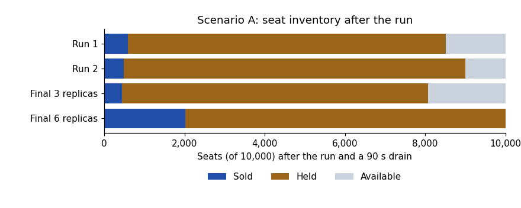
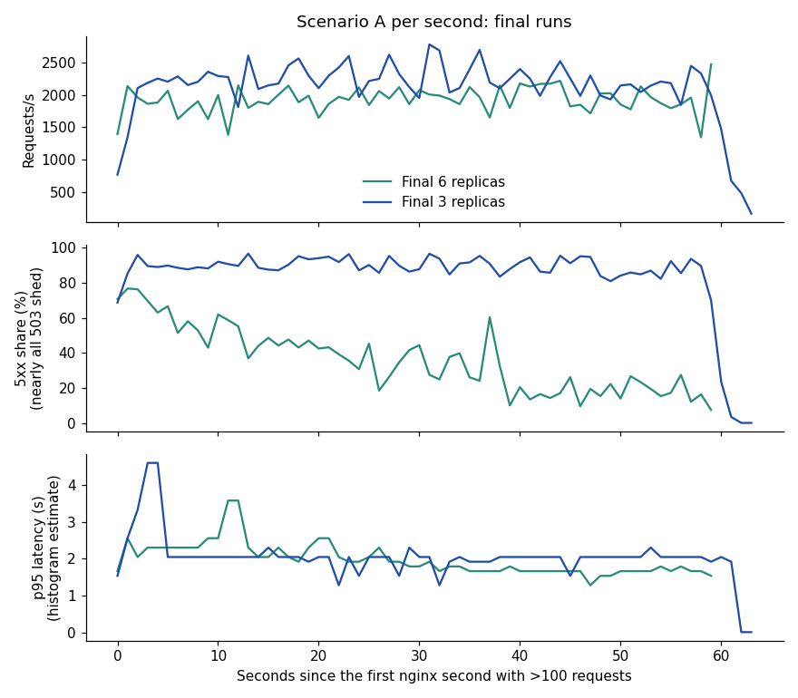

# 壓測與資源驗證

## 一、結論（先看這裡）

| 問題 | 答案 |
| --- | --- |
| 系統在搶票尖峰時會不會賣錯票？ | **這兩次最終壓測都沒有。** 都沒有超賣，壓測後的一致性檢查 0 筆異常，伺服器錯誤（502／500）為 0。 |
| 2,000 個即時連線看到的座位圖對不對？ | **對。** 2,000 個客戶端最後全部和資料庫一致。 |
| 撐得住 3,000 人同時搶嗎？ | **6 個 API 副本時，壓測結束並排空後 1 萬個座位全部被占用**（7,976 席鎖位中、2,024 席已售出），35% 的請求被系統主動以「503 忙碌中，請稍後重試」擋下；3 個副本時擋下 88%、占用 8,078 席。增加副本能明顯提高處理量。 |
| k6 為什麼顯示 FAILED？ | 那是壓測腳本自己設的**嚴格自我檢查**。6 副本只有一項沒過：有回應無法歸類為成功、正常業務結果或可重試的重送閘道錯誤（例如 5 秒內等不到回應），k6 記到 620 筆（0.53%），nginx 同期在付款路徑記到 598 筆客戶端斷線。3 副本另有一項：74 筆抽樣重送中 28 筆重試 10 次都被 503 擋下、沒機會驗證（驗證到的 46 筆全部正確）。兩次**伺服器都沒有回 502／500，資料也沒有錯誤**。詳見[第三節](#三怎麼判斷成功或失敗k6-的-failed-是什麼意思)。 |
| 下一個瓶頸在哪？ | 最可能是付款路徑：6 副本時 nginx 記到的 598 筆客戶端斷線全部在付款相關請求（548 筆建立付款、50 筆模擬金流確認），而模擬金流服務只有單一程序。這次沒有逐元件的等待時間量測，確切排隊位置仍待進一步量測。 |

兩次最終壓測都在同一台桌機、同一版程式（commit `346fe0f`）、同樣的壓測參數，刻意改變的只有 API 副本數。兩次都由壓測腳本以 `docker compose up -d --build` 重新建置並啟動，映像 digest 不同但原始碼相同，因此結果差異仍可能含建置與機器狀態的變動。[6 副本環境][env6] · [3 副本環境][env3]

## 二、兩個情境在測什麼

題目指定兩個情境，規模照題目，不縮減：

| | **情境 A：搶票** | **情境 B：即時座位推送** |
| --- | --- | --- |
| 題目要求 | 單一活動 10,000 個座位，3,000 個虛擬使用者持續搶購 60 秒 | 2,000 條即時連線同時訂閱同一個活動 |
| 模擬什麼 | 開賣瞬間大量買家同時下單、付款 | 大量買家開著座位圖頁面，看到別人買走座位時畫面即時更新 |
| 工具 | k6（`loadtest/scenario_a.js`） | 自寫的 Python SSE 客戶端（`loadtest/sse_client.py`，分 8 個程序）＋寫入程式（`loadtest/scenario_b_writer.py`） |
| 每個使用者做什麼 | 每個虛擬使用者是一個已登入的不同買家，重複：①下單 1–4 張（70% 指定座位、30% 只指定區域由系統配位）→ ②成功的話 80% 去付款（建立付款 → 模擬金流確認 → 最多輪詢 12 次直到訂單變「已付款」）、10% 取消、10% 放著不付 → ③收到限購回應且確認已持有 4 張後，改成只瀏覽訂單。2% 的成功訂單會用同一個 Idempotency-Key 再送一次，檢查不會重複下單 | 8 個客戶端程序各自先抓一次完整座位快照，再把 2,000 條 SSE 連線在 10 秒內逐步建立（每條連線從該快照開始），之後接收增量更新；斷線或停滯時先用最後收到的事件編號（Last-Event-ID）重新連線補收，伺服器判定補不回來（resync）時才重新抓快照；寫入程式以每秒 100 次的速度改變座位狀態，持續約 55 秒 |
| 時間 | 60 秒（k6 再給最多 90 秒讓進行中的迭代收尾） | 80 秒，最後給 20 秒讓推送送完 |
| 結束後檢查 | 等 90 秒讓付款與推送處理完，再跑一致性 SQL（`loadtest/consistency.sql`） | 比對每個客戶端最後看到的座位狀態與資料庫是否完全相同 |
| 一鍵執行 | `API_REPLICAS=6 loadtest/run.sh all`：先跑完 A（含排空與一致性檢查），再接著跑 B，兩者依序執行、不會同時壓 | 同左；只跑 B 用 `loadtest/run.sh b` |

## 三、怎麼判斷成功或失敗（k6 的 FAILED 是什麼意思）

題目要求報告 RPS、延遲、錯誤率與壓測後的一致性，**沒有給數字門檻**。本專案把標準分成三類，**只有第①類不通過才代表系統有問題**：

| 類別 | 標準 | 不通過代表什麼 |
| --- | --- | --- |
| **① 正確性（必須通過）** | 沒有座位被賣兩次；一致性 SQL 0 列；HTTP 502／500 為 0；2,000 個即時客戶端最後都和資料庫一致；待推送事件（outbox）0 筆、封存比對差異 0 筆 | **真正的失敗**：賣錯票、資料不一致、伺服器錯誤 |
| **② 容量與體驗（記錄）** | 每秒請求數、p50／p95／p99 延遲、被 503 擋下的比例、推送延遲 | 沒有對錯，依機器與副本數解讀，用來找瓶頸 |
| **③ k6 自我檢查（工具門檻）** | 見下表 | 視哪個門檻而定：`checks` 不過代表有重送沒通過驗證（拿到不同訂單、缺少重送標頭或回應無法解析），需要查明是否為正確性問題；**這兩次沒過的是 `unexpected_errors` 與 `replay_unverified`，代表有請求等太久、或抽樣重送沒機會驗證，沒有發現資料錯誤** |

### k6 的兩個門檻

k6 在壓測結束時檢查 `scenario_a.js` 設定的 4 個門檻（`unexpected_errors`、`replay_unverified`、`checks`、`replay_progress`），任何一個沒過就以非 0 結束，壓測腳本印出 `FAILED`。這兩次沒過的是下表兩個；`checks`（有拿到回應的重送，必須是 HTTP 201、帶重送標頭且訂單編號與原訂單相同）與 `replay_progress`（有抽樣時至少要驗證到一筆）兩次都通過：3 副本有回應的 46 筆、6 副本 98 筆全部通過這項檢查。

| 門檻 | 條件 | 這次為什麼沒過 |
| --- | --- | --- |
| `unexpected_errors: rate==0` | 每個回應被分成「成功（200／201）」、「正常的業務結果（已知代碼的 409、503 server-busy）」、「可重試的閘道錯誤（只限重送檢查遇到 502／504）」三類；**都不是就算非預期錯誤，只要有 1 筆就 FAILED** | 主要是請求在 k6 設定的 **5 秒逾時**內沒拿到回應，k6 放棄並記為非預期錯誤；nginx 把客戶端在收到回應前斷線的請求記為 499。6 副本：k6 記 620 筆，nginx 在付款路徑記 598 筆 499，兩邊各自計數、無法逐筆對應；3 副本：兩邊都是 63 筆 |
| `replay_unverified: count==0` | 抽樣的重送（同一個 Idempotency-Key 再送一次相同內容）遇到 503 server-busy、502 或 504 時依 `Retry-After` 重試，總共最多 10 次；**最後一次仍是 502／503／504，就沒有進入 `checks` 驗證，計為「未驗證」** | 3 副本時過載嚴重，74 筆抽樣中有 28 筆一直被擋、沒進入驗證，其餘 46 筆全部通過 `checks`；6 副本 98 筆全部進入驗證並通過，這項通過 |

**什麼情況下才是「真的失敗」**：第①類任一項不通過——例如一致性 SQL 有回傳列、出現 502／500、座位被賣兩次、重送拿到不同的訂單、即時客戶端最後和資料庫不同。這兩次最終壓測**都沒有發生**。

**為什麼不把門檻放寬讓它顯示 PASSED**：門檻設得嚴，任何逾時都會被看見；這次正是靠它看到：加副本之後，客戶端斷線集中出現在付款相關請求，成為下一個要量測的地方。

## 名詞解釋

| 名詞 | 意思 |
| --- | --- |
| **VU（虛擬使用者）** | k6 模擬的一個使用者，會不停重複「下單 → 付款／取消」的流程 |
| **API 副本** | 同一個後端程式跑幾份；nginx 把每個請求交給目前連線最少的副本（`least_conn`）。副本越多，同時能處理的請求越多 |
| **RPS** | 每秒請求數（requests per second） |
| **p50／p95／p99** | 延遲的百分位數：p95 = 2 秒代表 95% 的請求在 2 秒內完成，只有 5% 比較慢 |
| **503 server-busy** | 資料庫連線全滿時，每次取用連線最多等 1 秒，等不到就立刻回「請稍後重試」。這是刻意的**過載保護**，讓系統不會被壓垮；使用者重試時沿用同一個 Idempotency-Key，不會重複下單 |
| **409 業務衝突** | 正常的搶票結果：座位已被別人搶走、區域賣完、超過每人 4 張限購 |
| **499** | nginx 的記錄：客戶端在收到回應前就斷線了（這裡是 k6 等超過 5 秒放棄） |
| **502／500** | 閘道找不到後端、程式錯誤。這兩種才是伺服器真的出錯，兩次壓測都是 0 |
| **Idempotency-Key（冪等鍵）** | 客戶端每次下單附上的唯一編號；在保存期限內用同一個編號重送相同內容，伺服器回傳原本那筆訂單，不會建立第二筆 |
| **held／sold／available** | 座位狀態：鎖位中（已下單、等待付款，10 分鐘內沒付款會由背景工作自動釋放）／已售出／可購買 |
| **一致性 SQL** | 壓測後執行的檢查查詢，比對座位、訂單、付款、推送事件之間的關係；**回傳 0 列 = 完全一致** |
| **SSE** | Server-Sent Events，伺服器持續把座位變化推給瀏覽器的長連線 |
| **快照／delta** | 完整座位圖（快照）與之後的變化部分（delta）。瀏覽器打開座位頁時先抓快照；壓測客戶端每個程序只在啟動時抓一次。兩者斷線後都先用最後收到的事件編號重連補收，只有收到 resync 時才重新抓快照 |
| **resync／進度停滯** | 客戶端發現漏了事件或太久沒進度時，重新抓快照（resync）或重新連線，用來恢復到最新狀態；壓測最後比對每個客戶端與資料庫，有任何一個不同就判失敗（這兩次都是 2,000／2,000 一致） |
| **排空（drain）** | 流量停止後等 90 秒，讓付款回呼、逾時處理與推送全部做完，再做一致性檢查 |

## 四、結果總表

### ① 正確性

| 標準 | 目標 | 6 副本（建議） | 3 副本（基準） |
| --- | ---: | --- | --- |
| A 同一座位被賣兩次 | 0 | ✅ 0 [SQL][a-sql6] | ✅ 0 [SQL][a-sql3] |
| A 排空後一致性 SQL 異常列 | 0 | ✅ 0 [SQL][a-sql6] | ✅ 0 [SQL][a-sql3] |
| A HTTP 502／500 | 0／0 | ✅ 0／0 [nginx][a-nginx6] | ✅ 0／0 [nginx][a-nginx3] |
| B 寫入期間同時在線 | 2,000 | ✅ 2,000 [SSE][b-sse6] | ✅ 2,000 [SSE][b-sse3] |
| B 最終與 PostgreSQL 一致 | 2,000 | ✅ 2,000 [SSE][b-sse6] | ✅ 2,000 [SSE][b-sse3] |
| B 待推送事件／封存差異 | 0／0 | ✅ 0／0 [SSE][b-sse6] | ✅ 0／0 [SSE][b-sse3] |

### ② 容量與體驗

| 指標 | 6 副本（建議） | 3 副本（基準） |
| --- | --- | --- |
| A HTTP 請求數／吞吐 | 115,485／1,837.6 req/s [k6][a-k66] | 134,834／2,072.6 req/s [k6][a-k63] |
| A HTTP p50／p95／p99 | 1.06／2.03／4.05 s [k6][a-k66] | 1.05／2.02／2.64 s [k6][a-k63] |
| A nginx 503／建單 409 | 40,853（35.4%）／29,205 [nginx][a-nginx6] | 118,817（88.1%）／9,010 [nginx][a-nginx3] |
| A 排空後占席／已付款訂單 | 10,000／10,000 席，1,082 筆 [庫存][a-state6] | 8,078／10,000 席，237 筆 [庫存][a-state3] |
| B 快照取得 p50（8 個程序啟動時的快照請求，加上 resync 時的重抓；不是 2,000 個客戶端各自加入的時間） | 193 ms [SSE][b-sse6] | 3,420 ms [SSE][b-sse3] |
| B delta 套用 p50／p95／p99 | 175／2,750／9,450 ms [SSE][b-sse6] | 216／3,070／7,750 ms [SSE][b-sse3] |
| B 串流嘗試（含重連）／進度停滯／resync | 18,555／16,526／0 [SSE][b-sse6] | 21,279／19,229／33 [SSE][b-sse3] |

### ③ k6 自我檢查

| 檢查 | 6 副本（建議） | 3 副本（基準） |
| --- | --- | --- |
| 抽樣重放發起／驗證回原訂單／未驗證 | ✅ 98／98／0 [k6][a-k66] | ❌ 74／46／28 [k6][a-k63] |
| `unexpected_errors` 為 0 | ❌ 620 筆（k6 顯示 0.53%）[k6][a-k66] · [執行紀錄][run6] | ❌ 63 筆（k6 顯示 0.04%）[k6][a-k63] · [執行紀錄][run3] |
| k6 判定 | **FAILED**，僅 `unexpected_errors` 未達門檻。[執行紀錄][run6] | **FAILED**，`replay_unverified` 與 `unexpected_errors` 未達門檻。Runner 另報 `replays started and verified differ`。[執行紀錄][run3] |

基準輪有 28 筆重放用完 10 次嘗試仍回過載 503。[基準輪 k6][a-k63] · [基準輪執行紀錄][run3] · [重放邏輯](loadtest/scenario_a.js#L132-L152)

### 其他資源指標

| 標準（題目要求） | 結果 | 證據 |
| --- | --- | --- |
| 100,000 列座位匯入在 60 秒內完成 | ✅ 完整服務閒置時 CSV 11.6–15.6 秒、JSON 17.0–22.2 秒，同時跑完整測試套件時 CSV 21.0 秒、JSON 47.8 秒 | [匯入實測](docs/evidence/import-100k.md) |
| 500,000 筆訂單 Excel 在 512 MiB 記憶體上限內完成匯出 | ✅ 217 秒、程式記憶體峰值約 108 MiB、無 OOM | [Excel 實測](docs/evidence/cp4-excel-500k.md) |

## 五、圖

[請求結果](docs/evidence/charts/a-request-outcomes.png) · [座位庫存](docs/evidence/charts/a-seat-inventory.png) · [A 秒級指標](docs/evidence/charts/a-per-second.png) · [SSE 收斂與延遲](docs/evidence/charts/b-sse.png)。圖表由 [charts.py](loadtest/charts.py) 讀取原始輸出產生，並列於[附錄圖表](#對照圖)。

## 1. 測試機器與方法

| 項目 | 設定 | 證據 |
| --- | --- | --- |
| 日期／commit | 2026-11-22（台北）／`346fe0f` | [6 副本環境與映像 digest][env6] · [3 副本環境與映像 digest][env3] |
| 桌機 | AMD Ryzen 5 5600、12 執行緒、WSL2 可見約 16 GB RAM | [6 副本環境][env6] · [3 副本環境][env3] |
| 容器 | Docker Desktop Engine 29.9.3、Compose v5.7.0，分別啟動 6 與 3 個 API 副本 | [6 副本環境][env6] · [3 副本環境][env3] |
| Scenario A | 3,000 VUs、60 秒、單一活動 10,000 席 | [6 副本環境][env6] · [3 副本環境][env3] |
| Scenario B | 同一活動 2,000 條 SSE 連線、80 秒、writer 目標 100 changes/s | [6 副本環境][env6] · [3 副本環境][env3] |

題目固定 A、B 的規模與情境，API 副本數由部署決定。產壓工具與服務共用桌機，經 Compose network 呼叫 nginx。A 使用 k6，B 使用專案 API image 內的 Python writer 與 SSE client，各情境獨立建立活動。[Runner](loadtest/run.sh#L103)

## 2. Scenario A

準備腳本經 API 建立、匯入並發布活動，在 PostgreSQL 預建買家 session。k6 以 `constant-vus` 產壓，每次抽 1–4 張，約 70% 指定席、30% 區域配位。成功鎖位後約 80% 嘗試付款、10% 取消、10% 保留到期，另抽約 2% 以原請求與 Idempotency-Key 驗證重放。觸及限購後，確認已持有 4 張的 VU 改查訂單。[準備腳本](loadtest/prepare_a.py) · [A 腳本](loadtest/scenario_a.js)

| nginx HTTP 結果 | 6 副本（建議） | 3 副本（基準） |
| --- | --- | --- |
| 2xx | 44,829 [nginx][a-nginx6] | 6,944 [nginx][a-nginx3] |
| 409 | 29,205 [nginx][a-nginx6] | 9,010 [nginx][a-nginx3] |
| 503 | 40,853（35.4%）[nginx][a-nginx6] | 118,817（88.1%）[nginx][a-nginx3] |
| 499 | 598，`POST /api/v1/orders/{id}/payments` 548 筆、`POST /pay/:id` 50 筆 [nginx][a-nginx6] | 63，`POST /api/v1/events/{id}/orders` 55 筆、`POST /api/v1/orders/{id}/payments` 8 筆 [nginx][a-nginx3] |
| 502／500 | 0／0 [nginx][a-nginx6] | 0／0 [nginx][a-nginx3] |
| k6 成功鎖位 | 5,293 [k6][a-k66] | 3,940 [k6][a-k63] |

6 副本的 k6 共記錄 620 筆 `unexpected_errors`，對照 nginx 有 598 筆付款路徑的 499（client 在收到回應前斷線；k6 的請求逾時為 5 秒，最可能是逾時，但狀態碼本身無法逐筆證明）。3 副本的 `unexpected_errors` 和 nginx 499 同為 63 筆。k6 與 nginx 各自計數，付款摘要含模擬器路徑。[6 副本 k6][a-k66] · [6 副本 nginx][a-nginx6] · [3 副本 k6][a-k63] · [3 副本 nginx][a-nginx3] · [請求 timeout](loadtest/scenario_a.js#L77-L98)

每秒請求、錯誤與延遲可跟鎖位、付款、取消等業務指標對照。[6 副本秒級 HTTP][a-metrics6] · [6 副本秒級業務][a-business6] · [3 副本秒級 HTTP][a-metrics3] · [3 副本秒級業務][a-business3]

兩輪各排空 90 秒後讀取資料庫快照。[6 副本執行紀錄][run6] · [3 副本執行紀錄][run3]

| 訂單狀態（訂單／票） | 6 副本（建議） | 3 副本（基準） |
| --- | --- | --- |
| `pending_payment` | 3,959／7,976 [庫存][a-state6] | 3,652／7,640 [庫存][a-state3] |
| `paid` | 1,082／2,024 [庫存][a-state6] | 237／438 [庫存][a-state3] |
| `cancelled` | 253／499 [庫存][a-state6] | 52／95 [庫存][a-state3] |

| 座位狀態（席） | 6 副本（建議） | 3 副本（基準） |
| --- | --- | --- |
| `available` | 0 [庫存][a-state6] | 1,922 [庫存][a-state3] |
| `held` | 7,976 [庫存][a-state6] | 7,640 [庫存][a-state3] |
| `sold` | 2,024 [庫存][a-state6] | 438 [庫存][a-state3] |

兩輪 `held` 都等於待付款票數，`sold` 都等於已付款票數，座位各合計 10,000 席。6 副本的快照只列 `held` 與 `sold`，合計即為全部席位。[6 副本庫存][a-state6] · [3 副本庫存][a-state3]

## 3. Scenario B

Client 預建獨立 session，分 8 個程序取得快照後訂閱，連線在前 10 秒逐步啟動。達同時連線目標後，writer 切換座位狀態與版本，走正式 transactional outbox。Delta 延遲從 frame 內最早的 outbox `created_at` 算到 client 套用，含提交前剩餘時間。[環境][env6] · [SSE client][b-sse6] · [Runner](loadtest/run.sh#L147) · [Writer](loadtest/scenario_b_writer.py) · [Client 量測](loadtest/sse_client.py)

| 指標 | 6 副本（建議） | 3 副本（基準） |
| --- | --- | --- |
| 已建立連線／目標 | 2,000／2,000 [SSE][b-sse6] | 2,000／2,000 [SSE][b-sse3] |
| 寫入期間同時在線峰值 | 2,000 [SSE][b-sse6] | 2,000 [SSE][b-sse3] |
| Writer 寫入／實測速率 | 5,504 次／99.7 changes/s [Writer][b-writer6] | 5,504 次／99.5 changes/s [Writer][b-writer3] |
| 建連 p50／p95／p99（ms） | 317／2,820／3,600 [SSE][b-sse6] | 687／2,360／4,170 [SSE][b-sse3] |
| 快照 p50／p95／p99（ms） | 193／247／247 [SSE][b-sse6] | 3,420／8,240／8,640 [SSE][b-sse3] |
| Delta 套用 p50／p95／p99（ms） | 175／2,750／9,450（821,925 筆樣本）[SSE][b-sse6] | 216／3,070／7,750（789,776 筆樣本）[SSE][b-sse3] |
| `stream_attempts`／`stream_request_errors` | 18,555／29（0.16%，分母含重連）[SSE][b-sse6] | 21,279／17（0.08%，分母含重連）[SSE][b-sse3] |
| `resyncs`／`stalled_progress`／`gaps` | 0／16,526／16,526 [SSE][b-sse6] | 33／19,229／19,229 [SSE][b-sse3] |
| `matching_clients` | 2,000 [SSE][b-sse6] | 2,000 [SSE][b-sse3] |
| `outbox_pending`／`archive_mismatches` | 0／0 [SSE][b-sse6] | 0／0 [SSE][b-sse3] |

## 4. 座位匯入

| 項目 | 結果 | 量測起訖 |
|---|---|---|
| 10,000 列 CSV | **1.1 秒**（6 副本）／**1.6 秒**（3 副本） | 從上傳到讀取 job 成功終態。[6 副本執行紀錄](docs/evidence/loadtest-final-6replicas-20261122/run-log.txt#L497) · [3 副本執行紀錄](docs/evidence/loadtest-final-20261122/run-log.txt#L479) · [準備腳本](loadtest/prepare_a.py#L96) |
| 100,000 列 CSV | 完整服務閒置 **11.6–15.6 秒**，同時跑完整測試套件 21.0 秒，整合測試（隔離資料庫）15.14 秒（門檻 60 秒） | 先產檔才開始計時。完整服務經 nginx 上傳，整合測試直接呼叫 API，兩者都計到 worker 完成、讀到終態。 |
| 100,000 列 JSON | 完整服務閒置 **17.0–22.2 秒**，同時跑完整測試套件 47.8 秒，整合測試（隔離資料庫）15.35 秒（門檻 60 秒） | 同上，各格式獨立執行。 |

2026-11-22 以目前程式在開發筆電量測：完整服務的閒置與資源競爭兩種情境，以及隔離資料庫的整合測試，量測紀錄見 [10 萬列匯入實測](docs/evidence/import-100k.md)。兩種量測都確認 job 回報及 PostgreSQL 實際座位數都為 100,000。見 [test_import_100k_under_60s](backend/tests/imports/test_import_perf.py)（`backend/tests/imports/test_import_perf.py:17–36`）。可在已備妥 PostgreSQL 整合測試環境執行 `uv run pytest -s backend/tests/imports/test_import_perf.py`，或透過 `make test` 跑 Compose 測試。檔案上限及列數預設見 `backend/src/ticketing/core/settings.py:89–90`。

## 5. Excel 匯出

在 Intel MacBook 與 Docker Desktop VM 上，以 `scripts/seed_orders_500k.sql` 灌入 **500,000** 筆訂單，以 Admin 經 nginx 呼叫 `GET /api/v1/events/{event_id}/reports/sales.xlsx?tz=Asia/Taipei`，完成下載後用 openpyxl read-only 驗證。三個 API 副本均驗證 cgroup 的 512 MiB 上限。見 `backend/src/ticketing/api/routes/reports.py:124`、`compose.yaml:122` 及 [Excel 匯出原始量測](docs/evidence/cp4-excel-500k.md)。

| 項目 | 實測 |
|---|---|
| HTTP／下載時間 | 200。首次 **217.3 秒**，第二次 **236.5 秒**（含取樣開銷）。 |
| 匯出副本 cgroup 上限 | 536,870,912 bytes。 |
| 匯出副本匿名記憶體 `anon` 峰值 | **113,000,448 bytes（約 108 MiB）**。 |
| 同副本 `memory.current`／`file` 峰值 | 536,842,240／416,047,104 bytes。每 0.2 秒取樣，`file` 包含可回收 page cache。 |
| OOM／重啟 | 三副本 `OOMKilled=false`、`RestartCount=0`。 |
| 檔案驗證 | 33,419,621 bytes。含 `Summary`、`Zones`、`Orders`，明細 500,000 列，表頭標示 `Asia/Taipei`，金額以數值存放。 |

匯出使用 server-side cursor 每批 5,000 列與 xlsxwriter `constant_memory`，暫存檔寫入容器掛載的 export volume。nginx 報表專用 `proxy_read_timeout` 為 300 秒。匯出量測涵蓋單次匯出與檔案驗證。倉庫另有要求 cgroup `memory.peak` 的 opt-in 測試，這次用 cgroup v2 取樣。見 `backend/src/ticketing/reports/sales.py:30`、`backend/src/ticketing/reports/sales.py:289`、`compose.yaml:118`、`infra/nginx/nginx.conf:151`、`backend/tests/reports/test_export_memory.py:22`。

## 6. 一致性檢查

兩輪 Scenario A 各排空 90 秒後，對該活動執行 `loadtest/consistency.sql`。輸出為空，代表 0 列違規。預設 hold TTL 是 600 秒，當時仍可有有效鎖位。SQL 核對活動與庫存、座位唯一占用、訂單明細與金額、買家配額、鎖位期限、付款及退款帳本、滯留工作、冪等重放紀錄、outbox 序號與封存。[6 副本執行紀錄][run6] · [3 副本執行紀錄][run3] · [6 副本 SQL][a-sql6] · [3 副本 SQL][a-sql3] · [SQL](loadtest/consistency.sql) · [Hold TTL](compose.yaml#L22)

Scenario B 將每條連線的游標、版面版本、座位索引、狀態與版本和同一份 PostgreSQL 快照比對，另查待推送事件與封存差異。[6 副本 SSE][b-sse6] · [3 副本 SSE][b-sse3] · [稽核實作](loadtest/sse_client.py)

A 排空後可重跑 SQL。將 `EVENT_ID` 設為 `a/event.json` 的活動 ID，`SEATS` 設為該輪預期庫存。

```bash
docker compose exec -T postgres psql -XAt -U ticketing -d ticketing \
  -v event_id="${EVENT_ID:?set EVENT_ID}" -v expected_seats="${SEATS:-10000}" \
  -f - < loadtest/consistency.sql
```

## 7. 瓶頸分析

- **A。** 副本由 3 增至 6 後，nginx 503 由 88.1% 降至 35.4%，10,000 席全數占用。後續瓶頸量測聚焦付款路徑與 PostgreSQL。598 筆 nginx 499 都在付款路徑，付款模擬器以單一程序執行。兩輪 k6 p50 為 1.06／1.05 秒，接近 DB pool 取用上限 1 秒。受保護請求驗證 session 時也要取用連線。兩輪都缺少逐元件的 CPU 與等待時間取樣。[6 副本 nginx][a-nginx6] · [3 副本 nginx][a-nginx3] · [6 副本庫存][a-state6] · [6 副本 k6][a-k66] · [3 副本 k6][a-k63] · [付款模擬器](paymock/src/paymock/main.py#L334-L346) · [Session 讀取](backend/src/ticketing/api/security.py#L104) · [DB pool 設定](backend/src/ticketing/core/settings.py#L34)
- **服務日誌。** 6 副本有 67 行（66 行 warning、1 行 error）。API 有 31 行 `telemetry.watchdog_failed`、20 行 `telemetry.registry_failed`、1 行 `auth.refresh_failed`，collector 有 4 行 `telemetry.collector_job_failed`，relay 有 1 行 `service.tick_failed`，worker 有 2 行 `payment.reconcile_phase_failed`（`TimeoutError`）與 8 行 `payment.attempt_retry`。3 副本有 63 行 warning。API 依上述順序為 28／26／8 行，collector 1 行。[6 副本執行紀錄][run6] · [6 副本 API][log-api6] · [Collector][log-collector6] · [Relay][log-relay6] · [Worker][log-worker6] · [3 副本執行紀錄][run3] · [3 副本 API][log-api3] · [Collector][log-collector3]
- **B。** Client 偵測進度停滯後會主動重連。6 副本的快照 p50 與 delta p50 都較短，delta p99 為 9.45 秒，基準為 7.75 秒。兩輪最終全部收斂，待推送事件與封存差異皆為 0。[6 副本 SSE][b-sse6] · [3 副本 SSE][b-sse3] · [重連邏輯](loadtest/sse_client.py#L232)
- **匯入與 Excel。** 匯入計時涵蓋 worker 作業及終態回報。Excel 的 `memory.current` 峰值接近上限，包含可回收的 page cache。[匯入實測](docs/evidence/import-100k.md) · [Excel 實測](docs/evidence/cp4-excel-500k.md)

## 8. 重現指令與產物

使用可拋棄的 Compose 堆疊，於 repo root 執行。Runner 會檢查既有服務，若服務未就緒則以 Compose 建置並啟動。以下指令使用 Runner 的預設情境規模，依序列出建議配置與基準，`a`、`b` 亦可獨立執行。[Runner 預設值](loadtest/run.sh#L29-L31) · [6 副本環境][env6] · [3 副本環境][env3]

```bash
loadtest/run.sh smoke
API_REPLICAS=6 loadtest/run.sh all
API_REPLICAS=3 loadtest/run.sh all
```

`SSE_PROCESSES` 可覆寫 client 程序數，`K6_CPUS` 可限制 A 的產壓容器 CPU。資源配額、連接埠、輸出路徑與其他設定見[壓測工具包](loadtest/README.md)。

| 產物 | 用途 |
| --- | --- |
| `environment.txt`、`run.log` | 規格、映像、參數與失敗項目。 |
| `a/k6-summary.json`、`a/k6.log`、`a/nginx-access.json` | HTTP 吞吐、延遲、重放與狀態分布。 |
| `a/metrics_1s.csv`、`a/business_1s.csv`、`a/event.json` | 秒級 HTTP、業務指標與活動 ID。 |
| `a/consistency.txt`、`a/final-state.txt` | 排空後 SQL 異常列與訂單／座位統計。 |
| `b/seed.txt`、`b/writer.txt`、`b/sse-client.txt` | 活動、寫入、連線與最終稽核。 |

產物寫入 `loadtest/out/<timestamp>/`，進入打包步驟時會移除 `sessions.json`。Runner 會彙整門檻與稽核失敗，在終端與 `run.log` 列出失敗項目並以非零狀態結束。留存輸出見 [6 副本最終 run](docs/evidence/loadtest-final-6replicas-20261122/) · [3 副本基準](docs/evidence/loadtest-final-20261122/)。

## 附錄：改進歷程

| 輪次 | 發現 | 修正 | 驗證 |
| --- | --- | --- | --- |
| 第 1 輪 | nginx 在過載時把 3 個 API 副本暫時移出 upstream，歷史摘要記錄 104,136 筆 502 | `max_fails=0`，對齊 upstream keepalive（修正 commit `f089de4`） | 第 2 輪 502 為 0。第 1 輪的 502 數取自 Git 紀錄 `4d48a2c:LOADTEST.md:43`。[第 1 輪 k6][r1-k6] · [第 2 輪 nginx][r2-nginx] |
| 第 1 輪 | 付款輪詢落後，排空後一致性 SQL 有 205 列 | 提高對帳預算與並行度 | 第 2 輪 SQL 回傳 0 列。[第 1 輪 SQL](docs/evidence/loadtest-run1-20261121/a/consistency.txt) · [第 2 輪 SQL](docs/evidence/loadtest-run2-20261121/a/consistency.txt) |
| 第 1 輪 | SSE 大量重連，只有 1,326／2,000 個 client 收斂 | 放寬 session 撤銷檢查預算，client 分 8 程序，寫入目標由 300 調至 100 changes/s | 第 2 輪 2,000／2,000 收斂。[第 1 輪 SSE](docs/evidence/loadtest-run1-20261121/b/sse-client.txt) · [第 2 輪 SSE][r2-sse] · [寫入設定](docs/evidence/loadtest-run1-20261121/environment.txt) |
| 第 2 輪 | 3 個副本時約 84% 的請求回 503 | 以當時的 commit 增至 6 個 API 副本 | 503 降至約 40%，10,000 席全占用，SQL 仍為 0 列。[第 2 輪 k6][r2-k6] · [早期 6 副本 k6][r3-k6] · [庫存][r3-state] · [SQL][r3-sql] |
| 第 2 輪至 3 副本最終基準 | 以相同測試路徑追蹤過載和 SSE 表現 | 後續修正包含新增逐請求的 `request.completed` 日誌 | 503 比例約 84% → 88%，499 為 6 → 63，B delta p99 為 16.6 → 7.75 秒，快照 p50 為 0.98 → 3.42 秒。逐請求日誌可能影響負載，本次未單獨量測其影響。[第 2 輪 k6][r2-k6] · [第 2 輪 nginx][r2-nginx] · [最終基準 nginx][a-nginx3] · [第 2 輪 SSE][r2-sse] · [最終基準 SSE][b-sse3] · [日誌實作](backend/src/ticketing/api/middleware.py#L91) |

**歷史量測：早期 6 副本。** 同一台桌機以第 2 輪 commit `5be8721` 重跑 A，付款完成訂單由 263 增至 1,127。單一時點 CPU 截圖可用來追蹤壓力是否轉向 PostgreSQL，付款路徑也仍有 499，兩者都待獨立量測。[第 2 輪庫存](docs/evidence/loadtest-run2-20261121/a/final-state.txt) · [6 副本環境](docs/evidence/loadtest-run3-6replicas-20261121/environment.txt) · [庫存][r3-state] · [nginx](docs/evidence/loadtest-run3-6replicas-20261121/a/nginx-summary.txt) · [CPU 擷圖](docs/evidence/loadtest-run3-6replicas-20261121/docker-stats-during-a.png) · [監控畫面](docs/evidence/loadtest-run3-6replicas-20261121/monitoring-during-a.png)

原始輸出見[第 1 輪](docs/evidence/loadtest-run1-20261121/) · [第 2 輪](docs/evidence/loadtest-run2-20261121/) · [早期 6 副本](docs/evidence/loadtest-run3-6replicas-20261121/)。

### 對照圖


請求數採 k6 計數，綠色為總數扣除業務 409、過載 503 與 `unexpected_errors` 後的其餘請求。





兩次最終 run 只取 nginx 每秒超過 100 個請求的秒數，從各輪第一個符合條件的秒數起算。每秒 p95 為直方圖估計值。[6 副本秒級 HTTP][a-metrics6] · [3 副本秒級 HTTP][a-metrics3] · [估計方式](backend/src/ticketing/telemetry/metrics.py#L23-L25)


[env6]: docs/evidence/loadtest-final-6replicas-20261122/environment.txt
[env3]: docs/evidence/loadtest-final-20261122/environment.txt
[run6]: docs/evidence/loadtest-final-6replicas-20261122/run-log.txt
[run3]: docs/evidence/loadtest-final-20261122/run-log.txt
[a-k66]: docs/evidence/loadtest-final-6replicas-20261122/a/k6-summary.json
[a-k63]: docs/evidence/loadtest-final-20261122/a/k6-summary.json
[a-nginx6]: docs/evidence/loadtest-final-6replicas-20261122/a/nginx-summary.txt#L1-L20
[a-nginx3]: docs/evidence/loadtest-final-20261122/a/nginx-summary.txt#L1-L20
[a-sql6]: docs/evidence/loadtest-final-6replicas-20261122/a/consistency.txt
[a-sql3]: docs/evidence/loadtest-final-20261122/a/consistency.txt
[a-state6]: docs/evidence/loadtest-final-6replicas-20261122/a/final-state.txt#L3-L12
[a-state3]: docs/evidence/loadtest-final-20261122/a/final-state.txt#L3-L12
[a-metrics6]: docs/evidence/loadtest-final-6replicas-20261122/a/metrics_1s.csv
[a-metrics3]: docs/evidence/loadtest-final-20261122/a/metrics_1s.csv
[a-business6]: docs/evidence/loadtest-final-6replicas-20261122/a/business_1s.csv
[a-business3]: docs/evidence/loadtest-final-20261122/a/business_1s.csv
[b-sse6]: docs/evidence/loadtest-final-6replicas-20261122/b/sse-client.txt#L3
[b-sse3]: docs/evidence/loadtest-final-20261122/b/sse-client.txt#L3
[b-writer6]: docs/evidence/loadtest-final-6replicas-20261122/b/writer.txt#L1
[b-writer3]: docs/evidence/loadtest-final-20261122/b/writer.txt#L1
[log-api6]: docs/evidence/loadtest-final-6replicas-20261122/logs/api-problems.txt
[log-api3]: docs/evidence/loadtest-final-20261122/logs/api-problems.txt
[log-collector6]: docs/evidence/loadtest-final-6replicas-20261122/logs/collector-problems.txt
[log-collector3]: docs/evidence/loadtest-final-20261122/logs/collector-problems.txt
[log-relay6]: docs/evidence/loadtest-final-6replicas-20261122/logs/relay-problems.txt
[log-worker6]: docs/evidence/loadtest-final-6replicas-20261122/logs/worker-problems.txt
[r1-k6]: docs/evidence/loadtest-run1-20261121/a/k6-summary.json
[r2-k6]: docs/evidence/loadtest-run2-20261121/a/k6-summary.json
[r2-nginx]: docs/evidence/loadtest-run2-20261121/a/nginx-summary.txt
[r2-sse]: docs/evidence/loadtest-run2-20261121/b/sse-client.txt
[r3-k6]: docs/evidence/loadtest-run3-6replicas-20261121/a/k6-summary.json
[r3-state]: docs/evidence/loadtest-run3-6replicas-20261121/a/final-state.txt
[r3-sql]: docs/evidence/loadtest-run3-6replicas-20261121/a/consistency.txt
