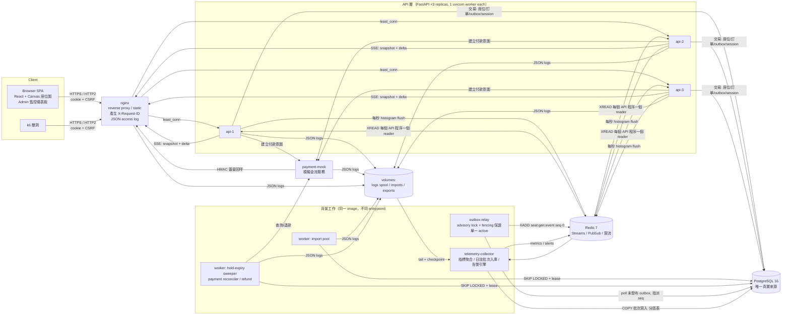
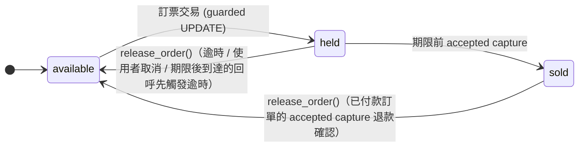
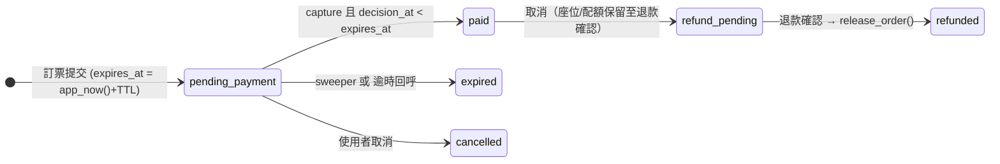
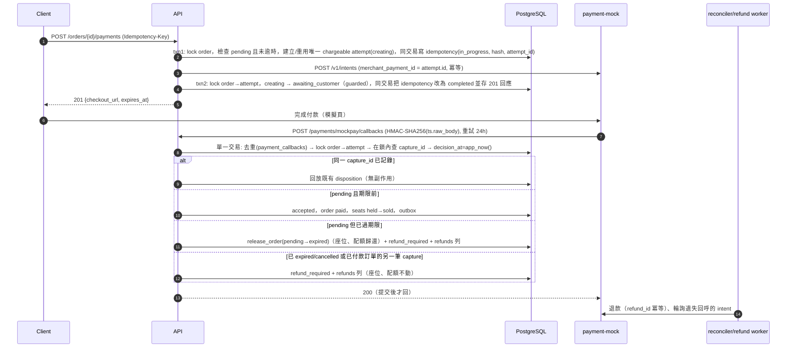
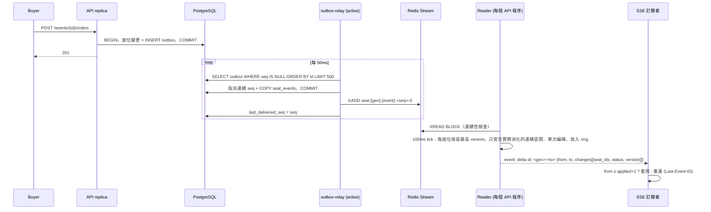
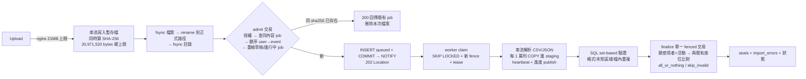
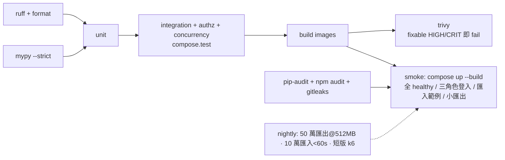
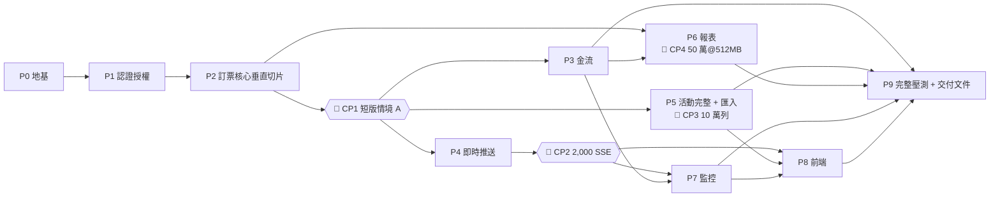

# 高併發活動搶票與即時監控平台 — 開發計畫（Production Readiness Plan）

> 版本：v1.3（2026-11-21）・狀態：**實作中**（P0、P1 完成；P2–P8 平行開發中）
> 來源：`requirement.txt` 全文 + 3 個平行研究 session（各自與 Codex 進行 3 輪批判/反駁/紅隊審查）後綜合裁決；v1.1 已納入 Codex 對整份計畫的完整度/品質審查（4 個 P0、5 個 P1、1 個 P2 全數修正，見 §19.3）。
> 所有效能數字在實測前皆為「假設/目標」，實測值寫入 `LOADTEST.md`。

---

> **v1.3 範圍調整**：為在交付期限內完成全部需求，部分機制改為較簡單但仍滿足需求的版本：即時推送改由各 API 程序輪詢 PostgreSQL 已指派序號的 outbox（不使用 Redis Streams、generation、epoch fencing）；告警收斂為 6 條核心規則；金流移除 provider_revision 等額外狀態；匯入移除重試 API。分頁物化快照、日誌 tail + checkpoint、50 萬筆 Excel、A/B 壓測與破壞驗證維持完整。完整對照見 `docs/development/workstreams.md` §4；以下章節中與其衝突之處以該文件為準。

## 0. 目標與設計原則

| 原則 | 具體做法 |
|---|---|
| **單一真實來源** | PostgreSQL 16 是座位、訂單、配額、Session、Job 狀態的唯一真實來源。Redis 只做 fan-out、限流、快取，**永遠不決定座位歸屬或權限**。 |
| **正確性優先於速度** | 防超賣三層防護（row lock + guarded UPDATE + partial unique index）；限購與寫入同一交易；所有逾時判斷用 DB 時鐘。 |
| **任何崩潰都可自行收斂** | Transactional outbox、lease + fencing token、reconciler、冪等 key；`kill -9` 任一元件都不需人工介入。 |
| **可驗證** | 每一項保證都對應一個自動化測試；「把保護拿掉 → 測試失敗」作為測試有效性的證明。 |
| **預設安全** | 未宣告授權政策的路由無法註冊；opaque session（可立即撤銷）；最小權限容器。 |
| **可觀測** | 從 nginx 到 worker 全鏈路 `request_id`；邊界（nginx）+ 應用 + 業務三層指標；「HTTP 200 但使用者受害」有專屬告警。 |

---

## 1. 需求追蹤矩陣（Requirement → Design → Verification）

| 需求 | 設計（章節） | 驗證方式 |
|---|---|---|
| FastAPI / Docker Compose 一鍵啟動 | §3, §15 | CI smoke：`docker compose up -d --build` 後全部 healthy、三種角色可登入 |
| Admin/User/Viewer 權限 | §7 | Route introspection test + 角色×端點×擁有權 矩陣測試 |
| 登出後憑證立即失效 | §7.1 | 撤銷測試（登出/停用/改角色後下一個請求 401）+ 每請求成本 benchmark |
| 活動 CRUD、分頁不重複不遺漏 | §5.6, §11 | 併發插入/編輯/刪除/發布/同值排序鍵下翻頁測試（property test） |
| 同時編輯不覆蓋 | §11（ETag/If-Match） | 併發 PATCH → 一個 200 一個 412 |
| 已有訂單不可刪 | §5.6 | 刪除 vs 下單 race test → 409 |
| 草稿/發布/開賣時間 | §5.6 | 狀態機單元測試 |
| 批量匯入 CSV/JSON、20MB/10 萬列 <60s、背景+即時進度、兩種模式、錯誤列號、重複上傳回既有 job、重複列為錯誤 | §8 | `test_import_100k_under_60s`、惡意檔案語料庫、kill -9 測試、重複上傳測試 |
| 座位狀態即時推送 | §6 | 情境 B 壓測 + 漏事件/重連/Redis 重啟故障注入 |
| 指定座位 / 區域+張數配位、每單 1–4 張 | §5.2 | 併發測試（同座位 200 人搶、區域配位收斂） |
| 每人每活動限 4 張、不可重複售出 | §5.2–5.3 | 兩個 key 同時下單測試、一致性 SQL |
| 模擬金流 + 回呼 | §5.4 | 回呼重放/亂序/簽章竄改/逾時後到達 測試 |
| 服務費 5% 四捨五入 | §5.5 | 0.5 邊界單元測試（Python `round()` 銀行家捨入陷阱） |
| 取消、查詢訂單 | §5.4, §11 | API 整合測試 |
| 每秒系統指標 + 圖表 | §10 | 儀表板 E2E、與 k6 數字交叉比對 |
| 日誌/座位事件/指標批次寫入 DB | §10.4 | 收集器 crash/輪替測試、計數比對 |
| Admin 即時告警 | §10.5 | 故障注入觸發告警測試 |
| Excel 報表（摘要/區域/明細、時區、數值金額、50 萬筆 @512MB） | §9 | `mem_limit: 512m` 下讀 cgroup `memory.peak` |
| 管理使用者角色/啟用 | §7.4 | 矩陣測試 + 最後一位 Admin 保護測試 |
| 依 request_id 查跨服務日誌 | §10.6 | E2E：一筆付款請求可查到 api/payment-mock/worker 日誌 |
| 搶票 UI（即時座位圖）+ 監控 UI | §12 | Playwright smoke |
| 單元 + 整合測試（同 DB）、一行指令、併發測試 | §14 | `make test` |
| 壓測 A/B + 一致性檢查 | §13 | `LOADTEST.md` |
| README / .env.example / 範例檔 / 架構圖 / LOADTEST / AI_USAGE / DESIGN | §15.4 | M9 交付檢查清單 |
| 完整 commit 歷史 | §15.5 | 每個里程碑多個小 commit，不 squash |

---

## 2. 系統架構圖

### 2.1 元件與資料流



### 2.2 服務清單（docker compose）

| Service | 角色 | 規模 | 重點設定 |
|---|---|---|---|
| `nginx` | 反向代理、靜態檔、`$request_id`、JSON access log、上傳大小限制 | 1 | SSE: `proxy_buffering off`；import 路由 21MB、其他 1MB |
| `api` | FastAPI（uvloop + httptools + orjson） | 3 | 1 worker/容器、`mem_limit: 512m`、`nofile 65536` |
| `worker` | import job、hold 逾時、付款 reconciler、退款（Excel 匯出在 api 內，見 §9） | 1–2 | 獨立 pool，避免 import 餓死逾時處理 |
| `outbox-relay` | outbox → 指派 seq → Redis Streams、seat_events 封存 | 1（`restart: always`） | `pg_try_advisory_lock` 防止誤啟動第二個；熱備援列為延伸項 |
| `telemetry-collector` | 指標聚合、日誌入庫、告警評估 | 1 | heartbeat 被 API 監看 |
| `payment-mock` | 模擬金流（intent/capture/refund/callback retry） | 1 | 可開 chaos flag（重複/亂序/延遲回呼） |
| `postgres` | 16 | 1 | `synchronous_commit=on`、`max_connections=200` |
| `redis` | 7 | 1 | AOF everysec |
| `migrate` | Alembic upgrade（one-shot） | – | `service_completed_successfully` |
| `seed` | 建立 Admin/User/Viewer 測試帳號（冪等）：`admin@example.com` / `user@example.com` / `viewer@example.com`，開發預設密碼 `Admin#Dev2026!` / `User#Dev2026!` / `Viewer#Dev2026!`，可由 `SEED_*` 覆寫 | – | prod 模式拒絕預設密碼；**api 以 `service_completed_successfully` 依賴 seed** |

對外 port（本機）：nginx `8080`；PostgreSQL `5432` 與 Redis `6379` 僅綁定 `127.0.0.1`（供測試與壓測工具使用）；nginx 只公開 `/healthz/live`，`/healthz/ready` 與 `/metrics` 僅限內部網路。payment-mock 的模擬付款頁 `/pay/{intent_id}` 提供「確認付款／拒絕付款」兩個按鈕，對應 `POST /v1/intents/{id}/confirm|decline`（k6 直接呼叫後者）。壓測的 run id 以 `X-Load-Run-ID` header 傳入，nginx 記錄於 access log 的 `load_run` 欄位。
| `k6`（profile: loadtest） | 壓測（含 xk6-sse） | – | cpuset 隔離 |

---

## 3. 技術棧

| 層 | 選擇 | 理由 |
|---|---|---|
| API | FastAPI、Pydantic v2（`extra="forbid"`）、uvicorn + uvloop + httptools、orjson | 指定框架；高效 JSON |
| DB 存取 | SQLAlchemy 2.0 Core（async）+ asyncpg；關鍵路徑手寫 SQL | 鎖/guard 語意需精確可控 |
| DB | PostgreSQL 16 | row lock NOWAIT/SKIP LOCKED、partial unique index、COPY、單一 ACID 邊界 |
| Migration | Alembic（CI 驗證 upgrade → downgrade -1 → upgrade、`alembic check`） | |
| Cache/Bus | Redis 7（Streams、Pub/Sub、Lua 限流） | Streams 可 replay；Pub/Sub 不可 |
| 背景工作 | **自建 PG 佇列**（`FOR UPDATE SKIP LOCKED`、DB 時鐘 lease、fencing token） | Job 狀態本來就在 PG，避免 DB/broker 雙寫；比 Celery/arq 更容易證明正確 |
| 密碼 | argon2-cffi（argon2id m=19MiB t=2 p=1），每容器並行上限 4 | OWASP 建議值；防 CPU DoS |
| 匯入解析 | `csv` + `streaming-form-data` + `ijson` | 串流、不吃記憶體 |
| Excel | xlsxwriter `constant_memory` + server-side cursor | 50 萬筆 @512MB |
| 前端 | React 18 + Vite + TypeScript、Zustand、TanStack Query、Canvas 座位圖、uPlot、`@microsoft/fetch-event-source` | 1 萬座位 DOM 太重；uPlot 輕量即時 |
| 壓測 | k6 + xk6-sse；Python asyncio SSE client 為備援 | 單機可撐 3,000 VU |
| 測試 | pytest、pytest-asyncio、hypothesis、Playwright | |
| 品質 | uv workspace、ruff、mypy --strict、import-linter | |
| 供應鏈 | pip-audit、npm audit、trivy、gitleaks、Dependabot | |

---

## 4. 資料模型（核心）

> 完整 DDL 於 M0/M2/M4 migration 實作；以下為關鍵約束。金額一律 `bigint` 整數元（TWD）。

```sql
-- 使用者與 Session
users(id bigserial PK, email citext UNIQUE, password_hash, role user_role, is_active bool, version int, created_at)
sessions(id uuid PK, token_hash bytea UNIQUE, user_id, csrf_secret, created_at, last_seen_at,
         idle_expires_at, abs_expires_at, revoked_at, revoked_reason, ip, ua)
  -- partial index: token_hash WHERE revoked_at IS NULL
audit_log(id, actor_id, target_type, target_id, before jsonb, after jsonb, request_id, ts)

-- 活動
events(id bigserial PK, owner_id, title, description, category, venue,
       sales_start_at, sales_end_at, status ('draft'|'published'), version int,   -- ETag "v{version}"
       layout_ver int NOT NULL DEFAULT 1,       -- 座位配置版本：匯入 finalize 時 +1，快照與 layout_changed 事件皆帶此值
       published_at, created_at, updated_at,
       CHECK (sales_end_at > sales_start_at))
zones(id, event_id, code, name, price_twd bigint CHECK (0..10,000,000), UNIQUE(event_id, code), UNIQUE(event_id, id))
seats(id bigserial PK, event_id, zone_id, row_label, seat_number, norm_key, sort_key int, seat_idx int,  -- seat_idx: 0..N-1 供 bitmap 快照
      status ('available'|'held'|'sold'), order_id, version int,
      UNIQUE(event_id, norm_key), UNIQUE(event_id, seat_idx),
      CHECK ((status='available') = (order_id IS NULL)))
  -- partial index: seats_alloc (zone_id, sort_key, id) WHERE status='available'

-- 訂單 / 配額 / 冪等
orders(id bigserial PK, public_id uuid UNIQUE, user_id, event_id REFERENCES events ON DELETE RESTRICT,
       status ('pending_payment'|'paid'|'expired'|'cancelled'|'refund_pending'|'refunded'),
       quantity smallint CHECK (1..4), subtotal_twd, fee_twd, total_twd, expires_at, created_at, paid_at, closed_at, version,
       CHECK (total_twd = subtotal_twd + fee_twd))
order_items(order_id, seat_id, event_id, zone_id, unit_price_twd, released_at, PK(order_id, seat_id))
  CREATE UNIQUE INDEX order_items_one_active_claim ON order_items(seat_id) WHERE released_at IS NULL;  -- 防超賣第三層
user_event_quota(user_id, event_id, reserved smallint CHECK (reserved BETWEEN 0 AND 4), PK(user_id, event_id))
idempotency_keys(user_id, key, operation, request_hash bytea, status ('in_progress'|'completed'),
                 resource_ref, response_status, response_headers jsonb, response_body jsonb, created_at, updated_at,
                 PK(user_id, key))

-- 金流
payment_attempts(id uuid PK, order_id, amount_twd, status, provider_intent_id UNIQUE, expires_at, last_polled_at timestamptz, ...)
  CREATE UNIQUE INDEX one_chargeable_attempt ON payment_attempts(order_id) WHERE status IN ('creating','awaiting_customer','captured');
payment_captures(provider_capture_id PK, attempt_id, order_id, amount_twd, disposition ('accepted'|'refund_required'), ...)
  CREATE UNIQUE INDEX one_accepted_capture ON payment_captures(order_id) WHERE disposition='accepted';
refunds(id uuid PK, provider_capture_id UNIQUE, reason, status, attempts, next_try_at, lease_owner text, lease_until timestamptz, ...)
provider_cancellations(attempt_id uuid PK, status ('pending'|'succeeded'|'failed_retryable'), attempts int, next_try_at, lease_owner, lease_until, created_at)  -- 取消待付款訂單時同交易寫入，worker 冪等地向金流取消 intent
payment_callbacks(provider_event_id PK, attempt_id, event_type, payload jsonb, received_at)   -- 回呼去重

-- 即時推送（一筆交易 = 一列 outbox，changes 陣列含該交易所有座位 [seat_idx, status, version]）
outbox(id bigserial PK, event_id, kind, changes jsonb, request_id, created_at DEFAULT clock_timestamp(),
       writer_xid xid8 DEFAULT pg_current_xact_id(),   -- 寫入交易 id；relay 的 seq UPDATE 會改寫 xmin，故另存以量測 commit→apply（搭配 track_commit_timestamp）
       seq bigint, assigned_at timestamptz, UNIQUE(event_id, seq))            -- seq 指派後 = PG 內連續的 replay log
  -- partial index: (id) WHERE seq IS NULL
event_stream_state(event_id PK, last_assigned_seq bigint, last_delivered_seq bigint, gen uuid)  -- 指派與投遞分開追蹤
relay_lease(id smallint PK DEFAULT 1, epoch bigint NOT NULL, holder text, acquired_at)            -- relay fencing epoch（W8b）
seat_events(event_id, seq, seat_idx, status, seat_version, request_id, recorded_at, published_at) PARTITION BY RANGE (recorded_at)  -- 每日分區

-- 匯入
import_jobs(id uuid PK, event_id, created_by, content_sha256, format, mode, status, file_path, total_rows, processed_rows,
            valid_rows, error_rows, attempt_no, fence uuid, lease_expires_at, worker_id, origin_request_id, ...,
            UNIQUE(event_id, content_sha256))
  CREATE UNIQUE INDEX one_active_import ON import_jobs(event_id) WHERE status IN ('queued','running');
import_staging(fence, line, item_index, zone_code, row_label, seat_number, norm_key, error)   -- LOGGED（crash 後不被清空）
import_errors(job_id, attempt_no, line, item_index, zone_code, row_label, seat_number, reason)

-- 分頁快照
list_snapshots(id uuid PK, scope ('public'|'principal'), principal_id NULL, query_hash, row_count, created_at, expires_at)
list_snapshot_rows(created_at timestamptz NOT NULL, snapshot_id uuid, ord int, event_id bigint,
                   PRIMARY KEY (created_at, snapshot_id, ord)) PARTITION BY RANGE (created_at)   -- 每小時分區，過期整區 DROP
  -- 只存成員與順序；顯示欄位一律 JOIN events 取「最新值」（文件化：內容是即時的，成員與順序是第一頁當下的）

-- 監控 / 日誌（皆為每日分區 + retention）
metrics_1s(ts, source ('edge'|'app'), scope, req_total, err_4xx, err_5xx, p50_ms, p95_ms, p99_ms, hist int[], conns_sse, completeness, ...)
business_1s(ts, event_id, hold_ok, hold_conflict, hold_soldout, hold_limit, pay_ok, pay_fail, cancels, expiries)
telemetry_ingest(boot_uuid, interval_no, bucket_sec, received_at, PK(boot_uuid, interval_no))     -- 多副本去重
telemetry_producers(boot_uuid PK, service, replica, started_at, last_interval_no, last_seen_at, offset_ms, offset_err_ms)  -- 預期 producer 與時鐘校準
access_logs(ts, request_id, method, route, status, req_ms, upstream_ms, upstream, user_id, ...)
service_logs(ts, request_id, service, boot_uuid, op_id, parent_op_id, local_seq, level, msg, attrs jsonb)
log_checkpoint(segment_id, path, inode, offset, done)
alert_events(id, rule_id, scope, state, value, threshold, ts, ack_by, ack_at)
```

**不變式**（CI 與壓測後一致性 SQL 都會檢查）：
1. `available` 座位 0 個 active item；`held/sold` 座位恰 1 個 active item 且 `order_id` 一致。
2. `pending_payment/paid/refund_pending` 訂單的 active item 數 = `quantity`；其他狀態 = 0。
3. `quota.reserved` = 該使用者在該活動「仍持有座位」訂單的 `quantity` 總和，且 ≤ 4。
4. 每筆 capture 不是 `accepted`（訂單 paid/refund_pending/refunded）就是有對應 refund。
5. Outbox 全部指派且投遞；`last_assigned_seq = last_delivered_seq` = Redis stream tail；`seq` 每活動連續無洞。

---

## 5. 核心流程：訂票、付款、逾時

### 5.1 座位與訂單狀態機





**唯一釋放路徑 `release_order(order_id, expected_status, new_status)`**（Codex P0 #1）：所有會歸還座位的轉換（逾時、待付款取消、已付款退款確認、期限後回呼）**只能**呼叫這一個函式，在同一交易內：
```sql
UPDATE orders SET status=:new, closed_at=app_now(), version=version+1
 WHERE id=:o AND status=:expected
   AND (:new <> 'expired' OR expires_at <= app_now())        -- 逾時路徑：取得訂單列鎖後以 DB 時鐘重檢期限
 RETURNING user_id, event_id, quantity;                      -- 0 rows → 什麼都不做（雙 worker 安全的那一行）
-- 只有上面回傳 1 列時才繼續（此時已持有訂單列鎖）：
SELECT id FROM seats WHERE order_id=:o ORDER BY id FOR NO KEY UPDATE;   -- 依 id 排序鎖座位，符合鎖圖
UPDATE seats SET status='available', order_id=NULL, version=version+1 WHERE order_id=:o AND status IN ('held','sold') RETURNING seat_idx, version;  -- 筆數必須 = quantity
UPDATE order_items SET released_at=app_now() WHERE order_id=:o AND released_at IS NULL;
UPDATE user_event_quota SET reserved=reserved-:qty WHERE user_id=:u AND event_id=:e;   -- CHECK >= 0 漂移即中止
INSERT INTO outbox(...);
```
- **配額語意**：配額只計「仍持有座位」的訂單（pending_payment/paid/refund_pending）；**退款完成後名額恢復**（寫入 DESIGN.md 假設）。
- **金流事件分四類**（與 §5.4 表格一致）：
  1. 新 capture、訂單 pending、期限前 → accepted、paid、座位 held→sold。
  2. **同一 `provider_capture_id` 重送** → 回放既有 disposition，無任何副作用（**不**建立退款）。
  3. 新 capture、訂單仍 pending 但已過期限 → 同交易先 `release_order(expected='pending_payment', new='expired')`，再記 `refund_required` + refund。
  4. 新 capture、訂單已 expired/cancelled，或已付款訂單的**另一筆** capture → 只記 `refund_required` + refund，**不碰座位與配額**（早已由 release_order 歸還過一次或仍屬於原 accepted capture）。

### 5.2 訂票交易（防超賣 + 限購 + 冪等，單一短交易）

READ COMMITTED、`lock_timeout=500ms`、`statement_timeout=2s`、交易內**沒有任何網路呼叫**。

```sql
BEGIN;
-- ① 冪等 claim：交易級 advisory try-lock；false → 409 idempotency-in-progress
SELECT pg_try_advisory_xact_lock(hashtextextended('idem:'||:u||':'||:key, 0));
SELECT request_hash, status, response_* FROM idempotency_keys WHERE user_id=:u AND key=:key;  -- 已完成 → 重放；hash 不同 → 422
-- ② 活動閘門（無鎖；發布後票價/區域/開賣時間凍結）
SELECT status, sales_start_at, sales_end_at FROM events WHERE id=:e;
-- ③ 限購：唯一會「等待」的鎖，與座位寫入同一交易 → 原子
INSERT INTO user_event_quota(user_id,event_id) VALUES(:u,:e) ON CONFLICT DO NOTHING;
UPDATE user_event_quota SET reserved = reserved + :n
 WHERE user_id=:u AND event_id=:e AND reserved <= 4 - :n RETURNING reserved;      -- 0 rows → 409 purchase-limit-exceeded
-- ④ 先插訂單表頭（FK KEY SHARE 在座位鎖之前取得 → 消除與「刪除活動」的死結）
INSERT INTO orders(user_id, event_id, quantity) VALUES(:u,:e,:n) RETURNING id;
-- ⑤a 指定座位：seat_ids 須互不重複（重複 → 422）且屬於 :e；NOWAIT（熱門座位不排隊）→ 55P03 回 409 seat-contended（可重試）
SELECT id, status FROM seats WHERE event_id=:e AND id = ANY(:ids) ORDER BY id FOR NO KEY UPDATE NOWAIT;  -- ◀ 保護開始
-- ⑤b 區域+張數：zone 以 (event_id, code) 解析；在 DB 內配位，SKIP LOCKED 分散競爭
SELECT id FROM seats WHERE event_id=:e AND zone_id=:z AND status='available' ORDER BY sort_key, id LIMIT :n FOR NO KEY UPDATE SKIP LOCKED;
--   拿到 < n：ROLLBACK 後以不加鎖的 count(*) 判斷 —— 可售數 < n → 409 insufficient-seats（權威）；
--   否則 → 409 allocation-contended（retryable，因為被鎖住的座位可能隨對方 rollback 回來）
-- ⑥ guarded transition，RETURNING 筆數必須 = n
UPDATE seats SET status='held', order_id=:o, version=version+1
 WHERE id = ANY(:locked) AND status='available' RETURNING id, seat_idx, version;
-- ⑦ order_items（partial unique index 為最後防線）、開賣時窗檢查（app_now()）、金額、期限
INSERT INTO order_items ...;
UPDATE orders SET subtotal_twd=:s, fee_twd=(:s*5+50)/100, total_twd=..., expires_at = app_now() + :ttl WHERE id=:o;
-- ⑧ outbox 列（在座位鎖之後才 INSERT → 同一座位的後續交易必拿到更大的 outbox id，見 §6.1）+ idempotency 列（completed, 201, body）
INSERT INTO outbox ...; INSERT INTO idempotency_keys ...;
COMMIT;                                                                              -- ◀ 保護釋放
```

**三層防超賣**：(a) 座位 row lock；(b) `WHERE status='available'` guarded UPDATE + 筆數檢查；(c) `order_items(seat_id) WHERE released_at IS NULL` partial unique index——即使 (a)(b) 被改壞，(c) 仍會把雙賣變成 IntegrityError → 409。

**完整鎖圖（無循環 → 無死結）**，`docs/adr/lock-graph.md` 維護並以 barrier 測試驗證：
- 訂票：idempotency(advisory) → quota row → orders INSERT（FK 對 events 取 KEY SHARE）→ seats（NOWAIT/SKIP LOCKED，永不等待）→ order_items（FK KEY SHARE 對 seats/orders，已持有）。
- release_order / 回呼：order → seats（依 id 排序，`FOR NO KEY UPDATE`）→ quota。**sweeper 每筆訂單一個交易**（先不加鎖讀取至多 200 個候選 id，再逐筆以 release_order 處理），避免兩個 worker 以 Q1→Q2 / Q2→Q1 順序鎖配額。
- 活動層級操作（刪除/發布/匯入 admission/重試/finalize/區域編輯）**統一順序**：`users FOR SHARE`（操作者/建立者）→ `events FOR UPDATE` → `import_jobs FOR UPDATE`（需要時，含 fence 驗證）→ 座位寫入。events FOR UPDATE 與訂票的 KEY SHARE 衝突 → 刪除與下單序列化，輸方：刪除得 409 `event-has-orders`，下單得 404/409 `event-not-on-sale`。
- 停用使用者：`users FOR UPDATE` → `sessions` 撤銷；與上面的 `users FOR SHARE` 互斥（§7.5）。
- 敏感寫入的 session 檢查：`sessions FOR SHARE` 永遠是交易的**第一個**鎖，因此不會插入上述順序的中間。
- 所有阻塞型鎖都受 `lock_timeout=500ms` 約束，逾時回 503 `server-busy`（retryable），不會無限等待。
- Barrier 測試：刪除 vs 下單、release vs 下單、雙 sweeper、回呼 vs sweeper。

**配位在 DB 內**：若讀到應用程式記憶體再挑，多副本會挑到同一批座位 → 大量假性售罄/重試風暴（沒 guard 則超賣）。測試：300 座位、500 人各要 2 張，客戶端對 `allocation-contended` 有界重試；之後進入**drain 階段**（單執行緒依序重試直到得到權威的 `insufficient-seats`）→ 必須恰好 150 筆成功、300 座位 held、不變式成立（drain 讓結果不受重試次數上限影響而不會 flaky）。

### 5.3 冪等（`Idempotency-Key` 必填於下單/付款/取消）

| 情況 | 回應 | 理由 |
|---|---|---|
| 第一次已成功 | 原 201 + 原 body + `Idempotent-Replayed: true` | 副作用與回應同交易提交 |
| 第一次仍在處理 | 409 `idempotency-in-progress` + `Retry-After: 1` | 結果未知；阻塞會占用連線池 |
| 相同 key 不同內容 | 422 `idempotency-key-reused` | 客戶端錯誤，絕不回傳別的操作結果 |

- 單交易操作只儲存成功結果（業務 409/422 無副作用，重試會重新執行）；多交易操作（付款）的終態結果——包括失敗——也會持久化（見 §5.4）。先驗證身分/授權再重放。
- `request_hash` = operation + resource id + canonical body（seat_ids 排序）。
- **語意精確化**（Codex P0 #2）：單交易操作（下單/取消）在第一個請求仍未提交時，第二個請求看不到其 hash → 一律 409 `idempotency-in-progress`（不論 payload）；**等第一個提交後**，hash 不同才回 422。此行為寫入 API 文件與 DESIGN.md Q3.1。
- 多交易操作（付款）：見 §5.4；`in_progress` 列綁定 `attempt_id`，永不清除，由 reconciler 推進到終態，終態回應同樣持久化供重放。
- **保留期限**：`completed` 列保留 24 小時後由每小時的清理工作刪除（之後同 key 視為新請求，API 文件註明 key 的有效期為 24 小時）；`in_progress` 列不清除，直到 reconciler 將其推進為 completed。

### 5.4 模擬金流



- 回呼處理順序（單一交易）：① `payment_callbacks` 依 provider_event_id 去重 → ② 鎖訂單 → attempt → ③ **在訂單鎖內**依 `provider_capture_id` 查既有 capture，已存在則直接回放其 disposition（兩個不同 event id 帶同一 capture 的回呼被訂單鎖序列化，不可能都走「新 capture」分支；`payment_captures` PK 為最後防線）→ ④ 才進入狀態轉換。`compare_digest`、時間窗 300 秒、驗證金額/幣別/attempt 對應；`provider_revision` 只前進不後退。
- **pending 但已過期限的訂單收到 capture**：先呼叫 `release_order(expected='pending_payment', new='expired')`（座位與配額歸還一次），再記 `refund_required` + refund。
- 每筆訂單最多一個可扣款 attempt。**attempt 與 merchant id 在呼叫金流前就已持久化（txn1）**；呼叫結果不明（逾時）時，一律重用同一 merchant id 重試 create（payment-mock 依 merchant id 去重），**絕不因結果不明就標 `abandoned`**；只有向金流查詢確認該 intent 已不可扣款（expired/canceled）後才能 `abandoned`，才釋出唯一 slot。
- Reconciler 每 15 秒：`creating` > 15s → 以同 merchant id 重跑 create，成功後執行與 txn2 相同的 guarded 轉換並完成 idempotency 列（API 與 reconciler 都走同一個 `finalize_attempt()`，guarded UPDATE 保證只有一方生效）；`awaiting_customer` 且 15 秒內沒有回呼 → `GET /v1/intents/{merchant_id}` 主動輪詢並經同一 handler 套用（**不必等到過期**）→ W3 收斂上界 ≈ 30 秒 + 退款呼叫（假設：reconciler 佇列未積壓、金流可連線；金流不可用時依 backoff 延後並觸發告警）。
- **回呼重試的簽章**：payment-mock 每次重送都以**當下時間**重新簽章（`ts` 與 HMAC 每次重算），因此 24 小時的重試期間都能落在 300 秒時間窗內；`provider_event_id` 不變，用於去重。
- **兩個不同 key 對同一訂單付款**：兩者都綁定到同一個唯一 attempt；各自的 idempotency 列獨立記錄，但 `resource_ref` 指向同一 attempt，重放時都回傳該 attempt 的**目前**狀態（201 + checkout_url，或終態 402/已付款），不會建立第二個 intent。
- **付款終態失敗的回應**：provider 明確拒絕（非逾時）→ attempt `failed`、idempotency 列 completed 並存 402 `payment-declined`，同 key 重送回放該 402；使用者可用新 key 重新付款（唯一 slot 已釋出）。
- 取消：`pending_payment` → `cancelled`（release_order；同交易寫入一筆 `provider_cancellations` 待辦，由 worker 冪等地向金流取消 intent，失敗重試）；`paid` → `refund_pending`（accepted capture 退款確認後才 release_order）；重複取消回放同一結果；已終態 → 409 `order-not-cancellable`。訂單回應帶 `refund_status`（none/pending/succeeded）。
- 報表營收定義：`paid` 計入營收；`refund_pending`/`refunded` 另列退款欄；`refund_required` 的多餘扣款不計營收、列入對帳區。

### 5.5 計價

`fee = (subtotal * 5 + 50) // 100`（整數元、四捨五入 half-up）。例：2,810 → 140.5 → **141**（Python `round()` 採銀行家捨入會得 140；單元測試覆蓋此邊界，只有在實作中真的發生時才會記入 `AI_USAGE.md`）。票價於下單時快照到 `order_items.unit_price_twd`。

### 5.6 逾時、時鐘與活動生命週期

- **逾時判斷時鐘 = DB 時鐘**：`app_now()` 回傳 `clock_timestamp()`，**在取得訂單鎖之後**取樣（不用 `now()`，它是交易開始時間，等鎖後會過舊）。所有副本共用一個時鐘，應用主機時鐘偏移不影響。
- **Sweeper**：先 `SELECT id ... WHERE status='pending_payment' AND expires_at <= app_now() ORDER BY expires_at LIMIT 200`（不鎖）取候選，再**逐筆**開交易呼叫 `release_order(expected='pending_payment', new='expired')`——該 UPDATE 取得訂單列鎖後以 `app_now()` **重檢期限**，且 **`WHERE status=:expected RETURNING` 回傳 0 列就什麼都不做，這一行就是「兩個 worker 同時執行仍正確」的保證**；座位/items/配額/outbox 的變更全部以該 RETURNING 結果為前提；`CHECK reserved >= 0` 在漂移時直接中止。
- **回呼不依賴 sweeper**：回呼自行檢查 `decision_at < expires_at`，sweeper 掛掉只會延後座位回到可售。
- **不 sleep 的測試**：測試專用 migration 把 `app_now()` 換成讀 `test_clock` 表；可推進時間、可注入 ±1h 應用時鐘偏移驗證決策不變。生產環境禁止此 migration（config validator 拒絕）。
- **活動**：發布後凍結區域/票價/開賣時窗（標題/描述/分類仍可改）；發布需 ≥1 座位且無進行中匯入；刪除時 `FOR UPDATE` 鎖活動後重查是否有任何訂單（有 → 409 `event-has-orders`），`ON DELETE RESTRICT` 為後盾。
- **活動閘門交易**（Codex P0 #4）：發布、匯入 admission、匯入重試、匯入 finalize、刪除、區域編輯**全部**依 §5.2 統一鎖序（`users FOR SHARE` → `events FOR UPDATE` → `import_jobs FOR UPDATE`），鎖後重檢：草稿狀態、操作者授權、`one_active_import`、fence。因此「發布」與「匯入 admission」互斥：先 admission → 發布看到進行中 job → 409 `import-running`；先發布 → admission 看到 published → 409 `event-not-draft`（不會先回 202 再被 finalize 拒絕）。
- **ETag 原子性**：`UPDATE events SET ..., version=version+1 WHERE id=:id AND version=:expected RETURNING *`（比對在 UPDATE 謂詞內，不是應用程式先讀再寫）；區域編輯（僅草稿）在**同一交易**內先執行同樣的 events 條件式 UPDATE（比對並推進父活動 ETag，0 列 → 412）再改 zones。

### 5.7 部分失敗時間窗（DESIGN Q2）

| # | 時間窗 | 收斂機制 | 時間 | 人工 |
|---|---|---|---|---|
| W1 | 訂票已提交、回應遺失 | 相同 key 重送 → 重放 | 客戶端重試 | 否 |
| W2 | 座位已變、outbox 未指派 seq / 已指派未投遞 | relay 輪詢 `seq IS NULL`；投遞以 `last_delivered_seq` 追蹤，重啟後從 PG replay log 補投；客戶端以座位 version 去重 | ≤ 100ms + 重啟 | 否 |
| **W3（最危險）** | **已扣款、回呼遺失/延遲、hold 已逾時、座位已被別人買走** | 金流 24h 重試 + reconciler 15s 主動輪詢 + release_order（若尚未逾時處理）+ `refund_required` + 退款 worker | 正常情況下**偵測**約 30 秒內開始、退款再加一次金流呼叫；金流或 reconciler 持續故障時沒有有限上界，由 `PAYMENT_PROVIDER_DOWN`/`RECONCILER_DOWN`/`REFUND_STUCK` 告警 | 否（持續故障時需處理基礎設施） |
| W4 | 已過期但 sweeper 掛了 | 回呼自行判斷期限；sweeper 恢復後釋放 | worker 起來後 ≈ 積壓筆數 ÷ sweeper 吞吐量（每輪 200 筆、逐筆交易）；吞吐量於 CP1 實測後填入上限 | 否 |
| W5 | intent 已建立、API 在 txn2 前被 kill | 重試續做或 reconciler 重跑冪等 create | ≤ 30s | 否 |
| W6 | 退款已受理、worker 記錄前被 kill | 同 `refund_id` 重試冪等 | backoff | 否 |
| W7 | 匯入做到一半 | 單一 fenced 交易 finalize；lease 到期後新 fence 從檔案重來 | lease 30s | 否 |
| W8b | 舊 relay 失去 advisory lock（網路分割/長暫停）後仍嘗試寫 Redis | **Fencing**：relay 取得鎖時 `epoch = epoch+1` 寫入 `relay_lease`；每次 XADD 透過 Redis Lua 腳本先比對 `relay:epoch` key，epoch 較小即拒絕；PG 端的指派/投遞更新也帶 `WHERE epoch=:mine` | 立即 | 否 |
| W8 | relay 已 XADD、`last_delivered_seq` 更新前被 kill | 投遞規則（每一輪都適用，不只重啟）：永遠只投 `last_delivered_seq+1`，依序推進；XADD 回 "ID 太小" 時以 `XRANGE id id` 比對 payload hash，相符才推進，不符 → 以新 generation 從 PG replay log 重建後才公開 | 重啟 | 否 |
| W9 | 使用者已登出/停用、SSE 連線仍開著 | Pub/Sub 立即關閉 + 每副本每秒批次重驗 | ≤ 2s（Pub/Sub 正常時 ~ms） | 否 |
| W10 | 上傳檔已寫入磁碟但 job 列未提交 / job 已提交但檔案未 fsync | 先 fsync+rename 再提交 `queued`；孤兒檔 sweeper 1h 清除 | ≤ 1h（只佔磁碟） | 否 |
| W11 | 應用遙測已在程序記憶體、尚未 flush 時程序被 kill；或 Redis 遺失未消費的 telemetry | 遺失 ≤ 1 個 interval（Redis 遺失時為未消費部分）；`telemetry_producers` 記錄預期 producer 與 `last_interval_no`，連最後一個 interval 遺失也能偵測並標示不完整；邊界指標來自磁碟上的 nginx log 不受影響 | 即時可見 | 否（**刻意取捨**：不為應用 histogram 另做持久 spool，見 §10.2） |
| W12 | Excel 檔產生完成、傳送中斷線 | 背景清理 + 啟動時清掃 tmp；使用者重新下載 | 立即 | 否 |

---

## 6. 即時座位推送（DESIGN Q4）

### 6.1 決策

| 項目 | 決策 | 捨棄方案 |
|---|---|---|
| 傳輸 | **SSE**（單向、原生 `id:` / `Last-Event-ID` 續傳；同源 cookie 驗證） | WebSocket（雙向用不到，且需自建續傳協定） |
| 順序 | **Relay 指派 per-event 連續 seq**：單一 active relay 輪詢 `outbox WHERE seq IS NULL ORDER BY id`，先在 PG 提交 seq（outbox 本身即成為 PG 內連續的 replay log），再 XADD `<seq>-0` 投遞、更新 `last_delivered_seq` | 訂票交易內遞增 per-event 計數器（會把同一活動的所有訂票序列化，約 500–1,000 tx/s 上限，搶票瞬間成瓶頸）；以 xid/id 游標推進（會跳過晚提交的列） |
| 正確性補強 | 每個座位帶 `version`（每次變更 +1）；快照與 delta 都帶 version；客戶端**只套用 `version > 本地` 的座位變化** | |
| 匯流排 | Redis Streams（明確 ID、generation 前綴 key、MAXLEN ~20000）；Redis 只負責投遞，**真實 replay log 在 PG** | Pub/Sub（不可重放）、LISTEN/NOTIFY（8KB、queue 滿會讓 commit 失敗） |
| 快照 | `GET /events/{id}/seats`：REPEATABLE READ 單一快照讀 `{gen, layout_ver, last_assigned_seq, seats(bitmap + 每座位 version)}`；單程序 single-flight 快取 ≤ 1s，但請求帶 `min_layout_ver` 時若快取較舊則繞過快取 | Redis materialized view（讀取可能撕裂） |
| 續傳 token | SSE `id: <gen>:<seq>`；generation 不符 → 直接給快照 | |
| 慢客戶端 | 每程序每活動一個共享 ring（100ms 合併 tick、5 秒 / 2MB）；每連線只有游標 + 單一 in-flight write（5s deadline）→ 落後：ring → Redis replay → PG replay log → 關閉連線，重連拿快照 | 每連線獨立 queue（記憶體無上限） |

**為何 relay 指派 seq 仍保證每個座位的順序**（依 Codex 審查補足前提）：
1. 每個寫入交易都是「先鎖並更新座位 → 之後才 INSERT outbox（取 id）」。同一座位的後一個交易 B 必須等前一個交易 A 提交才拿得到座位鎖，所以 B 的 `nextval` 發生在 A 提交之後 → `B.id > A.id`。
2. B 可見時 A 必已可見；relay 依 id 排序指派 → A 的 seq < B 的 seq。
3. 一筆交易只寫一列 outbox（changes 陣列），不會被切到兩個 relay 批次。
4. 不同座位之間的 seq 順序可能與提交順序不同——無妨，座位狀態彼此獨立；客戶端以每座位 version 判斷新舊。

**快照與 seq 的一致性**（Codex P0 #3 的反例：快照時座位已是 `available/v2`、但 `held/v1` 尚未指派 seq，之後以 seq 11 送達）：因為快照帶每座位 version，客戶端收到 `held/v1` 時本地已是 v2 → 忽略，畫面不會倒退。快照之後送達的 seq 一律套用「version 較大者勝」規則。
**Relay 停擺偵測**：progress frame 改帶 `oldest_unassigned_age_ms`（PG 取樣）而不只是 head seq；> 2s 即客戶端顯示過期橫幅、Admin 收到 `OUTBOX_LAG`。

### 6.2 路徑



### 6.3 漏事件偵測與回復
- 偵測：delta `from > applied+1`；每秒 `progress` frame 帶 PG 取樣的 `assigned_head` 與 `oldest_unassigned_age_ms` → `assigned_head > applied` 超過 3 秒或 unassigned age > 2 秒；5 秒沒收到任何 frame。
- 回復：重連帶 `Last-Event-ID: <gen>:<seq>` → ring → Redis XRANGE →（仍不足）PG replay log `outbox WHERE seq > :s` → 快照。UI 顯示「資料可能過期」橫幅。
- **續傳游標 = 最後「套用」的 seq，不是最後「收到」的 id**：原生 EventSource 會自動帶最後收到的 id，若某個 frame 因斷層而被拒絕套用，就會跳過它。因此客戶端用 `fetch-event-source` 並**自行**在重連時設定 `Last-Event-ID = <gen>:<applied>`；測試涵蓋「收到但被拒的 frame」與 ring 輪轉中的交接。
- **Replay → live 交接**：連線建立時先向本程序 reader 登記並取得 live 起點 `L`（reader 目前已消化的最大 seq），replay 只送 `(s, L]`，之後從 ring 的 `L+1` 接續 live；replay 與 live 由同一個連線協程依序寫出，不會交錯或漏掉中間段。快照交接相同：以快照的 `last_assigned_seq` 為 `s`，之後的事件一律以座位 version 判斷是否套用。
- 購買永遠由 DB 重新驗證；畫面過期最壞只會得到 409 `seat-unavailable`，不會超賣。
- **最壞過期程度**：正常 ~150–250ms（待測）；慢客戶端：落後 ~5s + write deadline 5s + 重連 1–3s + 快照/追趕 ~1s ≈ **最多 ~14 秒**，期間畫面上**任何座位**都可能是舊狀態；Redis/relay 全掛時無上界，但 5 秒內出現橫幅。

### 6.4 故障處理
- Redis 重啟清空：generation key 不見 → relay 從 outbox 以原 seq 重建新 generation；reader 偵測 gen 變更 → 關閉串流 → 客戶端 1–3s jitter 重連。每 5 秒 reconcile（tail + 抽樣 hash）抓「資料掉了但 key 還在」。
- API `kill -9`：客戶端重連到其他副本，從 ring/Redis 續傳。
- 匯入座位：草稿只有擁有者/Admin 可能訂閱 → finalize 在同一交易內 `events.layout_ver+1` 並寫一筆 `layout_changed{layout_ver}` outbox，避免 10 萬筆推送。客戶端收到後以 `GET /seats?min_layout_ver=N` 取快照（快取較舊則繞過），**拿到 `layout_ver ≥ N` 之前暫停套用 delta**（delta 的 seat_idx 依附於 layout）。

---

## 7. 認證與授權（DESIGN Q5）

### 7.1 認證
- **Opaque 256-bit token**，DB 只存 SHA-256；cookie（HttpOnly、SameSite=Lax、Path=/）+ session 綁定的 CSRF header（非安全方法）。SPA、SSE、Swagger、k6 一律用 cookie。
  - **Cookie 名稱依環境**：`COOKIE_SECURE=true`（TLS 環境）→ `__Host-sid` + Secure；`COOKIE_SECURE=false`（預設的本機 `http://localhost:8080`）→ `sid`、不帶 Secure。`__Host-` 前綴強制要求 Secure，在 http 下瀏覽器會拒收，所以本機不可使用該前綴（否則一鍵啟動後登入會失敗）。smoke test 從乾淨 clone 驗證三角色經瀏覽器與 k6 都能登入。
- **不用 JWT**：要立即失效就必須每請求查 server 狀態，JWT 的無狀態優勢歸零，還多了金鑰輪替與 alg 陷阱。
- **不做 Redis session 快取**：Codex 證明兩種快取設計都有漏洞（DEL 後被讀者回填；PG 提交後、寫 Redis 前 crash 會讓舊值繼續被服務）。→ **每請求一次 PG 索引查詢，不一致窗口 = 0**。成本以 microbenchmark + 情境 A（auth on/off 對照）量測寫入 DESIGN.md。
- 登出撤銷當前 session；停用與**任何**角色變更在同一交易撤銷該使用者全部 session；登入時 `SELECT user FOR SHARE` 防止以舊狀態發新 session。
- **HTTP 生效點**：撤銷交易提交後的下一個請求即 401。已在處理中的敏感寫入（下單、付款、取消、Admin 操作）在自己的交易內 `SELECT ... FROM sessions WHERE id=:sid AND revoked_at IS NULL FOR SHARE`，與撤銷的 UPDATE 互斥 → 不存在「檢查後才被撤銷卻仍寫入」的窗口。
- **開啟中的 SSE**（依審查重新預算）：Redis Pub/Sub 立即關閉（正常 ~ms）；另每副本**每秒一次**、針對「本副本所有 distinct session」的單一 `id = ANY($1)` 查詢（與推送 tick 解耦，安靜的連線也會被檢查），使用獨立的 2 連線小 pool。2,000 session / 3 副本 ≈ 每秒 3 個查詢、共 2,000 個 id，成本可忽略。
  - **關閉期限**（從撤銷交易提交起算）：Pub/Sub 正常 → 數十 ms；Pub/Sub 遺失 → 輪詢間隔 1s + pool acquire 逾時 200ms + 查詢 `statement_timeout` 300ms + 取消串流 ≈ **≤ 2 秒**。
  - **Fail-closed**：重驗查詢失敗或逾時連續 2 次 → 關閉該副本上所有 SSE（客戶端重連時重新驗證）。
  - 已交給 TCP 的位元組仍可能送達（文件化）。
  - 情境 B 量測：2,000 個**不同 session**、含安靜連線、並刻意丟棄 Pub/Sub 通知 → 記錄關閉延遲、每秒檢查 row 數、對訂票 p99 的影響。
- **敏感寫入的 session fence 範圍**：下單、取消、付款建立與 txn2/finalize、活動與區域的建立/修改/刪除/發布、匯入 admission/重試、Admin 操作。
- 密碼 argon2id（m=19MiB, t=2, p=1）專用 4 執行緒池，超量回 503 + Retry-After；未知 email 也跑 dummy hash（防帳號列舉）。
- Idle 30 分鐘、絕對 12 小時逾時。`last_seen_at`/`idle_expires_at` **最多每 60 秒寫一次**（驗證查詢回傳的 `last_seen_at` 距今 > 60s 才發一個非阻塞 UPDATE），避免每個請求都寫入；idle 判斷因此有 ≤ 60 秒誤差（文件化）。

### 7.2 限流
Redis Lua 原子計數：登入 10/15min/email + 50/min/IP + 全域預算；註冊 10/h/IP；下單 ~10/s/user；匯入 1/min/user；匯出同時 1 個/user。不鎖帳號（避免 DoS），改漸進延遲。**壓測例外**：所有門檻皆可由 `.env` 調整（`RATE_LIMIT_*`）；`loadtest` compose profile 提供預先建立 session 的腳本（以 seed 直接寫入 3,000 個測試使用者與 session，不經登入端點），因此不需放寬正式環境的登入限流。Redis 掛掉：登入 fail-closed；下單改用程序內 semaphore 有界放行。

### 7.3 授權
- 規則：Viewer/User 只看已發布活動（User 另可看自己的草稿）；不可見或父資源不符 → 404；可見但禁止 → 403。

| 端點 | Viewer | User | Admin |
|---|---|---|---|
| 瀏覽活動/座位/SSE | 已發布 | 已發布 + 自己草稿 | 全部 |
| 建立活動 | ✗ | ✓ | ✓ |
| 修改/刪除/發布活動、匯入座位、看匯入 job/錯誤報告 | ✗ | 自己的 | 全部 |
| 下單、付款 | ✗ | ✓ | ✓ |
| 查看/取消訂單 | ✗ | 自己的 | 全部 |
| 銷售報表 Excel | **所有活動**（依需求第四節字面；草稿活動報表內容為空；購買者假名化） | 自己活動的 | 全部 |
| `/admin/*`、監控/告警串流 | ✗ | ✗ | ✓ |
| 金流回呼 | 僅 HMAC（system principal） | | |

- **強制機制**：`SecureRouter` 覆寫 `add_api_route` / `add_api_websocket_route`，沒宣告 `policy=` 的路由在 import 時直接 raise；公開路由須明確 `Public()`。Policy = (action, 依父資源範圍載入的 resource loader, rule)。集合查詢一律經過需要 principal 的 repository（import-linter 禁止未限定範圍的查詢）。Pydantic 分離 Create/Update/Read schema，`role/is_active/owner_id/status/version` 永不可由使用者寫入。
- **系統性驗證**：① Route introspection test（含自動 HEAD/OPTIONS、mount）：任何路由缺 policy 或不在矩陣中 → fail。② 宣告式矩陣 × fixture {自己的、別人的、Admin 的、草稿、已發布} 參數化測試，**拒絕時斷言資料列數與 version 不變**。③ 每個巢狀路由的「父子不符」測試。④ SSE 訂閱矩陣 + Origin + 已撤銷 session 測試。
- **最容易漏掉的端點**：匯入錯誤報告下載（以 job_id 為 key 的衍生資源，上傳時檢查了活動擁有權，下載時常直接用 job_id 查而沒驗父資源）。

### 7.4 Admin 管理
`PATCH /admin/users/{id}`（If-Match）：不可自我降級/停用；鎖定 active admins 保護「最後一位 Admin」；寫 `audit_log`。

### 7.5 停用使用者時正在跑的匯入 job
**取消**。「繼續」等於讓可能被盜的帳號在撤銷後仍完成變更；「以建立時權限執行」是 confused deputy。Worker 在每批邊界提早檢查；**權威檢查在 finalize 交易**（依 §5.2 統一鎖序：`users FOR SHARE` → `events FOR UPDATE` → `import_jobs FOR UPDATE` 驗 fence，重檢 active/擁有者/草稿），與停用交易的 `users FOR UPDATE` 互斥 → 誰先提交誰贏，不會半套。

---

## 8. 座位批量匯入



- **格式**：CSV 表頭必須恰為 `zone_code,row_label,seat_number`（UTF-8，可帶 BOM，拒絕 NUL）；JSON 為 3-key 物件陣列（重複 key/深度超限為列錯誤，結構錯誤則整個 job 失敗）。
- **列數上限**：解析時計數，第 100,001 筆資料列即中止並使 job `validation_failed(too_many_rows)`（不只靠 20MB 位元組上限）。
- **列號**：CSV 回報 1-based 實體起始行（表頭 = 第 1 行）；JSON 回報 item_index + 起始行。JSON 行號不依賴 parser 的預讀位置：自寫輕量 tokenizer 包裝層，逐 byte 追蹤換行與巢狀深度，在每個頂層物件的 `{` 記錄行號後再交給 `json.loads` 解析該物件（hypothesis 測試對照）。
- **重複上傳**：以 `(event_id, sha256)` 唯一；同內容不同 mode 也回傳既有 job（mode 不屬於內容）；併發同時上傳由 `ON CONFLICT` 決定唯一贏家。終態為 `validation_failed`/`system_failed`/`cancelled` 時，可經 `POST /seat-imports/{job}/attempts {mode}` 在同一 job 下重試（重新授權、最多 3 次）。
- **重複**：檔內重複群組的**每一列**都標錯（不是保留第一筆）；與既有座位重複在 finalize 檢查；**絕不使用靜默的 `ON CONFLICT DO NOTHING`**。正規化規則 `upper(zone)|upper(row)|ltrim(number,'0')` 寫入 DESIGN.md 假設。
- **模式**：`all_or_nothing`（預設）任一錯誤 → 0 筆寫入、`validation_failed`；`skip_invalid` → 寫入有效列、`partially_succeeded`。
- **崩潰**：COMMIT 前 kill -9 → 什麼都沒寫入；lease 到期由新 fence 接手；舊 worker 的任何寫入因 `AND fence=$f` 為 0 筆而自行中止。重試上限 3 次後 `system_failed`。
- **進度**：Redis 發布 → SSE `GET /seat-imports/{job}/stream`；輪詢備援。
- **時間預算（估）**：上傳 <1s、解析+COPY 2–4s、驗證 <2s、寫入 1–3s → 目標 <15s（需求 60s）。由 `test_import_100k_under_60s` 從上傳開始計時到終態；測試條件：佇列為空、1 個 import worker、同時有短版 k6 背景負載。
- **Finalize 原子性**：依 §5.2 統一鎖序 `users FOR SHARE` → `events FOR UPDATE` → `SELECT ... FROM import_jobs WHERE id=:j AND fence=:f AND status='running' FOR UPDATE`，最後一句 0 列即 ROLLBACK 整個交易（舊 worker 不可能寫入任何座位）；seats、errors、`layout_ver+1`、終態在同一交易提交。
- **Admission 判斷順序**：授權（可見且有權匯入）→ 同 `(event_id, sha256)` 已存在 → 200 回傳既有 job（即使活動已發布或另有進行中 job，也優先回放）→ 否則依鎖序重檢草稿與 `one_active_import` → 409 或建立新 job。

---

## 9. Excel 銷售報表

- `GET /api/v1/events/{id}/reports/sales.xlsx?tz=Asia/Taipei`（tz 以 `zoneinfo` 驗證）。
- **在 API 實例內產生**（就是需求說的 512MB 實例），但**與 event loop 隔離**：在專用的單執行緒 executor 中執行、使用專用 DB 連線（不占訂票 pool）、每實例 `Semaphore(1)` + 全域 advisory lock，忙碌回 429 + Retry-After。xlsxwriter 的工作暫存檔與最終檔都放在 exports volume、共用 2GB 配額（超過即中止並回 507）；**依列順序（row-major）逐列寫入**，三張表依序寫完不回頭；完成後以 `FileResponse` 串流送出（不讀入 RAM）。
- **檔案清理責任**：executor 任務擁有暫存目錄直到它結束——不論成功、失敗或客戶端已斷線（斷線時設取消旗標，executor 在下一批列邊界停止並自行刪除）；傳送完成或失敗由 response 的 background task 刪除最終檔；API 啟動時清掃殘留。
- 驗收（CP4，於 P4 完成後執行）：匯出期間同一副本的訂票 p99 與 SSE 延遲，證明不會拖垮搶票。worker 執行匯出列為未來備案，不在基線架構內。
- `REPEATABLE READ READ ONLY` 單一快照 → 三張表一致；server-side named cursor（itersize 5000）；xlsxwriter `constant_memory`、tmpdir 在**磁碟 volume**（tmpfs 會計入記憶體上限）；`strings_to_formulas=False`，不可信字串以 `write_string` 並對 `= + - @ \t \r` 開頭加 `'` 防公式注入。
- 內容（營收定義見 §5.4）：**摘要**（活動資訊、產生時間、「All times in Asia/Taipei (UTC+08:00)」、各狀態數量與金額）、**區域彙總**（票價、容量、已售、保留、可售、營收）、**訂單明細**（表頭如 `Created At (Asia/Taipei)`）。金額 `write_number` + `#,##0` 格式（數值不是字串）。
- 時區測試包含有日光節約的時區（如 `America/New_York`）跨 DST 的訂單。
- **記憶體驗證**：`generate_series` 灌 50 萬筆 → API 容器 `mem_limit: 512m` → 讀 cgroup v2 `memory.peak`，斷言 < 450MiB，同時有 k6 背景負載；用 openpyxl read_only 解析驗證筆數與總額。

---

## 10. 監控、日誌、告警、追蹤（DESIGN Q6）

### 10.1 指標來源

| 指標 | 量測層 | 時間窗 | 儲存 |
|---|---|---|---|
| RPS | **邊界**：nginx JSON access log（`$msec`、status、request_time、upstream）；排除串流請求 | 1 秒滾動窗（nginx 單一時鐘）、2 秒寬限 | `metrics_1s(source='edge')` |
| 錯誤率 | 邊界 5xx/4xx（存分母）；應用層 5xx by route + **業務失敗原因** | 1 秒；告警用 30 秒 | `metrics_1s`、`business_1s` |
| p50/p95/p99 | 邊界 request_time（使用者感受）+ 應用 handler histogram | 1 秒；分鐘值由合併 bucket 重算，**不平均百分位數** | `hist int[]` |
| 即時連線數 | 主圖：**所有 HTTP/SSE 連線**＝nginx `stub_status` active；分項：應用 gauge `sse_active`（每 producer 每 interval 只取最新值後加總，3 秒未回報視為 stale，不會因補送而重複加總） | 每秒取樣 | `metrics_1s` |

Histogram：固定 log-linear bucket（0.5ms–60s、每倍 8 個子 bucket，誤差 ~9%），可逐元素相加合併（SQL 內也可）。

### 10.2 多副本不重複、不遺失
- 每程序每秒（monotonic timer）`XADD telemetry:app {boot_uuid, interval_no, mono_ms, wall_ts, body}`；`interval_no` 是穩定的 interval ID。
- **分桶**（修正審查指出的補送擠在同一秒、以及首次 flush 延遲被當成時鐘差的問題）：collector 為每個 producer 維護 `offset_ms = min(recv_time − mono_ms)`（取最小值濾掉佇列延遲，類似 NTP 的最小延遲樣本；每 60 秒滑動更新，誤差 `offset_err_ms` 一併存於 `telemetry_producers`），interval 所屬秒 = `floor((offset_ms + mono_ms_at_interval_end)/1000)`。補送的 flush 回到它真正的那一秒，不會讓 RPS 出現假尖峰；producer 的 wall clock 完全不參與分桶。
- **刻意取捨**：應用層 histogram 不另做持久 spool——producer 被 kill 只遺失 ≤ 1 秒、且一定會被標示為不完整；需要持久保證的「使用者實際感受」由邊界指標（磁碟上的 nginx log）提供。
- Collector `XREADGROUP` → 單一交易：`INSERT telemetry_ingest(boot_uuid, interval_no) ON CONFLICT DO NOTHING` + 只有真的插入才累加 → **提交後才 ACK**；重啟以 XAUTOCLAIM 接手未 ACK 項目。
- 遺失：`interval_no` 斷號 → `missing_intervals`；預期 producer 由 heartbeat 註冊表決定，completeness = 回報 producer 數 / 預期數，圖表上把不完整的秒加陰影。producer 在 flush 前被 kill 或 Redis 遺失資料 → 該秒標示不完整（邊界指標不受影響，因為來源是磁碟上的 nginx log）。

### 10.3 副本時鐘慢 20 秒
- 邊界圖：不受影響（只用 nginx 時鐘）。應用圖：以 collector 建立的 offset + interval_no 分桶，不受影響。
- skew 偵測：`(offset_ms + mono_ms) − wall_ts`，因 offset 取自最小延遲樣本，此值只反映時鐘差（誤差 ±`offset_err_ms`）；佇列延遲另以 `recv_time − (offset_ms + mono_ms)` 監控為 `COLLECTOR_LAG`。skew > 2s 觸發 `CLOCK_SKEW`——兩者不會互相誤判。
- 對照（寫入 DESIGN.md）：若以生產者時鐘分桶，即時圖會少掉約 1/N 的 RPS、p99 漏掉該副本延遲、並在 20 秒前出現一個突起（或被當遲到資料丟棄）。
- 逾時判斷用 DB 時鐘，不受影響。
- **兩個來源不一致時**：HTTP 結果信邊界（看得到 502/504/499 與 proxy 排隊時間）；歸因信應用層；業務事實信 DB。差異 >10% 持續 30 秒 → `EDGE_APP_DIVERGENCE`。

### 10.4 批次持久化
- 所有服務寫 JSON log 到 volume（每 writer 一個檔、50MB rename+reopen 輪替，**不用 copytruncate**）→ 檔案即持久 spool（~2GB ≈ 25 分鐘 @5k lines/s）。
- Collector tail（inode+offset）→ asyncpg `copy_records_to_table` 進 UNLOGGED staging → `INSERT … SELECT` 進分區表，**offset checkpoint 同交易提交**（重放不重複）。每 500ms 或 2,000 列一批。
- 座位變化事件由 relay 以 COPY 批次寫入 `seat_events`；每秒指標由 collector 批次寫入。
- API 永不因遙測阻塞；spool 超過 80% 淘汰最舊段並計數 `logs_lost_lines`（告警）。
- Retention：日誌 7 天、`metrics_1s` 14 天、`seat_events` 90 天；分區預建 3 天。

### 10.5 告警（collector 每秒評估；inactive → pending → firing → resolved；dedup key = rule+scope；冷卻 5 分鐘；推送至 Admin SSE + REST 備援）

告警送達的降級路徑：正常 collector → `alert_events`（PG）→ Redis `admin:feed` → API → Admin SSE。collector 掛掉時，API 程序自行偵測 heartbeat 遺失並把 `MONITOR_DOWN`/`RELAY_DOWN` **直接寫入 PG `alert_events`** 並推給本副本的 Admin SSE 連線；Redis 也掛時，Admin UI 每 5 秒輪詢 `GET /admin/alerts?state=firing`（直讀 PG）。

**範圍分級**：P0 告警（必做）＝ EDGE_5XX、EDGE_P99、PURCHASE_FUNNEL_COLLAPSE、PAYMENT_CALLBACK_LAG、PAYMENT_PROVIDER_DOWN、RECONCILER_DOWN、REFUND_STUCK、HOLD_EXPIRY_BACKLOG、OUTBOX_LAG、RELAY_DOWN/MONITOR_DOWN、DB_DOWN；其餘為 P1/延伸。

| 規則 | 條件 | 持續 | 等級 |
|---|---|---|---|
| EDGE_5XX | 5xx > 2%（≥100 req） | 30s | crit |
| EDGE_P99 | p99 > 1s | 30s | warn |
| **PURCHASE_FUNNEL_COLLAPSE** | **依區域**計算：該區可售座位 ≥ 請求張數 × 10（排除接近售完時的正常競爭）且 hold 成功率 < 20%；拒絕原因以 `seat-contended`/`allocation-contended` 為主時不觸發（那是正常搶票）（**HTTP 全 200/409 但使用者受害**） | 30s | crit |
| PAY_FAIL_RATE | > 20% | 60s | crit |
| PAYMENT_CALLBACK_LAG | 金流端已 capture、本地尚無對應紀錄超過 30s（以 payment-mock 的 `captured_at` 起算，由 reconciler 輪詢發現；**不**把買家尚未付款的思考時間算進去） | 10s | crit |
| HOLD_EXPIRY_BACKLOG | 有 hold 超過 expires_at 30s 仍為 HELD | 0 | crit |
| OUTBOX_LAG | 最舊未發布 > 2s | 10s | crit |
| RELAY_DOWN / MONITOR_DOWN | heartbeat 遺失（由 API 監看，不靠 collector 自己） | 5s | crit |
| SEQ_GAP / STREAM_GEN_CHANGE | 任何斷號 / Redis 重建 | 0 | crit/warn |
| SSE_RESYNC_RATE | > 5% 串流/分鐘 | 60s | warn |
| DB_POOL_WAIT / DB_DOWN | p95 > 100ms / probe 失敗 | 30s / 3s | warn/crit |
| LOOP_LAG | event loop lag > 200ms | 15s | warn |
| TELEMETRY_INCOMPLETE / COLLECTOR_LAG / LOGS_LOST | completeness<1 / >10s / >0 | | warn |
| CLOCK_SKEW / EDGE_APP_DIVERGENCE | >2s / >10% | 30s | warn |
| IMPORT_STALLED | 無進度 60s | | warn |
| REFUND_STUCK（**P0**） | 最舊未完成退款 > 5 分鐘 | | crit |
| PAYMENT_PROVIDER_DOWN（**P0**） | API 或 reconciler 呼叫 payment-mock 連續失敗 > 30s（獨立於 reconciler 是否存活：API 端也會回報） | | crit |
| RECONCILER_DOWN（**P0**） | reconciler heartbeat 遺失 > 30s（由 API 程序監看） | | crit |
| **CANARY_FAIL** | 每 30 秒合成使用者在隱藏活動跑 hold→pay→callback→cancel，連續 2 次失敗 | – | crit |
| AUTH_FAIL_SPIKE | 401/403 > 10× 10 分鐘基線 | 60s | warn |

### 10.6 request_id 追蹤
- nginx 產生 `$request_id`（覆寫客戶端傳入值，原值另存不信任）→ `X-Request-ID` 一路傳遞：API → payment-mock（header）→ 回呼 body 帶 `origin_request_id` → outbox/seat_events → import/export job → worker log。sweeper 每輪自己的 id 並 `links=[原 hold request_id]`。
- contextvar 存 `request_id/op_id/parent_op_id`，logging filter 附加 `local_seq/boot_uuid`；header 兼容 W3C `traceparent`，未來可接 OTel。
- `GET /api/v1/admin/requests/{request_id}/logs?include_linked=true` → access log + 各服務 entries（依因果樹排序）+ skew 警告 + 入庫延遲。
- 不上 OpenTelemetry/Jaeger/Grafana（多 3+ 容器、資料分散第二儲存）；監控 UI 內建（React + uPlot）。

---

## 11. API 設計規範

- Base `/api/v1`；JSON snake_case；時間 RFC 3339 UTC；金額 `*_twd` 整數；每個回應帶 `X-Request-ID`。
- 錯誤：RFC 9457 `application/problem+json`：`{type, title, status, detail, instance, code, request_id, retryable, errors[]}`。
- 狀態碼：400 格式錯誤、401 未驗證、402 `payment-declined`（金流明確拒絕）、403 禁止、404 不存在/不可見、409 狀態衝突、410 cursor 過期、412/428 前置條件失敗/缺少、413 檔案過大、422 語意驗證、429 限流、503 `server-busy` + Retry-After、507 匯出空間不足。
- 並行編輯：強 ETag `"v{version}"`，PATCH/發布必須 `If-Match`（缺 → 428、不符 → 412 並附最新表示）。
- **分頁（v1.1 改為第一頁物化快照，Codex P1 #5）**：watermark 方案擋不住「頁間編輯分類/標題」「發布/刪除改變成員」「同值排序鍵」等情況，故改採：
  - 第一頁請求在**單一語句**（`INSERT ... SELECT row_number() OVER (ORDER BY <sort>, id) ...`，同一語句即同一 MVCC 快照）內把「經授權 + 篩選 + 排序」後的成員（event_id、`ord`）寫入 `list_snapshot_rows`，排序鍵一律附 `id` 作 tie-breaker。上限 50,000 列（窄投影約 2MB），超過 → 422 `refine-filters`（實務上活動數遠低於此，文件化為已知限制）。
  - Cursor = HMAC(snapshot_id, last_ord, principal_id, query_hash)，TTL 10 分鐘；**即使共用公開快照，cursor 也綁定呼叫者**。後續頁 `WHERE snapshot_id=:s AND ord > :last ORDER BY ord LIMIT n`，JOIN `events` 取最新內容（顯示欄位即時、成員與順序凍結）。
  - **成員消失的處理**：活動被刪除 → 以 `{id, unavailable:true}` 佔位（不移位、不重複、不遺漏）；**呼叫者失去權限**（角色變更、活動轉為不可見）→ 在送出任何資料前回 409 `cursor-invalidated`，要求從第一頁重來（避免洩漏新的不可見 id）。principal 不符 → 409；過期 → 410。
  - 每使用者最多 20 個存活快照，過期分區每小時清除。相同公開查詢（僅已發布範圍）在 2 秒桶內共用同一快照，避免搶票高峰時瀏覽造成大量寫入。
  - 訂單列表（只屬於自己、只增不改排序鍵）用 `id DESC` keyset 即可。

| 端點 | 說明 |
|---|---|
| `POST /auth/register` `POST /auth/login` `POST /auth/logout` `GET /auth/me` | 註冊固定為 user 角色 |
| `GET /events?category&status&sales_from&sales_to&q&sort&cursor&limit` | 分頁/篩選/排序 |
| `POST /events` · `GET/PATCH/DELETE /events/{id}` · `POST /events/{id}/publish` | 201+Location+ETag；412/428/409 |
| `GET /events/{id}/zones` · `GET /events/{id}/seats?min_layout_ver=` · `GET /events/{id}/seat-stream`（SSE） | 快照 `{gen, layout_ver, last_assigned_seq, seats(bitmap+version)}`；SSE id = `gen:seq` |
| `POST /events/{id}/seat-imports` · `GET /seat-imports/{job}` · `GET /seat-imports/{job}/stream` · `GET /seat-imports/{job}/errors.csv` · `POST /seat-imports/{job}/attempts` | 202 / 200（重複檔） |
| `POST /events/{id}/orders`（`{seat_ids}` 或 `{zone_code, quantity}`，Idempotency-Key） | 409：`seat-unavailable` `seat-contended` `insufficient-seats` `allocation-contended` `purchase-limit-exceeded` `event-not-on-sale` `idempotency-in-progress`；422 `idempotency-key-reused` |
| `GET /orders` · `GET /orders/{id}` · `POST /orders/{id}/cancel` · `POST /orders/{id}/payments` · `GET /orders/{id}/payments` | |
| `POST /payments/mockpay/callbacks` | HMAC only |
| `GET /events/{id}/reports/sales.xlsx?tz=` | |
| `GET/PATCH /admin/users` · `GET /admin/requests/{rid}/logs` · `GET /admin/metrics?from&to` · `GET /admin/metrics/stream` · `GET /admin/alerts` · `GET /admin/alerts/stream` · `POST /admin/alerts/{id}/ack` | |
| `GET /healthz/live` · `GET /healthz/ready` | ready 檢查 PG/Redis/migration head |

API 文件：FastAPI OpenAPI（`/api/docs`，prod 可由 env 關閉），補齊 problem+json 範例、cookie security scheme、各錯誤碼 `retryable` 說明；另輸出靜態 `docs/openapi.json`。

---

## 12. 前端

- React 18 + Vite + TS，由 nginx 同源提供（無 CORS）。
- **搶票頁**：Canvas 座位圖（DPR aware、每區 offscreen layer、`Uint8Array` 座位狀態、requestAnimationFrame 局部重繪、grid 數學 hit-test、縮放/平移/culling；1 萬座位重繪目標 <5ms）；色彩 + 圖樣（色盲友善）；過期橫幅；無障礙 DOM 選位器（虛擬化 + aria-live）；區域+張數表單；訂單/付款倒數。
- **Admin 監控頁**：uPlot 300 秒滾動（RPS、錯誤率、p50/95/99、連線數；邊界與應用並列、不完整秒加陰影）、業務漏斗、告警面板（可 ack）、request_id 追蹤檢視、匯入進度、使用者管理。

---

## 13. 效能預算與壓測

### 13.1 調校基線
- asyncpg pool 每程序 10、`pool_timeout=1s`（逾時 503）；總連線 ~70，`max_connections=200`；worker/回呼獨立 pool。預設不用 pgbouncer（transaction mode 會失去 prepared statement）。
- `lock_timeout 500ms`、`statement_timeout 2s`、`idle_in_transaction_session_timeout 5s`；每程序 admission semaphore。
- PG：`shared_buffers=1GB`、`max_wal_size=4GB`、`wal_compression=on`、`synchronous_commit=on`（**不可 off**：會遺失已確認的 hold）；`seats`/`outbox` autovacuum scale factor 0.01。
- 可選：250ms per-replica 區域售罄快取，只回可重試的 `zone-sold-out-cached`，正確性測試中關閉。

### 13.2 目標（假設，待實測）
- 訂票 p95 < 300ms、p99 < 800ms（開賣瞬間）；售罄拒絕 p95 < 50ms；0 非預期 5xx（負載削減 503 另列）；0 超賣；60 秒內 1 萬座位全部 held；outbox lag p99 < 1s。
- SSE：2,000 連線 100% 成功；commit → 客戶端套用 p99 < 500ms @300 changes/s。

### 13.3 情境
- **A**：1 萬座位 4 區；3,000 VU `constant-vus` 60 秒同時於開賣時刻起跑；70% 指定座位（從快照挑）、30% 區域+1–4 張；hold 後 80% 付款並輪詢、10% 取消；think time 50–300ms；全部帶 Idempotency-Key、2% 以相同 key 重送。業務 409 另標記不算錯誤。另跑 arrival-rate sweep（500→5,000 it/s）找拐點。分三階段報告（爆發、競爭、售完）。
- **B**：3 副本 × 1 worker（nginx least_conn），2,000 條 SSE 訂閱同一活動（2,000 個不同 session）；writer 50/300 changes/s（1,000 changes/s 屬 Could）；10% 讀者限速；中途 `docker kill` 一個 API；中途 Redis 重啟；1 秒內 2,000 連線重連風暴。量 commit→apply 延遲、首快照時間、斷層/resync 次數、每程序 RSS、loop lag、bytes/s、最終狀態 hash 與 PG 比對。
- **一致性檢查（壓測後必跑）**：無座位雙賣；座位狀態 ↔ 訂單項目一致；無人超過 4 張；金額 = 票價和 + 5% 服務費；無過期未釋放 hold；所有付款為終態或排程中；outbox 全發布且 checkpoint = Redis tail；seat_events ↔ outbox 一致、SSE 探針客戶端 hash = PG hash；重送沒有產生重複訂單；邊界 `req_total` 與 k6 `http_reqs` 差 < 1%。

`LOADTEST.md` 結構：機器規格 → 版本與設定 → 方法 → A 結果（RPS、各端點 p50/95/99、錯誤率、結果分類、三方數字對照、儀表板截圖）→ B 結果 → 一致性輸出 → 瓶頸分析（證據 + 調校前後）→ 限制。

---

## 14. 測試策略

| 層級 | 內容 | 工具 |
|---|---|---|
| 單元 | 計價、狀態機、policy、cursor 編解碼、histogram 合併、CSV/JSON 行號追蹤（hypothesis） | pytest |
| 整合（**與正式環境相同的 PG 16 image**） | 真 ASGI app + 真 PG + 真 Redis；每測試從已 migrate 的 template DB 複製 | pytest-asyncio、compose.test.yaml |
| 授權 | introspection + 矩陣 + 父子不符 + SSE 訂閱 + 撤銷 | 參數化產生 |
| **併發** | 同座位 200 人搶（恰 1 成功）；重疊多座位 {1,2}{2,3}{3,1}×50（無 5xx、無雙佔）；區域配位收斂（恰 150 單）；同人兩 key 各 3 張 ×100（每輪恰 1 成功）；冪等 in-flight；兩個 sweeper 同時跑；回呼 vs sweeper（推進 test_clock）；逾時捕獲不影響他人配額；回呼重放/亂序/竄改 | 真實平行連線 + 伺服器端 barrier |
| **併發測試的連線池注意事項** | barrier 一律放在**取得 DB 連線之前**（同步 N 個請求同時進入），交易內的 barrier 只用於 2 個交易的情境；否則 200 個請求卡在交易內 barrier 而 pool 只有 10 條，失敗原因會變成 pool timeout 而不是競爭 | |
| **破壞驗證（Q1.3）** | 以「兩個交易」的伺服器端 barrier 製造 stale read（兩者都讀到 available 後才放行寫入），重複多個座位；**同一支測試、同一組不變式斷言**（「每個座位 active claim ≤ 1」「每人 ≤ 4 張」）分別跑在正常版與破壞版：破壞版以 `BOOKING_STRATEGY=naive`（無鎖讀 → 伺服器端 barrier → 無 guard 更新）+ 移除 partial unique index 的測試 migration、SUM 預檢替換限購；正常版通過、破壞版**失敗**，失敗輸出貼入 DESIGN.md；另逐層單獨破壞，證明其餘層仍擋得住 | 破壞掛鉤只存在於 test image，prod image 不含該程式碼，且 config validator 拒絕 |
| 故障注入 | kill -9（API 於 capture 與回呼提交之間、relay 於 XADD 後、worker 於 finalize 前）、Redis FLUSHALL、log 輪替 | compose + 腳本 |
| 效能/資源（nightly） | 10 萬列匯入 < 60s、50 萬筆匯出 @512MB、短版 k6 | |
| E2E | 三角色登入、匯入、搶票、付款、監控頁 | Playwright 經由 nginx |

**一行指令**：
- `make test`（需求要求的「全部測試」）→ `docker compose -f compose.test.yaml run --rm tests`：ruff + mypy + unit + integration + authz + concurrency + fault-injection + E2E（Playwright）。
- `make test-fast`：日常開發用（unit + 受影響的 integration）。
- `make verify-all`：`make test` + **破壞驗證（同一斷言在破壞版必須失敗）** + 資源驗收（10 萬匯入 <60s、50 萬匯出 @512MB、2,000 SSE smoke）+ 短版 k6 + 一致性 SQL。
- 覆蓋率門檻：policies/services/jobs ≥ 80%。一致性檢查一律在系統 drain 到定義好的 checkpoint（outbox 全投遞、無 in-flight 請求）後才比對 DB 與客戶端 hash。

---

## 15. 部署、Repo 與交付

### 15.1 Repo 結構
```
apps/api/src/ticketing/{api/v1, core, policies, domain, services, repositories, realtime, jobs, observability}
apps/api/tests/{unit, integration, authz, concurrency, fault, perf}
apps/worker/   apps/relay/   apps/collector/   apps/payment-mock/   apps/frontend/
migrations/ (Alembic)   migrations_test/ (test_clock 等測試專用)
infra/{nginx, postgres, redis, docker}
loadtest/{k6/scenario_a.js, k6/scenario_b.js, writer.js, seed.py, consistency.sql, run.sh, report.py, sse_client.py}
samples/{seats_valid_100k.csv, seats_valid.json, seats_invalid.csv, seats_dupes.json}
scripts/{gen_seats.py, seed_orders_500k.sql}
docs/{architecture.md, architecture.png, adr/, openapi.json}
compose.yaml  compose.test.yaml  Makefile  pyproject.toml  uv.lock  .env.example
.github/workflows/ci.yml
README.md  DESIGN.md  LOADTEST.md  AI_USAGE.md
```

### 15.2 容器與營運
- 多階段 slim image、uid 10001、`read_only: true` + 小 tmpfs、僅 imports/exports/logs 掛磁碟 volume、`cap_drop: [ALL]`、`no-new-privileges`、不掛 docker socket。
- `depends_on` 搭配 `service_healthy` / `service_completed_successfully`；`/healthz/live`、`/healthz/ready`。
- Graceful shutdown：readiness 先轉 503 → SSE 送 `resync` 後關閉 → flush buffer → worker 釋放 lease；`--timeout-graceful-shutdown 20`、`stop_grace_period: 30s`。
- 安全標頭：CSP `default-src 'self'; frame-ancestors 'none'; object-src 'none'`、nosniff、`Referrer-Policy: no-referrer`、COOP、Permissions-Policy、API `Cache-Control: no-store`、TLS 時 HSTS。CORS 關閉（同源）。
- Secrets：`.env` 不入版控；`.env.example` 每個變數附說明；prod 模式啟動時拒絕預設 secret/示範密碼。開發用 `COOKIE_SECURE=false` 僅限 localhost。

### 15.3 CI（GitHub Actions）

Migration 檢查：upgrade → downgrade -1 → upgrade、`alembic check`。

### 15.4 交付文件
README（介紹、技術棧、本地運行、`docker compose up -d --build`、API 文件連結、Admin/User/Viewer 測試帳號、**已知問題與未完成項目**）、`.env.example`、`samples/`、`docs/architecture.*`、`LOADTEST.md`、`AI_USAGE.md`、`DESIGN.md`（Q1–Q6 附 `檔案:行號`、假設、替代方案、取捨、驗證）。

**AI_USAGE.md 證據規則**：開發期間維護 `docs/ai-defects.log`，每發現一處 AI 產生的錯誤立即記錄：產生它的工具與 commit、如何發現（哪個測試/審查/壓測失敗及其輸出）、修正 commit。只收錄**實際發生**的錯誤，不寫假設性範例（§5.5 的 `round()` 只有在真的發生時才列入）。

### 15.5 Commit 策略
Conventional Commits、小而含測試；直接在 feature branch 上逐 task commit，merge 用 `--no-ff`（不 squash）；AI 錯誤的修正獨立 `fix:` commit 並於 `AI_USAGE.md` 引用。交付前最後檢查：`git log` 在遠端 GitHub 上完整可見。

---

## 16. 里程碑與完成定義（DoD）

> v1.1 依 Codex P2 #10 重排：**先打通可壓測的垂直切片、提早做資源驗收**，讓會推翻基礎設計的風險（3,000 VU 訂票、2,000 SSE、10 萬匯入、50 萬匯出）在第一週內曝光，而不是留到 M9。詳細 task 見 §21。

| Phase | 範圍 | 完成定義（DoD） |
|---|---|---|
| **P0 地基** | repo、compose、CI、DB schema 基線、request_id、測試基礎設施 | 乾淨環境 `docker compose up -d --build` 全 healthy；`make test` 在 CI 綠燈 |
| **P1 認證授權** | sessions、cookie+CSRF、argon2、限流、SecureRouter、seed、Admin 使用者管理 | introspection + 矩陣綠燈；撤銷測試；auth 成本 benchmark 記錄 |
| **P2 垂直切片：訂票核心** | 活動/區域最小 CRUD + 發布、小量座位建立、下單（兩種模式）、release_order、sweeper、冪等、配額 | 全部併發測試 + **同一斷言的破壞驗證**輸出；不變式 SQL 綠燈 |
| **🚩 CP1 規模檢查點 A** | 短版情境 A，**僅訂票**（3,000 VU × 30s，不含付款，因金流在 P3） | 0 超賣、0 非預期 5xx、得到第一份瓶頸數據；若 p99 失控 → 先調整設計再往下 |
| **P3 金流** | payment-mock、付款、回呼、reconciler、退款、取消 | 回呼重放/亂序/竄改；kill -9 W3 收斂測試；callback vs sweeper（test_clock） |
| **P4 即時推送** | outbox-relay、Redis Streams、reader/ring、SSE、快照+version、斷層回復、撤銷 | Redis 重啟/副本 kill/relay kill 收斂；撤銷後 Pub/Sub 正常時數十 ms、Pub/Sub 遺失時 ≤2s 關閉（§7.1） |
| **🚩 CP2 規模檢查點 B** | 2,000 SSE 連線 + writer 300 changes/s | 100% 連線、延遲數據、最終 hash 一致 |
| **P5 活動完整 + 匯入** | ETag、刪除、快照分頁、匯入管線、進度、錯誤報告、attempts | 10 萬列 <60s（**CP3**）；重複上傳；兩種模式；kill -9/fence；停用建立者；惡意語料；翻頁 property test |
| **P6 報表** | Excel 匯出 | 50 萬筆 @512MB 峰值 + 匯出期間訂票 p99（**CP4**）；DST 時區；CSV injection |
| **P7 監控** | 遙測、collector、批次入庫、P0 告警、request_id 查詢 | request_id 跨 api/payment-mock/worker；「200 但失敗」告警觸發；時鐘偏移/補送測試 |
| **P8 前端** | 搶票頁（Canvas 座位圖）、監控儀表板、管理頁 | Playwright smoke 經 nginx 通過 |
| **P9 壓測與交付** | 完整 A/B、調校、安全掃描、所有文件 | `make verify-all` 綠燈；完整 A/B 有紀錄 + 一致性 0 差異；`AI_USAGE.md` 有**至少 3 筆實際發生**的 AI 程式碼錯誤（含發現證據與修正 commit）；第二節交付物齊全；GitHub 上 commit 歷史完整 |

P1 先做，讓之後每個路由一出生就有 policy。平行關係以 §21.1 相依圖為準：P3、P4、P5 都在 CP1 之後可平行；P6 需 P2+P3（CP4 的 SSE 量測需 P4）；P8 需 CP2、P5、P7。

---

## 17. DESIGN.md 問答對應

| 題目 | 答案位置 / 證據來源 |
|---|---|
| Q1 防超賣路徑、保護起訖行號、最可能雙賣時序、破壞測試 | §5.2（保護起於 ⑤ 鎖、止於 COMMIT）；時序：回呼在 lock 上等待跨過期限 → guarded transition + 期限後分支擋下；§14 破壞驗證輸出 |
| Q2 部分失敗時間窗、kill -9 收斂、時鐘、雙 worker | §5.7（最危險 W3）；§5.6 DB 時鐘 + test_clock；sweeper status guard 那一行 |
| Q3 冪等三情況、兩 key 限購原子性、配位位置 | §5.3；§5.2 ③（quota guarded UPDATE 與座位同交易）；§5.2 ⑤b DB 內 SKIP LOCKED + 收斂測試 |
| Q4 推送路徑與順序、漏事件、慢客戶端、情境 B 實測 | §6；B 實測值於 M9 填入 |
| Q5 憑證失效成本、停用時的匯入 job、系統性授權驗證 | §7.1（無快取，不一致 0，成本實測）；§7.5 取消；§7.3 |
| Q6 指標來源/窗/儲存、200 但受害、多副本與 20 秒時鐘偏移、信哪個來源 | §10 |

---

## 18. 主要風險

| 風險 | 緩解 |
|---|---|
| 開賣瞬間過載崩潰 | admission semaphore、短交易、可重試錯誤碼、pool 大小 sweep、503 誠實分列 |
| 每請求 PG session 查詢在 3k VU 下造成 pool 壓力 | 實測；pool 調整；敏感寫入把 session 檢查併入同交易；必要時評估 pgbouncer |
| `seats` 頻繁更新造成 bloat（partial index 阻止 HOT update） | autovacuum 調校；備案：獨立 `available_seats` 表 |
| 卡住的付款狀態 / 重複扣款 | 唯一 chargeable attempt、reconciler、自動退款、年齡告警 |
| Redis 掉資料但 key 還在 | 每 5 秒 reconcile + hash 比對強制新 generation |
| Proxy 緩衝 SSE | `X-Accel-Buffering: no` + CI 經 nginx 檢查首事件 1 秒內到達 |
| k6 與受測系統同機互相干擾 | cpuset 隔離並報告 k6 CPU |
| 測試掛鉤洩漏到生產 | config validator 拒絕；測試 migration 獨立目錄 |
| 匯出超過 proxy timeout | 300s 路由 timeout；文件化 worker job 備案 |

---

## 19. 研究過程與跨 session 裁決紀錄

三個 session 各自與 Codex 進行 3 輪（草案批判 → 反駁與故障情境 → 收斂與紅隊）。原始討論紀錄：
`/private/tmp/claude-501/-Users-kaiser-workspace-wy-test/e63da65b-f063-428d-b8c4-4814e5011d44/scratchpad/research/{s1,s2,s3}/`

**Codex 推翻、已採納的關鍵修正**：付款期限必須用取鎖後的 `clock_timestamp()` 且需「期限後到達」分支；回呼去重與套用必須同交易；換 key 可能建第二個 intent（→ 唯一 chargeable attempt）；逾時捕獲若走通用退款會重複扣減配額；刪除活動 vs 下單的死結（→ 先插訂單表頭）；以 xid/id 游標推進 outbox 會跳列；Redis session 快取兩種設計皆會在撤銷後繼續放行；匯入 UNLOGGED staging crash 後被清空；檔內重複只標第一筆是錯的；50 萬匯出必須在 API 實例內證明且 tmpfs 計入記憶體；單純 keyset 分頁在晚提交時會遺漏。

**跨 session 衝突與裁決**（v1.0；分頁一項於 v1.1 依 Codex 審查改判，見 §19.3）：

| 議題 | S1（訂票核心） | S2（即時/監控） | S3（安全/平台） | **裁決** |
|---|---|---|---|---|
| 推送傳輸 | – | SSE | 假設 WebSocket | **SSE**：單向、原生續傳；同源 cookie 即可驗證，不需 ticket |
| 事件 seq 來源 | relay 指派（先提交對應再 XADD） | 訂票交易內 per-event 計數器 | – | **relay 指派 + 座位 version**：計數器會把同活動所有訂票序列化，正好打在情境 A 的熱點；relay 以「未發布列」輪詢而非游標，不會跳列；per-seat 順序由 row lock 保證（§6.1） |
| 開啟中串流的撤銷 | – | 可接受 30 秒 | 每批推送前重驗 | v1.0：每 100ms tick 重驗 → **v1.1 已改為每副本每秒一次批次 + Pub/Sub 立即關閉 + fail-closed，見 §7.1** |
| 日誌入庫 | – | 檔案 spool + offset checkpoint | 記憶體佇列滿則丟 | **檔案 spool**：kill -9 不遺失，滿足「保存至資料庫」 |
| Session | users.token_version | – | sessions 表、無快取 | **sessions 表、無快取** |
| 分頁 | 提交序 seq + watermark + 不可變排序鍵 | – | 第一頁物化快照表 | v1.0 選 watermark → **v1.1 起已改為第一頁物化快照（§11）** |
| API 副本數 | – | 3 × 1 worker | 2 | **3 × 1 worker** |
| ID 型別 | bigint + 訂單 public_id | uuid | uuid | **內部 bigint（座位 bitmap 用 seat_idx）+ 對外訂單/job 用 uuid** |

---

### 19.3 Codex 整份計畫審查（v1.0 → v1.1）

原始審查：`/private/tmp/claude-501/-Users-kaiser-workspace-wy-test/e63da65b-f063-428d-b8c4-4814e5011d44/scratchpad/research/plan_review.md`。結論：「需要先修正才能開工」；完整度表中 0 項 Missing、多項 Partial。

| # | 嚴重度 | Codex 指出的問題 | v1.1 修正 |
|---|---|---|---|
| 1 | P0 | 期限後回呼的釋放與配額互相矛盾、多條釋放路徑會漂移 | 唯一 `release_order()`（§5.1）；配額恢復語意明確化 |
| 2 | P0 | 付款結果不明時標 `abandoned` 會讓第二個 intent 可扣款；capture 去重順序錯；冪等 409/422 語意不精確 | §5.3、§5.4 重寫；reconciler 15s 主動輪詢 |
| 3 | P0 | 快照不帶 version 會讓畫面倒退；先指派 seq 再 XADD 中間 crash 會卡住；resume token 沒有 generation | §6.1–6.3：快照帶每座位 version、指派/投遞分開追蹤、PG replay log、`gen:seq` |
| 4 | P0 | 匯入 admission 與發布沒有互斥 | §5.6 活動閘門交易、§8 finalize fence 先行 |
| 5 | P1 | watermark 分頁擋不住頁間編輯/成員變化/同值排序 | 改為第一頁物化快照（§11） |
| 6 | P1 | 每 100ms 重驗成本與 check-to-use 窗口 | 敏感寫入交易內 `FOR SHARE`；SSE 每秒每副本一次批次（§7.1） |
| 7 | P1 | Excel 在單 worker API 的 event loop 上會卡住搶票 | 專用 executor + 專用連線 + 磁碟配額 + 量測訂票 p99（§9） |
| 8 | P1 | SKIP LOCKED 拿不足時的錯誤分類、sweeper 批次鎖序、ETag 非原子 | §5.2、§5.6 |
| 9 | P1 | 遙測補送擠在同一秒、skew 與佇列延遲混淆、gauge 重複加總 | interval_no + collector offset 分桶（§10.2–10.3） |
| 10 | P2 | 驗收太晚、測試指令不涵蓋全部 | 4 個規模檢查點、`make test`/`make verify-all`（§14、§16） |

**第二次複查（v1.1 → v1.2）**：Codex 判定 10 項皆「部分修正」並列出 13 處內部不一致，已全部處理：金流四分類與回呼在訂單鎖內查 capture、付款 txn1/txn2 與 idempotency 原子寫入及 402 終態、relay 逐一依序投遞與 replay→live 交接、`layout_ver` 防舊快照、活動層級統一鎖序與 admission 判斷順序、分頁 schema 與失權處理、撤銷關閉期限 ≤2s 與 fail-closed、sweeper 鎖後重檢期限、Excel 單一執行者與清理責任、遙測最小延遲校準、移除未使用欄位、T2.6/CP1/CP4/P9 範圍修正；Viewer 報表依需求字面改回「所有活動」。原始複查：`/private/tmp/claude-501/-Users-kaiser-workspace-wy-test/e63da65b-f063-428d-b8c4-4814e5011d44/scratchpad/research/plan_reverify.md`。

另採納：JSON 行號追蹤方式；列數上限；DST 時區測試；Q2 補 W10–W12；Q1.3 用同一斷言；AI_USAGE 只記實際錯誤；精簡範圍（單一 relay、P0 告警先做）。

---

## 20. 開工前需要你確認的事項

0. **Viewer 與草稿活動的報表**：需求寫 Viewer 可看「所有活動的報表」，但草稿活動對 Viewer 是不可見的（瀏覽時 404）。目前 v1.2 依字面允許下載（草稿無訂單，但報表會揭露草稿的標題/場地等資訊）。替代方案：只允許已發布活動（草稿 404，並在 DESIGN.md 記為假設）。你傾向哪一個？
1. **Hold TTL**：預設 10 分鐘（`HOLD_TTL_SECONDS=600`），是否需要調整？
2. **Viewer 看報表時的購買者資料**：預設以 HMAC 假名化；或完全不顯示？
3. **正規化規則**：座位號 `001` 與 `1` 視為重複、區域與排號不分大小寫——是否同意？
4. **GitHub repo**：要我在開始實作時建立 repo（public/private？），還是你提供既有 repo？

---

## 21. 開發順序與 Task 拆解

> 原則：每個 task 是一個可獨立 review 的 commit 群（含測試），有明確驗收標準；`→` 表示相依。規模檢查點（🚩）沒過就停下來調整設計，不往後疊功能。

### 21.1 相依圖



關鍵路徑：P0 → P1 → P2 → CP1 → P4 → CP2 → P7 → P8 → P9。P3、P5、P6 可與關鍵路徑平行。

### 21.2 Task 清單

**P0 地基**
| ID | Task | 驗收 |
|---|---|---|
| T0.1 | `git init`、uv workspace、ruff/mypy/import-linter、pre-commit、`.gitignore`、目錄骨架（§15.1） | `make lint` 通過 |
| T0.2 | compose.yaml：nginx、api×3、worker、relay、collector、payment-mock、postgres、redis、migrate、seed（stub） | `docker compose up -d --build` 全 healthy |
| T0.3 | FastAPI app factory、settings（pydantic-settings + prod validator）、`/healthz/live|ready`、problem+json 錯誤處理、graceful shutdown | 單元測試；未設定 secret 時 prod 模式拒絕啟動 |
| T0.4 | request_id：nginx `$request_id` → contextvar → structlog JSON log；httpx client 自動傳遞 | 整合測試：回應 header 與 log 一致 |
| T0.5 | Alembic 基線 migration（§4 全部核心表、約束、partial index）；`app_now()`；測試專用 migration 目錄（test_clock） | upgrade/downgrade/upgrade、`alembic check` |
| T0.6 | 測試基礎設施：compose.test.yaml、template DB 複製、pytest fixtures、併發 barrier helper、不變式 SQL helper | `make test` 一行跑完 |
| T0.7 | GitHub Actions CI（§15.3 骨架）+ `.env.example` 初版 | CI 綠燈 |

**P1 認證授權**
| ID | Task | 驗收 |
|---|---|---|
| T1.1 | users/sessions repository、argon2id（專用 executor + 並行上限 4 + dummy hash） | 單元測試；hash 時間 benchmark |
| T1.2 | register/login/logout/me、session cookie（依 `COOKIE_SECURE` 決定 `__Host-sid` 或 `sid`）、CSRF header、Origin 檢查 | 整合測試：登出後下一請求 401；http localhost 下瀏覽器可登入 |
| T1.3 | `SecureRouter` + Policy 框架（resource loader 依父資源、Public()）+ repository 必帶 principal | 未宣告 policy 的路由 import 時 raise |
| T1.4 | 授權測試產生器：route introspection + 宣告式矩陣 + 拒絕無副作用斷言 | 對 T1.2 路由全綠；刻意漏掉 policy 會紅 |
| T1.5 | Redis Lua 限流（登入/註冊/下單/匯入）、fail-closed 策略 | 限流測試；Redis 停掉時登入 503 |
| T1.6 | Admin 使用者管理（改角色/停用 → 同交易撤銷 session、最後一位 Admin 保護、audit_log） | 撤銷測試、自我降級 409 |
| T1.7 | seed 服務（Admin/User/Viewer，冪等，prod 拒絕預設密碼） | compose 起來後三角色可登入 |
| T1.8 | auth 每請求成本 microbenchmark | 數據寫入 `docs/bench/auth.md` |

**P2 訂票核心垂直切片**
| ID | Task | 驗收 |
|---|---|---|
| T2.1 | 活動最小 CRUD（建立含區域票價、讀取、發布）+ 發布後凍結欄位 | 整合 + 授權矩陣 |
| T2.2 | 開發用座位產生器（SQL `generate_series`，供切片與壓測，匯入管線之後才做） | 1 萬座位 < 1s |
| T2.3 | 冪等 key 框架（advisory try-lock、hash、重放、409/422 語意） | `idempotency_inflight` 等測試 |
| T2.4 | 下單交易（§5.2：配額、表頭先行、NOWAIT/SKIP LOCKED、guarded UPDATE、items、計價、outbox 列） | 單元：計價 0.5 邊界；整合：兩種模式 |
| T2.5 | `release_order()` + 待付款取消 + sweeper（逐筆交易） | `sweeper_double_run`；配額回補 |
| T2.6 | 訂票與逾時相關的併發測試（同座位搶、重疊多座位、區域配位收斂、同人兩 key、冪等 in-flight、雙 sweeper、刪除 vs 下單）+ 不變式 SQL；回呼相關的競爭測試在 T3.3 | 全綠 |
| T2.7 | 破壞驗證：`BOOKING_STRATEGY=naive` + 移除 unique index 的測試 migration + SUM 預檢；同一斷言正常版綠、破壞版紅 | 失敗輸出存檔供 DESIGN.md |
| T2.8 | 訂單查詢（列表 keyset、單筆）| 授權矩陣 |
| T2.9 | k6 情境 A 腳本初版（座位清單取自 `GET /events/{id}/seats` 的簡化版 JSON，不依賴 P4 的 bitmap 快照）+ 預建 3,000 session 的 seed 腳本 + 一致性 SQL 腳本 + `make loadtest-a` | — |
| 🚩 CP1 | 短版情境 A（3,000 VU × 30s）+ 調校 pool/semaphore/timeouts | 0 超賣、0 非預期 5xx、瓶頸紀錄 |

**P3 金流**（可與 P4/P5 平行）
| ID | Task | 驗收 |
|---|---|---|
| T3.1 | payment-mock 服務：intent（merchant id 去重、持久化）、capture（每 intent 至多一次、過期拒絕）、refund（refund_id 冪等）、回呼重試 24h、chaos flags | 服務自身測試 |
| T3.2 | 付款建立（txn1 → provider → txn2，結果不明時重用 merchant id） | 結果不明/逾時重試測試 |
| T3.3 | 回呼 handler（HMAC、時間窗、event 去重、capture 去重先行、§5.4 狀態表全部分支） | `callback_replay_reorder`、`callback_vs_sweeper`、`late_capture_no_quota_drift` |
| T3.4 | Reconciler（15s）+ 退款 worker + 已付款取消 → refund_pending → release_order | kill -9 W3 收斂測試，記錄收斂時間 |

**P4 即時推送**
| ID | Task | 驗收 |
|---|---|---|
| T4.1 | outbox-relay：advisory lock、`seq IS NULL` 輪詢、連續 seq 指派、COPY seat_events、XADD、last_delivered_seq、ID 衝突時 XRANGE 驗證 | relay kill（XADD 前/後）測試 |
| T4.2 | 座位快照 API（REPEATABLE READ：bitmap + version + last_assigned_seq，single-flight 快取） | 快照與 PG 一致 |
| T4.3 | API reader + 100ms tick 合併（每座位最高 version）+ 共享 ring + 每連線游標/單一 in-flight/write deadline | 慢客戶端測試：記憶體有界 |
| T4.4 | SSE 端點：`gen:seq` 續傳、ring → Redis → PG replay → 快照 的回補階梯、progress frame（assigned_head + unassigned age） | 斷層/重連測試 |
| T4.5 | Generation 管理與 Redis 重建、每 5 秒 reconcile | Redis FLUSHALL 測試 |
| T4.6 | 撤銷：Pub/Sub 立即關閉 + 每秒每副本批次重驗 + fail-closed | Pub/Sub 正常時數十 ms、刻意丟棄通知時 ≤2s 關閉 |
| T4.7 | k6 + xk6-sse 情境 B 腳本、Python 備援 client、hash 比對；writer 以「hold + 取消」產生座位變更（不需 P3 金流）；`make loadtest-b` | — |
| 🚩 CP2 | 2,000 SSE + writer 300 changes/s；kill 一個 API；Redis 重啟 | 100% 連線、延遲數據、最終 hash 一致 |

**P5 活動完整 + 匯入**（可與 P3/P4 平行）
| ID | Task | 驗收 |
|---|---|---|
| T5.1 | 活動 PATCH（原子 ETag）、DELETE（活動閘門 + 有訂單 409）、區域編輯 | 併發編輯 412；刪除 vs 下單 barrier 測試 |
| T5.2 | 第一頁物化快照分頁（篩選/排序/tie-breaker/簽章 cursor/可見性重檢/共用公開快照） | property test：頁間插入/編輯/刪除/發布不重複不遺漏 |
| T5.3 | 上傳串流（大小/列數上限、SHA-256、fsync+rename、admission 活動閘門、重複檔回既有 job） | 併發重複上傳只有一個 job |
| T5.4 | PG job 佇列（claim、lease、fence、heartbeat、attempt 上限、孤兒檔 sweeper） | stale fence 無法寫入 |
| T5.5 | CSV/JSON 串流解析 + 行號追蹤（JSON tokenizer 包裝）+ COPY staging | hypothesis 行號測試 |
| T5.6 | SQL 驗證 + finalize（兩種模式、檔內/既有重複、停用建立者取消） | 惡意語料庫；disable-during-import 測試 |
| T5.7 | 進度 SSE + 錯誤報告 CSV 下載（公式注入防護）+ attempts API + `layout_changed` 事件 | 授權矩陣（含最容易漏的 errors.csv） |
| T5.8 | 範例檔：`samples/` 四個檔 + `scripts/gen_seats.py` | — |
| 🚩 CP3 | `test_import_100k_under_60s`（背景短版 k6） | < 60s，數據記錄 |

**P6 報表**
| ID | Task | 驗收 |
|---|---|---|
| T6.1 | Excel 匯出（專用 executor + 連線、REPEATABLE READ、named cursor、constant_memory、三張表、時區表頭、數值金額、假名化、清理） | 內容測試（openpyxl 解析）、DST 測試、CSV injection |
| T6.2 | `scripts/seed_orders_500k.sql` + 記憶體驗收測試（`mem_limit: 512m` + `memory.peak`） | 🚩 CP4：峰值 < 450MiB；匯出期間**同副本**的訂票 p99 與 SSE 延遲記錄（若 P4 尚未完成，SSE 部分於 P4 後補測） |

**P7 監控**
| ID | Task | 驗收 |
|---|---|---|
| T7.1 | 應用 histogram middleware（raw ASGI）+ 每秒 flush（interval_no）+ SSE gauge | 單元：histogram 合併 |
| T7.2 | nginx JSON log + 檔案輪替（rename+reopen）+ collector tail（inode/offset checkpoint 同交易）+ COPY 入庫 | 輪替與 collector kill 測試：不重不漏 |
| T7.3 | collector 指標聚合（最小延遲 offset 分桶、去重、completeness、`telemetry_producers`）→ `metrics_1s`/`business_1s` + Admin 指標 SSE/REST | 分開測試：時鐘偏移 20s、首次 flush 積壓、補送、Redis 重啟、producer 被 kill |
| T7.4 | 告警引擎（P0 規則、狀態機、dedup/cooldown、降級送達路徑） | 故障注入觸發每條 P0 告警 |
| T7.5 | `/admin/requests/{rid}/logs`（因果排序、linked ids） | 一筆付款可查到 api/payment-mock/worker |
| T7.6 | 分區建立與 retention 排程 | — |

**P8 前端**
| ID | Task | 驗收 |
|---|---|---|
| T8.1 | Vite/React/TS 骨架、登入/登出、角色導覽、API client（CSRF、problem+json） | — |
| T8.2 | 活動列表（快照分頁）/詳情/建立/編輯（If-Match 衝突處理）/匯入（進度、錯誤下載） | — |
| T8.3 | Canvas 座位圖 + SSE client（version 規則、斷層重連、過期橫幅）+ 無障礙選位 + 區域張數表單 | 1 萬座位重繪 < 5ms |
| T8.4 | 訂單/付款流程（倒數、模擬付款頁、取消、狀態輪詢） | — |
| T8.5 | Admin 監控儀表板（uPlot、邊界/應用並列、不完整秒陰影、告警面板、request_id 追蹤、使用者管理） | — |
| T8.6 | Playwright smoke（三角色主流程經 nginx） | CI 綠燈 |

**P9 壓測與交付**
| ID | Task | 驗收 |
|---|---|---|
| T9.1 | 完整情境 A（60s）+ 調校前後對照；arrival-rate sweep 屬 Could（§21.3），有時間才做 | LOADTEST.md A 節 |
| T9.2 | 完整情境 B（各寫入速率 + 4 種故障注入） | LOADTEST.md B 節 |
| T9.3 | 壓測後一致性檢查（drain 後）+ 三方數字對照 | 業務不變式 0 差異；邊界 vs k6 請求數差 < 1%（§13.3） |
| T9.4 | 安全強化：headers、容器 hardening、trivy/pip-audit/npm audit/gitleaks 清零 | CI 綠燈 |
| T9.5 | DESIGN.md（Q1–Q6，`檔案:行號` 對準最終程式碼、破壞驗證輸出、實測數據） | 每題有證據 |
| T9.6 | README、`.env.example` 定稿、架構圖 PNG、OpenAPI 靜態檔、AI_USAGE.md（整理 `docs/ai-defects.log`） | §15.4 交付清單（＝需求第二節）逐項打勾 |
| T9.7 | 乾淨機器驗證：clone → `docker compose up -d --build` → `make verify-all` → 推送 GitHub（完整歷史） | 全部通過 |

### 21.3 範圍取捨線

範圍分三級。**Must 全部完成才進入 Should；時間不夠時 Could 直接刪除並在 README「未完成項目」誠實列出**。

| 級別 | 內容 |
|---|---|
| **Must**（需求字面要求 + 正確性核心） | 三層防超賣、限購、冪等、release_order、sweeper、金流回呼/reconciler/退款、SSE 推送 + 快照 version + 斷層回復、session 撤銷、授權矩陣測試、匯入兩模式與 10 萬列 <60s、Excel 50 萬@512MB、每秒指標 + 圖表、日誌/座位事件/指標批次入庫、P0 告警、request_id 查詢、最小搶票頁（Canvas 座位圖）+ 最小監控頁、A/B 壓測 + 一致性、破壞驗證、全部交付文件、乾淨 clone 一鍵啟動 |
| **Should** | 分頁物化快照的共用公開快照、fail-closed 撤銷、telemetry 最小延遲校準、Redis generation 每 5 秒 reconcile、P1 告警、Playwright smoke、trivy/gitleaks、Admin request_id 追蹤 UI |
| **Could**（優先刪除） | CANARY_FAIL 合成交易、EDGE_APP_DIVERGENCE、relay 熱備援、無障礙 DOM 選位器（保留區域+張數表單作為替代）、1,000 changes/s 與 arrival-rate sweep、Canvas 進階圖層、匯出改 worker 備案 |

**提早打通瀏覽器流程**：在 CP2 之後立刻做 P8 的最小版（T8.1 + 簡化 T8.3 + T8.4 + 最小 T8.5），讓「瀏覽器搶票 + Admin 看到即時圖表」在中期就能展示；P8 其餘部分放到 P9 前補強。

### 21.4 規劃證據入庫
- `git init` 後第一批 commit 就把 `PLAN.md`、`docs/architecture.md`、草稿文件與 Codex 審查紀錄（整理到 `docs/ai-reviews/`，不只留在暫存目錄）納入版控，讓規劃過程也成為 commit 歷史的一部分。
- `AI_USAGE.md` 的「AI 程式碼錯誤」章節在實作開始前標示為「尚未開始」，開發中每發現一筆即記入 `docs/ai-defects.log` 並附發現方式與修正 commit。

### 21.5 執行方式建議
- 每個 Phase 開一個 branch，task 完成即 commit（訊息帶 task ID，如 `feat(booking): T2.4 booking transaction`）。
- 每個 Phase 結束時：跑 `make test` + 該 Phase 的 DoD，並請 Codex 做一次 diff review（重點：併發、授權、錯誤處理），review 發現的 AI 錯誤記入 `docs/ai-defects.log`。
- 規模檢查點（CP1–CP4）的數據直接累積進 `LOADTEST.md` 草稿與 `docs/bench/`，最後 P9 只需補完整版與分析。
