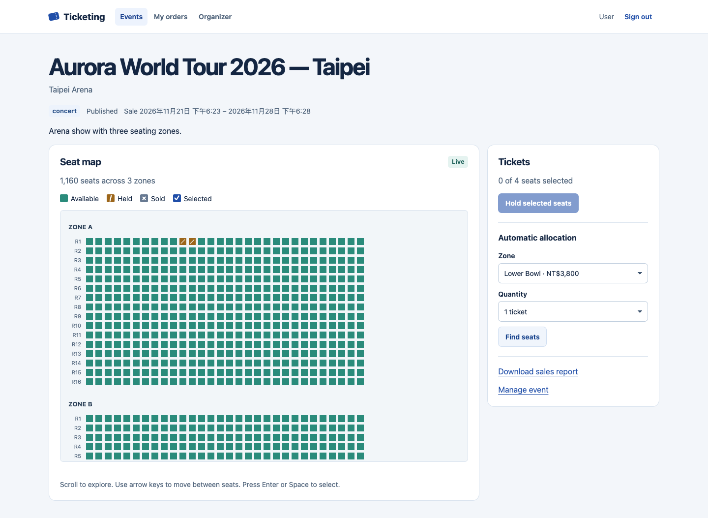
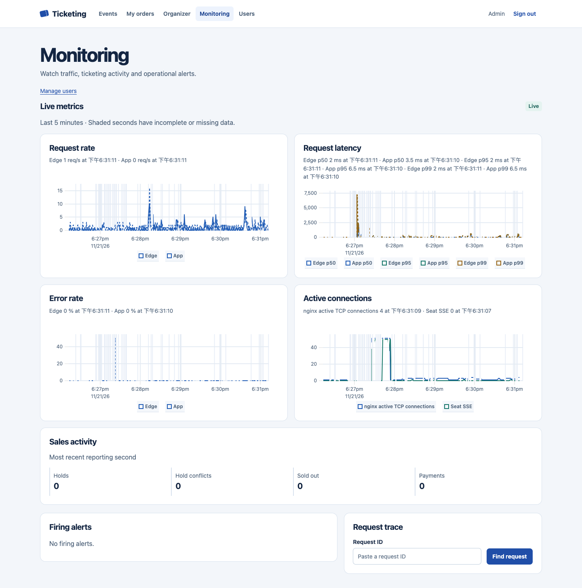
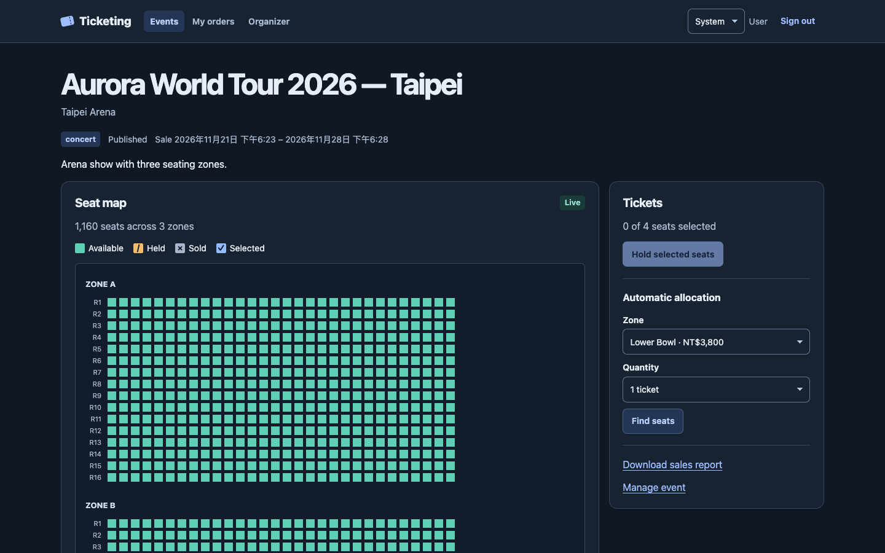
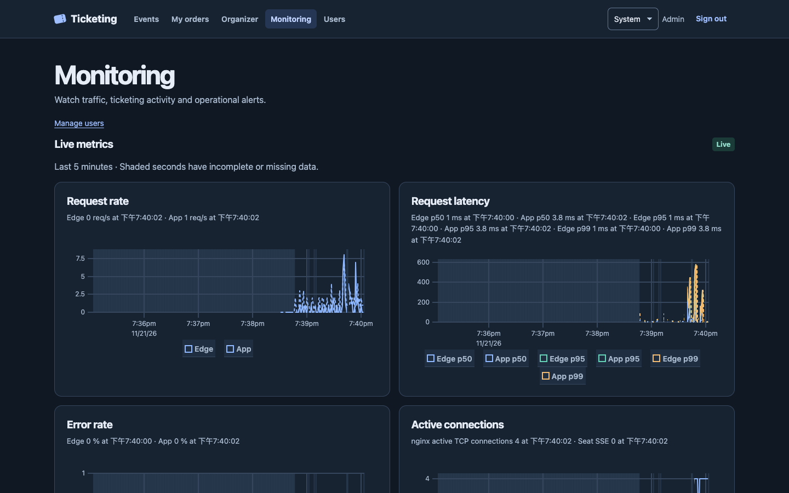
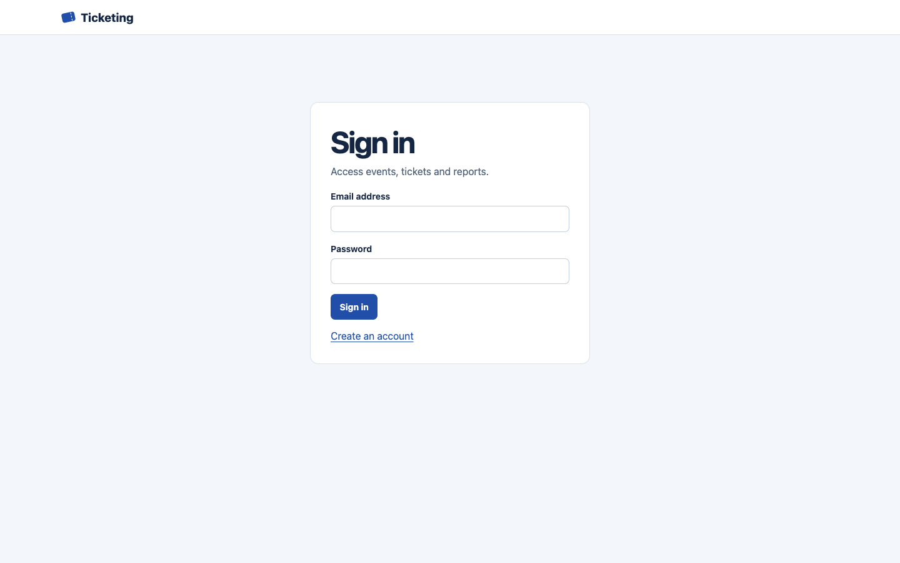
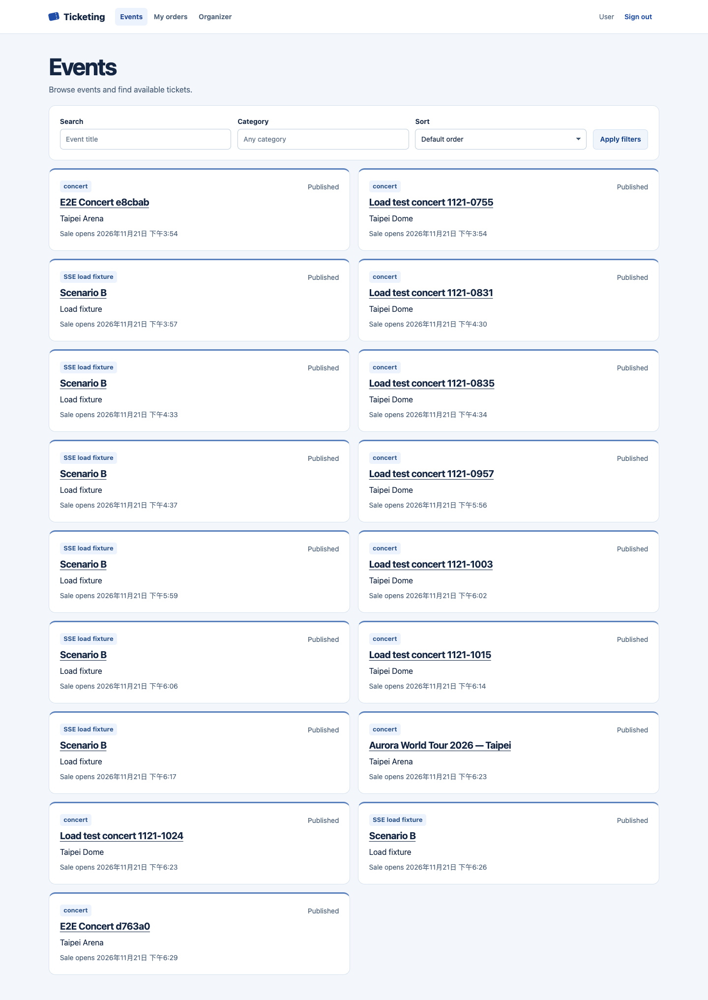
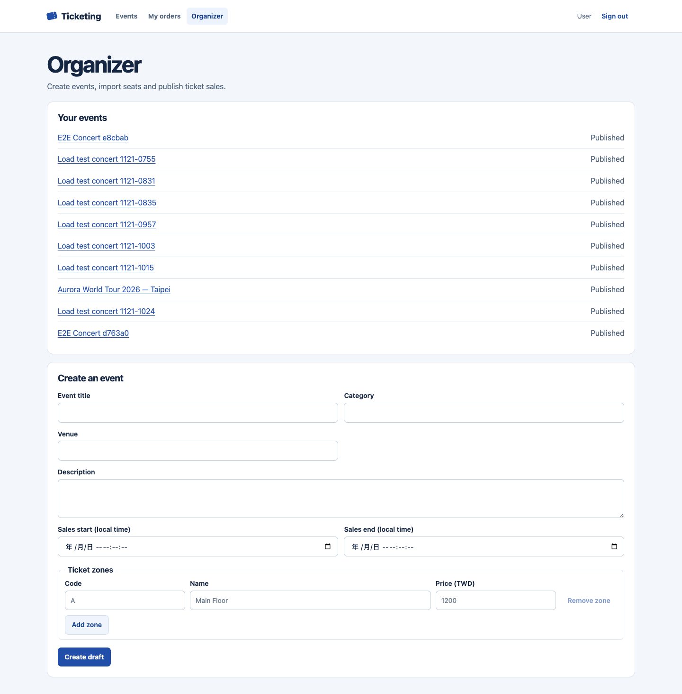
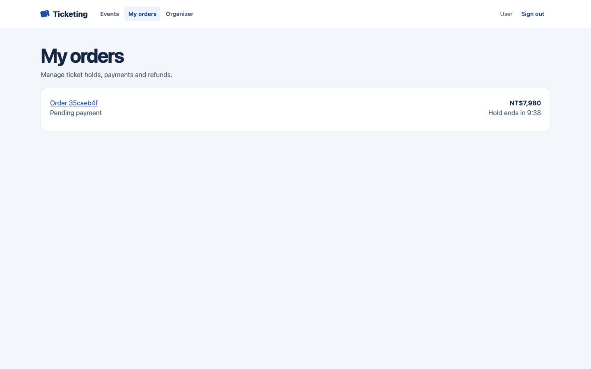
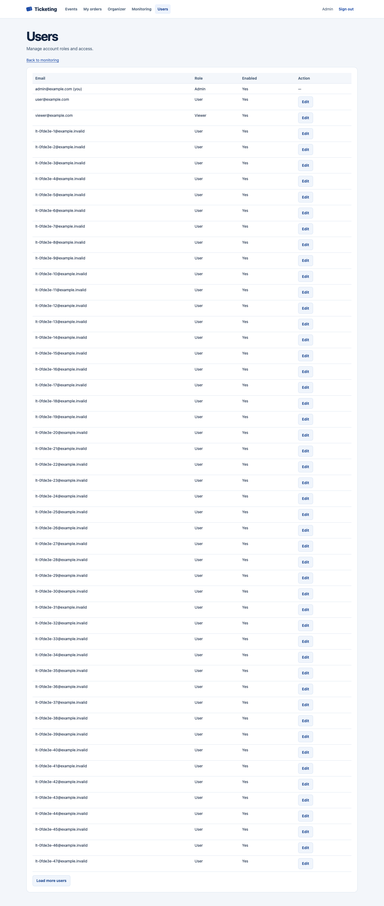
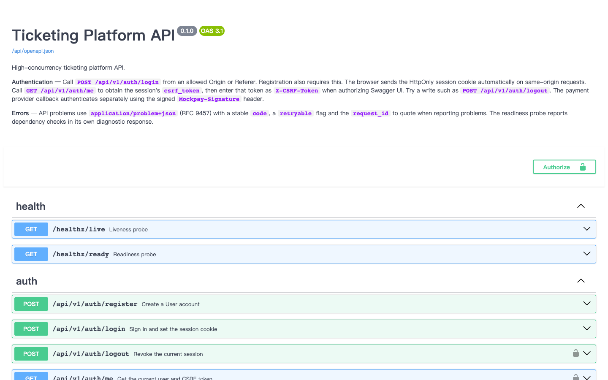

# 高併發活動搶票與即時監控平台

主辦人可建立活動、匯入座位並發布。購票者可查看即時座位圖、指定座位或由系統配位，再透過模擬金流付款。Admin 可查看即時指標與告警、管理使用者，並以 `request_id` 查詢關聯日誌。

## 快速開始

需要 Git、Docker（含 Compose v2）、Bash、`curl`、`uv` 與 Make。以下使用 Compose 開發預設值，請先確認 host ports 8080、5432、6379 可用。

1. 取得程式。

   ```bash
   git clone https://github.com/kaiser0421/wy-project.git
   cd wy-project
   ```

2. 建置並啟動服務。

   ```bash
   docker compose up -d --build
   ```

3. 重複執行 `docker compose ps -a`，等 `migrate`、`seed` 以 0 結束，三個 `api` 副本皆為 healthy。執行 `curl -fsSi http://127.0.0.1:8080/healthz/live`，確認 HTTP 200 與 `X-Request-ID`。
4. 在 [操作介面](http://localhost:8080) 選 **Sign in**，依序以三個帳號登入，每次檢查後選 **Sign out**。`seed` 會建立預設帳號，保留已有的帳號與密碼。

   | 角色 | 預設帳號 | 預設密碼 | 登入後檢查 |
   | --- | --- | --- | --- |
   | User | `user@example.com` | `User#Dev2026!` | 開啟 **Organizer**，確認可看到 **Create an event**。 |
   | Admin | `admin@example.com` | `Admin#Dev2026!` | 從 **All orders** 管理所有活動的訂單，並可透過 **Monitoring** 與 **Manage users** 監控系統及管理帳號。 |
   | Viewer | `viewer@example.com` | `Viewer#Dev2026!` | 可瀏覽 **Events**、座位圖與活動報表，導覽列沒有 **Organizer** 或 **Monitoring**。 |

5. 開啟 [Swagger UI](http://localhost:8080/api/docs)，確認可瀏覽 API operations。
6. 執行 `uv run scripts/e2e_flow.py --base http://127.0.0.1:8080`，確認輸出 `E2E flow passed`。腳本會寫入活動與已付款訂單。
7. 執行 `make test`，確認後端與前端檢查成功，指令以 0 結束。
8. 執行 `loadtest/run.sh smoke`，以小規模跑過情境 A、B 與一致性檢查。結果核對方式見 [壓測工具包](loadtest/README.md)。

首次建置需下載 base images 並安裝 Python 與 npm 依賴，時間取決於網路。已有 Docker 建置快取時，從全新 clone 執行 `docker compose up -d --build` 到全部服務 healthy 約 40 秒（開發筆電實測）。

[畫面](#畫面) · [本機開發](#本機開發) · [測試與實測](#測試與實測) · [API 與架構](#api-與架構) · [服務與設定](#服務與設定) · [需求對照](#需求對照) · [已知問題與未完成項目](#已知問題與未完成項目)

## 畫面

以預設帳號在 Compose 堆疊上操作的實際畫面（瀏覽器視窗 1440×900，長頁面為整頁截圖）。

Admin 即時監控的「Recent warnings and errors」面板可依服務篩選近期警告與錯誤，並點選請求 ID 直接查詢追蹤紀錄。

導覽列可切換深色或淺色主題，也可跟隨系統設定。

| 即時座位圖（User） | Admin 即時監控 |
| --- | --- |
| [](docs/screenshots/03-seat-map-live.png) | [](docs/screenshots/06-admin-monitoring.png) |
| 座位狀態經 SSE 即時更新，可指定座位或由系統依區域配位。 | Edge／App 的每秒 RPS、延遲分位數、錯誤率、連線數、銷售活動、告警與 `request_id` 追查。 |
| [](docs/screenshots/09-dark-seat-map.png) | [](docs/screenshots/10-dark-monitoring.png) |
| 深色主題（跟隨系統設定）。 | 深色主題下的監控圖表。 |

<details>
<summary>其他畫面：登入、活動列表、主辦管理、我的訂單、所有訂單、使用者管理、Swagger</summary>

**所有訂單（Admin 專用）**可依活動 ID、狀態、買家電子郵件前綴與建立時間篩選，也可查看訂單明細、取消待付款訂單或申請已付款訂單退款。

| | |
| --- | --- |
| [](docs/screenshots/01-login.png) 登入 | [](docs/screenshots/02-events-list.png) 活動列表 |
| [](docs/screenshots/04-organizer.png) 主辦管理（建立、匯入、發布） | [](docs/screenshots/05-my-orders.png) 我的訂單（鎖位倒數、付款） |
| [](docs/screenshots/07-admin-users.png) Admin 使用者管理 | [](docs/screenshots/08-api-docs-swagger.png) Swagger API 文件 |

</details>

## 技術棧

| 層級 | 實作 |
| --- | --- |
| 前端 | TypeScript SPA、Vite、Canvas 座位圖、uPlot 監控圖表。見 `frontend/package.json:6`、`frontend/src/seat-canvas.ts:8`。 |
| 應用 | Python 3.12、FastAPI、Uvicorn、Pydantic、asyncpg、Alembic、Argon2id、XlsxWriter。見 `backend/pyproject.toml:5`。 |
| 資料 | PostgreSQL 16 保存座位、訂單、session 與監控資料。Redis 7 提供限流、Pub/Sub、遙測 stream 與背景心跳。模擬金流以 SQLite 保存付款與回呼佇列。見 `compose.yaml:55`、`compose.yaml:80`、`paymock/src/paymock/main.py:86`。 |
| 部署與驗證 | Docker Compose、nginx 1.30、pytest、Vitest、Playwright、k6 與 Python SSE client。見 `infra/nginx/Dockerfile:12`、`compose.test.yaml:41`、[壓測工具包](loadtest/README.md)。 |

## 本機開發

在 repo 根目錄安裝 Python 3.12 workspace，並用 Node.js 22 安裝前端依賴，再執行靜態檢查。見 `pyproject.toml:5`、`Makefile:32`。

```bash
uv sync --python 3.12
(cd frontend && npm ci)
make lint typecheck
```

`make lint` 另以 Docker 執行 ShellCheck（首次會下載映像檔）。

用 Node.js 22 開發 UI。以下方式將 Compose nginx 移到 host port 8081，讓 Vite 以預設允許的瀏覽器 Origin `http://localhost:8080` 開發，並將 `/api`、`/pay/` 代理回 Compose。見 `frontend/vite.config.ts:3`、`backend/src/ticketing/core/settings.py:45`、`backend/src/ticketing/api/security.py:80`。

```bash
HTTP_PORT=8081 docker compose up -d --build
cd frontend
npm ci
TICKETING_ORIGIN=http://127.0.0.1:8081 npm run dev -- --port 8080 --strictPort
```

### 座位匯入範例

在 repo 根目錄用 [`scripts/gen_seats.py`](scripts/gen_seats.py#L28) 各產生一份 100,000 列 CSV 與 JSON。輸出格式由副檔名決定，`--zone` 預設為 `A`。

```bash
uv run python scripts/gen_seats.py 100000 /tmp/seats_100k.csv --zone A
uv run python scripts/gen_seats.py 100000 /tmp/seats_100k.json --zone A
```

每個檔案與模式各用一個尚無座位、只含區域 `A` 的草稿活動驗證。上傳後查看匯入作業狀態與錯誤報告。

| 檔案 | `all_or_nothing` | `skip_invalid` |
|---|---|---|
| [seats_sample.csv](samples/seats_sample.csv) | `succeeded`，新增 3 席 | `succeeded`，新增 3 席 |
| [seats_sample.json](samples/seats_sample.json) | `succeeded`，新增 3 席 | `succeeded`，新增 3 席 |
| [seats_invalid.csv](samples/seats_invalid.csv) | `validation_failed`，新增 0 席，6 列錯誤 | `partially_succeeded`，新增 `A/R1/1`，6 列錯誤 |
| [seats_duplicates.json](samples/seats_duplicates.json) | `validation_failed`，新增 0 席，2 列錯誤 | `partially_succeeded`，新增 `A/R1/2`，2 列錯誤 |

重複座位以區域和排號的大寫值及去除前導零的座號比對，同組每列均標記為錯誤。見 `backend/src/ticketing/imports/validation.py:11`、`backend/src/ticketing/imports/runner.py:225`。

## 測試與實測

正式量測與擴容對照見 [壓測結論摘要](LOADTEST.md#結論摘要)。

| 指令 | 驗證範圍 |
| --- | --- |
| `make test` | Docker 內執行後端 Ruff、mypy、import-linter、pytest 單元與整合測試（PostgreSQL 16、Redis 7，含併發訂票），以及前端 ESLint、typecheck、build、Vitest 覆蓋率與 Playwright 預設 UI 測試（`smoke.spec.ts`、`seat-recovery.spec.ts`、`registration.spec.ts`）。見 `frontend/playwright.config.ts:8`、`Makefile:22`、`compose.test.yaml`。 |
| `make test-fast` | 以 `uv run pytest backend/tests/unit -q` 在 host 跑後端單元測試。見 `Makefile:29`。 |

在 `frontend/` 執行 `npm run lint` 做型別感知的靜態檢查，或執行 `npm run test:coverage` 跑 Vitest 單元測試並產生覆蓋率摘要（JSON 位於 `frontend/coverage/coverage-summary.json`）。DOM 與頁面模組由 Playwright UI 測試涵蓋，Vitest 的摘要只計入單元測試覆蓋率。

nginx 整合測試可另外執行。先啟動 Compose，準備一個已匯入座位並發布的活動，將下列 `123` 換成實際 ID。使用 Node.js 22，在 Bash 中執行。另可在可拋棄的測試堆疊設 `TICKETING_SMOKE_WRITE=1`，加入建活動與付款的案例。見 `infra/nginx/Dockerfile:3`、`frontend/playwright.config.ts:8`、`frontend/tests/e2e/nginx.spec.ts:6`、`frontend/tests/e2e/nginx.spec.ts:41`。

```bash
cd frontend
npm ci
npx playwright install chromium
TICKETING_SMOKE_ORIGIN=http://localhost:8080 TICKETING_SMOKE_EVENT_ID=123 \
  TICKETING_SMOKE_USER_EMAIL=user@example.com TICKETING_SMOKE_USER_PASSWORD='User#Dev2026!' \
  TICKETING_SMOKE_VIEWER_EMAIL=viewer@example.com TICKETING_SMOKE_VIEWER_PASSWORD='Viewer#Dev2026!' \
  TICKETING_SMOKE_ADMIN_EMAIL=admin@example.com TICKETING_SMOKE_ADMIN_PASSWORD='Admin#Dev2026!' \
  npm run test:e2e
```

併發測試包含指定座位、區域配位與同一使用者的限購競爭。破壞驗證會抓到同一座位有多筆 active claim。見 `backend/tests/booking/test_booking.py:46`、`backend/tests/booking/test_booking.py:67`、`backend/tests/booking/test_booking.py:91`、`backend/tests/booking/test_booking.py:106`、[破壞驗證輸出](docs/evidence/break-it.txt)。

- 壓測以 `loadtest/run.sh smoke` 試跑，以 `loadtest/run.sh all` 執行情境 A（10,000 席、3,000 VUs、60 秒及一致性檢查）與 B（2,000 條 SSE）。見 `loadtest/run.sh:21`。參數與輸出格式見 [壓測工具包](loadtest/README.md)，報告見 [LOADTEST.md](LOADTEST.md)。
- **正式 Scenario A**。第 2 輪共 134,801 次 HTTP 請求、2,098 req/s，k6 p50／p95 為 1,043／2,036 ms，排空後占席 8,997／10,000。兩輪均未超賣，第 2 輪一致性 SQL 回傳 0 列。[第 1 輪證據](docs/evidence/loadtest-run1-20261121/) · [第 2 輪證據](docs/evidence/loadtest-run2-20261121/) · [一致性檢查](LOADTEST.md#6-一致性檢查)
- **正式 Scenario B**。第 2 輪目標 100 changes/s，寫入期間同時 SSE 峰值 2,000，最終 2,000／2,000 個 client 與 DB 相符。[SSE 原始輸出](docs/evidence/loadtest-run2-20261121/b/sse-client.txt) · [壓測中管理後台監控](docs/screenshots/11-monitoring-under-load.png)
- 匯入 10,000 列的 API 實測為 3.3 秒。100,000 列從上傳到完成，CSV 11.38 秒、JSON 13.46 秒（開發筆電，門檻 60 秒，`test_import_100k_under_60s`）。見 [10 萬列匯入實測](docs/evidence/import-100k.md)、`backend/tests/imports/test_import_perf.py:16`。
- 在 512 MiB 上限的 API 容器匯出 500,000 筆訂單，首次下載完成為 217.3 秒，`anon` 取樣峰值約 108 MiB，三個副本均無 OOM。見 [Excel 匯出實測紀錄](docs/evidence/cp4-excel-500k.md)。

## API 與架構

- API 文件可查 [Swagger UI](http://localhost:8080/api/docs)、[執行中 OpenAPI JSON](http://localhost:8080/api/openapi.json) 或 [repo 內的 OpenAPI JSON](docs/openapi.json)。見 `backend/src/ticketing/api/app.py:328`。
- 系統圖涵蓋服務拓撲、訂票交易、座位 SSE、金流與監控。[架構 Markdown](docs/architecture.md) · [架構 HTML](docs/architecture.html)（透過 jsDelivr 載入 Mermaid，需網路連線）。
- Q1–Q6 與驗證方式見 [DESIGN.md](DESIGN.md)。

## 服務與設定

| Compose 服務 | 副本 | 容器 port | 預設 host 綁定 | 功能與設定位置 |
| --- | ---: | --- | --- | --- |
| `nginx` | 1 | 8080 | `127.0.0.1:8080` | 靜態 UI、API／SSE、付款頁入口。 `compose.yaml:215` |
| `api` | 3 | 8000 | — | REST、SSE、Excel，每副本 512 MiB。 `compose.yaml:120`、`compose.yaml:122` |
| `worker` | 1 | — | — | 匯入、鎖位逾時、付款對帳、退款、取消。 `compose.yaml:138` |
| `relay` | 1 | — | — | 指派座位 outbox 序號並寫入 `seat_events`。 `compose.yaml:153` |
| `collector` | 1 | — | — | 收集日誌、指標及告警。 `compose.yaml:168` |
| `paymock` | 1 | 8000 | — | 模擬金流、付款頁與簽章回呼。 `compose.yaml:187` |
| `postgres` | 1 | 5432 | `127.0.0.1:5432` | PostgreSQL 16。 `compose.yaml:52` |
| `redis` | 1 | 6379 | `127.0.0.1:6379` | Redis 7。 `compose.yaml:77` |
| `migrate` | 1（一次性） | — | — | 執行 Alembic migration。 `compose.yaml:93` |
| `seed` | 1（一次性） | — | — | 建立預設帳號。 `compose.yaml:104` |

可複製 [`.env.example`](.env.example) 為 `.env` 覆蓋 Compose 的插值預設值。範例也標明需直接傳給程序或以 Compose override 注入的設定。

`DB_POOL_MAX` 預設為 10，套用於每個 API 副本及各個 `worker`、`relay`、`collector` 程序的 PostgreSQL 連線池。背景維護會清除編序超過 1 小時的座位 outbox 列，已歸檔的 `seat_events` 仍會保留。若回放需要已清除的序號區間，SSE 會通知客戶端重新取得快照。見 `backend/src/ticketing/core/service.py`、`backend/src/ticketing/maintenance.py`。

## 需求對照

| 交付項目 | 位置 |
| --- | --- |
| 二.1 完整程式與歷史 | [GitHub repository 與 commit 歷史](https://github.com/kaiser0421/wy-project) |
| 二.2 啟動、技術棧、帳號、限制 | 本 README |
| 二.3 環境參數 | [`.env.example`](.env.example) |
| 二.4 座位匯入範例 | [座位匯入範例](#座位匯入範例)列出樣本、兩種模式的預期結果及 100,000 列產檔指令。 |
| 二.5 系統架構圖 | [Markdown](docs/architecture.md) · [HTML](docs/architecture.html)（透過 jsDelivr 載入 Mermaid） |
| 二.6 壓測腳本與報告 | [執行說明](loadtest/README.md) · [LOADTEST.md](LOADTEST.md) |
| 二.7 AI 工具與實作缺陷 | [AI_USAGE.md](AI_USAGE.md) |
| 二.8 設計問答、假設、取捨與驗證 | [DESIGN.md](DESIGN.md) |

## 已知問題與未完成項目

- **水平擴充**。同一台桌機改用 6 個 API 副本重跑 Scenario A，排空後快照中 10,000 席全數被占用、過載 503 由 84% 降至 40%、一致性 0 違規；研判下一個瓶頸可能是 PostgreSQL 與付款路徑（尚待持續量測）。見 [LOADTEST.md](LOADTEST.md#7-瓶頸分析)。
- **正式 Scenario A 過載**。第 2 輪 k6 正式判定 **FAILED**，17 筆重放重試後仍遭拒，另有 6 筆付款請求逾時。抽樣的 89 筆重放中 72 筆回傳原訂單、驗證正確，約 84% 的 HTTP 請求回 `503 server-busy`。[k6 原始輸出](docs/evidence/loadtest-run2-20261121/a/k6-summary.json) · [nginx 狀態摘要](docs/evidence/loadtest-run2-20261121/a/nginx-summary.txt)
- **正式 Scenario B 重連與尾端延遲**。第 2 輪所有 client 最終與 DB 相符，壓測 client 仍頻繁因進度停滯而重連，delta 套用 p99 為 16,600 ms。[正式結果](LOADTEST.md#3-scenario-b)
- **筆電壓測**。在 2 核心／4 執行緒的 MacBook 上，3,000 VUs 與服務同機造成 CPU 飽和。多數請求收到快速的 `503 server-busy` 或 client timeout，約 86–95 req/s，SQL 平均耗時受競爭影響約 35–170 ms。該次一致性檢查未發現超賣。
- **大型 Excel 匯出耗時**。兩次下載約 217–237 秒，nginx 報表路徑的讀取逾時為 300 秒。見 `infra/nginx/nginx.conf:151`、[Excel 匯出實測紀錄](docs/evidence/cp4-excel-500k.md)。
- **固定 Docker 子網**。Compose 網路使用 `172.28.0.0/24`，nginx 固定在 `172.28.0.200`，讓 API 只信任 nginx 轉送的 client IP。若本機已有網路使用同一段位址，`docker compose up` 會回報 `Pool overlaps with other one on this address space`，需先移除該網路（例如舊的堆疊執行 `docker compose down`）。見 `compose.yaml:10`、`compose.yaml:224`、`compose.yaml:244`。
- **告警演練**。停掉 relay 後觸發服務中斷告警並顯示在 Admin 監控頁，恢復後自動 resolved。見 [告警演練紀錄](docs/evidence/alert-drill-20261121/README.md)。
- **監控可見性**。極晚到達的 nginx 日誌仍可依 `request_id` 查到，但可能超出每秒指標的回填窗口。Collector 也從共用目錄收集 paymock 的請求處理與回呼傳送日誌，供管理後台依 `request_id` 查詢。見 `backend/src/ticketing/telemetry/logs.py:76`、`compose.yaml:180`、`compose.yaml:203`、[監控資料契約](backend/src/ticketing/telemetry/README.md)。
