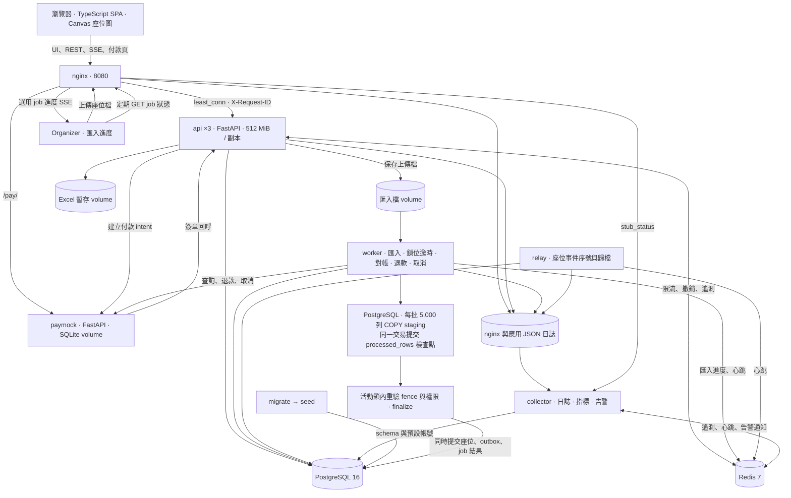
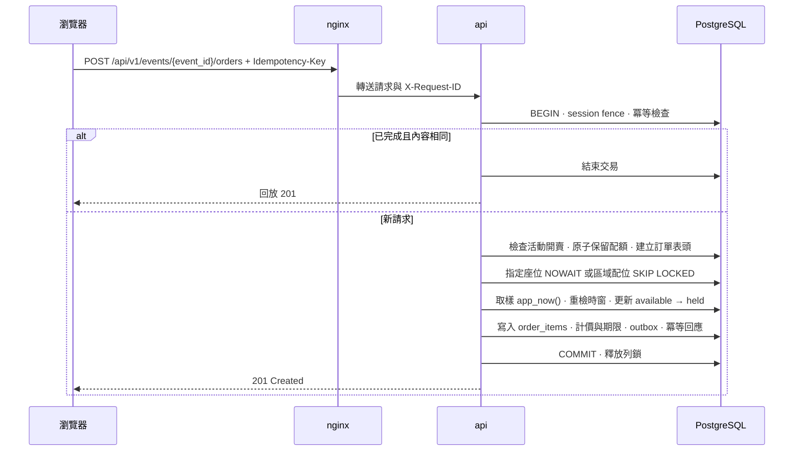
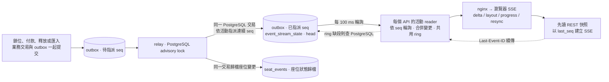
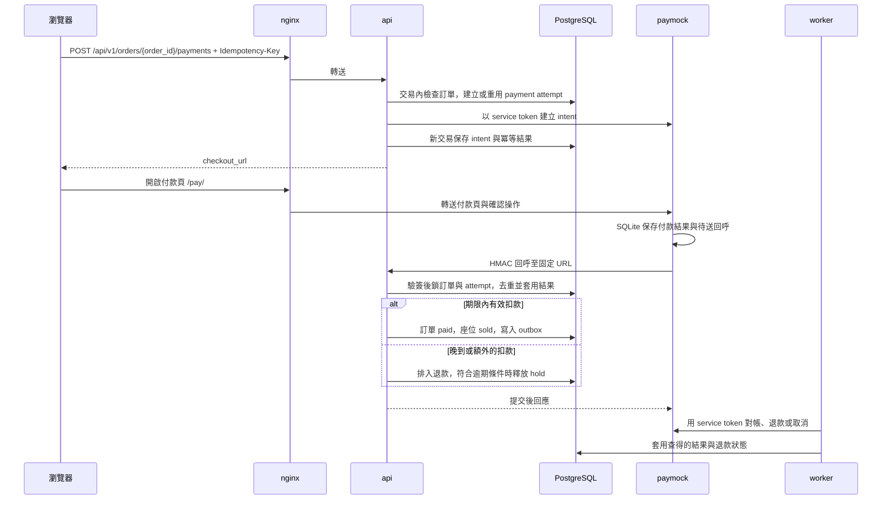
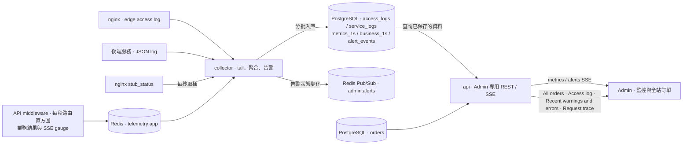

# 系統架構圖

[服務拓撲](#1-服務拓撲) · [訂票交易](#2-訂票交易) · [座位即時推送](#3-座位即時推送) · [付款與回呼](#4-付款與回呼) · [監控資料流](#5-監控資料流)

[瀏覽器版架構圖](architecture.html)（透過 jsDelivr 載入 Mermaid，需網路連線） · [啟動與服務 port](../README.md#服務與設定) · [設計問答](../DESIGN.md)

## 1. 服務拓撲

- PostgreSQL 保存座位、訂單、配額、session、匯入 job、outbox 與監控資料。nginx、PostgreSQL 與 Redis 的 host port 預設綁在 loopback。三個 API 副本各由一個 Uvicorn 程序處理 REST 與 SSE。見 `compose.yaml:52`、`compose.yaml:67`、`compose.yaml:85`、`compose.yaml:120`、`compose.yaml:231`、`backend/src/ticketing/api/main.py:36`。
- `migrate` 以 schema owner 執行，`seed` 與 runtime 使用低權限角色。Worker 分別排程匯入、hold expiry、付款 reconciler 與 maintenance。見 `compose.yaml:7`、`compose.yaml:99`、`backend/src/ticketing/worker/main.py:20`。
- Organizer 輪詢 `GET /api/v1/seat-imports/{job_id}`，也可另外訂閱 `GET /api/v1/seat-imports/{job_id}/stream`。租約重領後從已提交的列數檢查點接續，並保留已提交的解析結果與檔案驗證狀態。見 `backend/src/ticketing/api/routes/imports.py:137`、`backend/src/ticketing/api/routes/imports.py:208`、`backend/src/ticketing/imports/runner.py:331–394`。
- Redis Pub/Sub 通知 API 有 session 撤銷與匯入進度變化，持久狀態由 PostgreSQL 提供。見 `backend/src/ticketing/auth/sessions.py:89`、`backend/src/ticketing/auth/sessions.py:134`、`backend/src/ticketing/imports/runner.py:323`、`backend/src/ticketing/api/routes/imports.py:188–204`。

## 2. 訂票交易

指定座位的保護取自 `FOR NO KEY UPDATE NOWAIT`。更新再檢查座位為 `available`，partial unique index 保證每席最多一筆未釋放的 order item。配額透過同一交易內的 guarded UPDATE 保留，失敗時一併回滾。見 `backend/src/ticketing/api/routes/orders.py:40`、`backend/src/ticketing/booking/create.py:54`、`backend/src/ticketing/booking/create.py:91–92`、`backend/src/ticketing/booking/create.py:131–132`、`backend/src/ticketing/booking/create.py:242–248`、`backend/src/ticketing/booking/database.py:31`、`backend/migrations/versions/0001_baseline.py:189`。

## 3. 座位即時推送

- relay 依可見 outbox 列排序，為每個活動指派連續的 `seq`。同一座位的寫入受列鎖序列化，不同座位的序號可與交易提交順序不同。所有 API 副本讀取相同序號，各自合併連續列。同一座位保留較新的版本，layout 事件切開合併區間。見 `backend/src/ticketing/realtime/relay.py:14`、`backend/src/ticketing/realtime/relay.py:46`、`backend/src/ticketing/realtime/frames.py:40`、`backend/src/ticketing/realtime/reader.py:161`。
- 瀏覽器先讀 `GET /api/v1/events/{event_id}/seats`，再連 `GET /api/v1/events/{event_id}/seat-stream`，以 `Last-Event-ID` 帶入快照的 `last_seq` 或最後套用的數字序號。遇到缺段可重連回放。收到 layout、resync 或回放失敗時重新取快照。寫入逾時會結束串流。nginx 對此路徑停用 buffering。見 `backend/src/ticketing/api/routes/seats.py:58`、`backend/src/ticketing/api/routes/seats.py:112`、`backend/src/ticketing/realtime/stream.py:45`、`frontend/src/events.ts:300`、`infra/nginx/nginx.conf:128`。

## 4. 付款與回呼

- Merchant 請求使用 `X-Payment-Provider-Token`。Paymock 啟動時讀取固定 `PAYMOCK_CALLBACK_URL`，Compose 預設為 `http://api:8000/api/v1/payments/callbacks`。配送重試會重新簽章。見 `compose.yaml:198`、`paymock/src/paymock/main.py:75`、`paymock/src/paymock/main.py:150`、`paymock/src/paymock/delivery.py:17`、`backend/src/ticketing/payments/provider.py:42`。
- 付款建立先提交 attempt，再發出外部呼叫。回呼與對帳共用結果處理，扣款判定在鎖內使用 PostgreSQL `app_now()`。已付款訂單取消後先進入 `refund_pending`，退款確認後釋放座位與配額。見 `backend/src/ticketing/payments/attempts.py:147`、`backend/src/ticketing/api/routes/payments.py:126`、`backend/src/ticketing/payments/callbacks.py:144`、`backend/src/ticketing/payments/reconciler.py:51`、`backend/src/ticketing/payments/reconciler.py:90`、`backend/src/ticketing/booking/orders.py:148`。

## 5. 監控資料流

- Collector tail nginx 與共享目錄中的應用 JSON 日誌，COPY 與 checkpoint 在同一交易內完成。Edge RPS 與延遲依 nginx access log 分秒聚合，連線數來自 `stub_status`。應用遙測按 boot UUID 與 interval number 去重，入庫後才 ACK Redis stream。見 `backend/src/ticketing/telemetry/logs.py:266`、`backend/src/ticketing/telemetry/collector.py:153`、`backend/src/ticketing/telemetry/app_metrics.py:132`。
- Admin 的 `/api/v1/admin/metrics/stream` 與 `/api/v1/admin/alerts/stream` 讀 PostgreSQL 快照。告警狀態變更另送 Redis 的 `admin:alerts`。`GET /api/v1/admin/requests/{request_id}/logs` 查找入口與關聯服務日誌。見 `backend/src/ticketing/telemetry/common.py:10`、`backend/src/ticketing/telemetry/collector.py:170`、`backend/src/ticketing/api/routes/monitoring.py:462`、`backend/src/ticketing/api/routes/monitoring.py:515`、`backend/src/ticketing/api/routes/monitoring.py:696`。
- Admin 透過 `GET /api/v1/admin/orders` 讀全站訂單，透過 `GET /api/v1/admin/logs/access` 讀存取日誌，透過 `GET /api/v1/admin/logs/recent` 讀近期警告與錯誤。
- 時鐘校正、保留期與缺測判讀見 [監控資料契約](../backend/src/ticketing/telemetry/README.md)。
