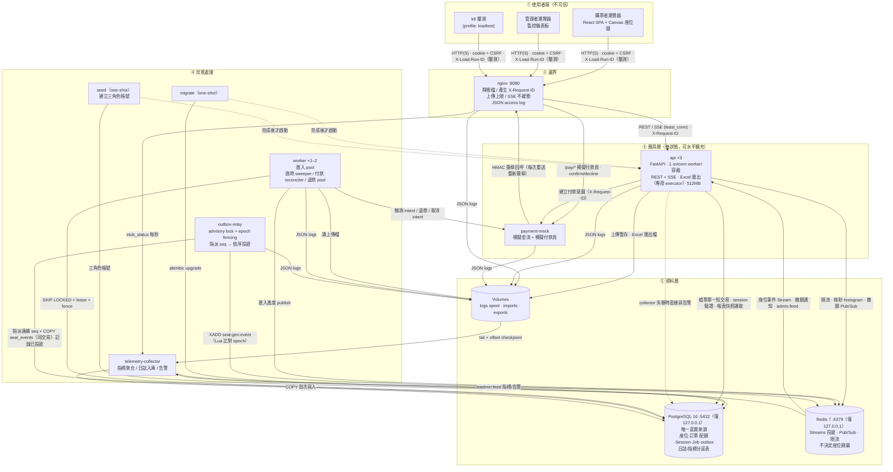
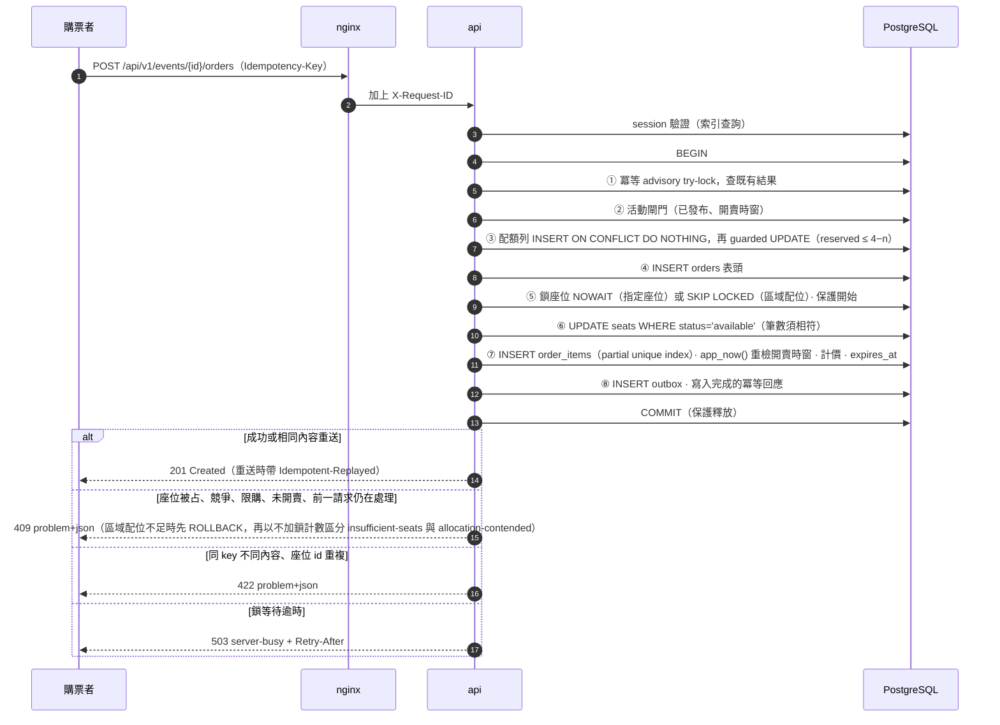
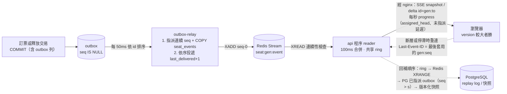
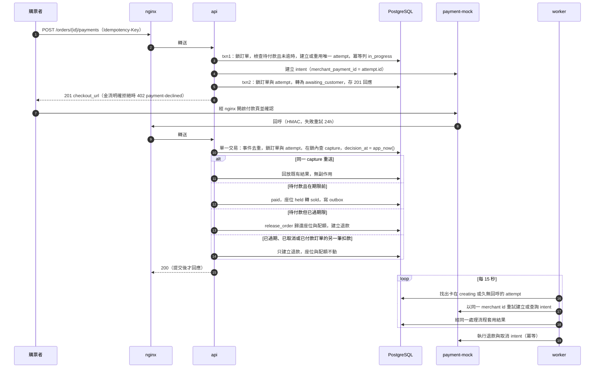
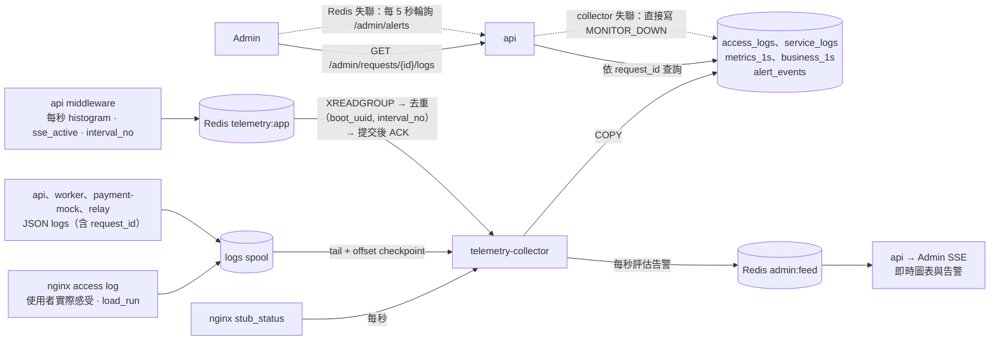

# 系統架構圖

> 對應 `requirement.txt` 二.5「系統架構圖：呈現系統的各個元件與資料流向」。設計細節見 `PLAN.md`。
> 文件狀態：實作前草稿（v1.2）；元件名稱與 compose service 名稱一致。圖面只呈現主要資料流，完整的交易步驟、錯誤碼與故障處理見 `PLAN.md` 對應章節。

## 1. 元件總覽與資料流向

## 2. 搶票寫入路徑（防超賣）· PLAN §5.2

## 3. 即時座位推送 · PLAN §6

- generation 不符時直接回快照；慢客戶端落後超出回補範圍時關閉串流，重連後取快照。
- 匯入完成會 `layout_ver+1` 並發出 `layout_changed`；客戶端暫停套用 delta，取得 `layout_ver ≥ N` 的快照後再繼續。
- Redis 被清空時，relay 以新 generation 從 outbox 依原 seq 重建，舊串流關閉、客戶端重連。

## 4. 付款與回呼 · PLAN §5.4

- 取消待付款訂單：`release_order` + 同交易寫入取消 intent 的待辦；取消已付款訂單：`refund_pending` → 退款確認後才釋放座位與配額。

## 5. 監控資料流 · PLAN §10

- `seat_events` 由 outbox-relay 寫入（見圖 3），不經 collector。
- request_id 由 nginx 產生，傳遞到 payment-mock（回呼 body 帶 `origin_request_id`）、outbox、seat_events、匯入 job 與 worker 日誌；sweeper 日誌連結原始 hold 的 request_id。

## 6. 部署拓撲（docker compose）

| Service | 數量 | 依賴 | 對外 |
|---|---|---|---|
| nginx | 1 | api（healthy） | :8080（本機 http；TLS 為選配） |
| api | 3 | migrate、seed（completed）、postgres、redis（healthy） | 僅經 nginx |
| worker | 1–2 | migrate、postgres | – |
| outbox-relay | 1 | migrate、postgres、redis | – |
| telemetry-collector | 1 | migrate、postgres、redis | – |
| payment-mock | 1 | – | 內部網路；付款頁經 nginx |
| postgres | 1 | – | 127.0.0.1:5432 |
| redis | 1 | – | 127.0.0.1:6379 |
| migrate / seed | one-shot | postgres（seed 另依賴 migrate） | – |
